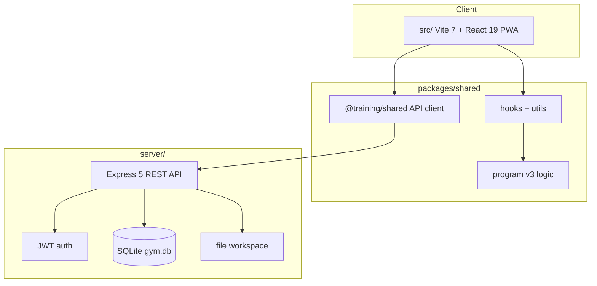

# Architecture

Training Calculator (Periodizatsiya) **v0.003** is a **web-only product**: Vite 7 + React 19 PWA, Express 5 + SQLite API, shared TypeScript package `@training/shared`. Native Expo / Capacitor / Electron trees live in `_archive-non-web/` and are not part of the running app.

## High-level diagram

## Packages

| Path                | Role                                                                   |
| ------------------- | ---------------------------------------------------------------------- |
| `src/`              | Primary UI: calculator, journal, training, split, theory screens       |
| `server/`           | Auth, user data persistence, journal API, static `dist/` in production |
| `packages/shared/`  | `@training/shared` — types, calculations, API client                   |
| `_archive-non-web/` | Archived Electron / Expo / Capacitor shells (not built by root)        |

## Authentication

1. User registers or logs in via `POST /api/register` or `POST /api/login`.
2. Server returns a JWT (signed with `JWT_SECRET` from environment).
3. Client stores token and sends `Authorization: Bearer <token>` on protected routes.
4. User profile and journal data live in SQLite `users.data` JSON column.

**Production:** set a strong `JWT_SECRET`. The `JWT_SECRET=dev` default in `package.json` scripts is for local development only.

## Data storage

| Store          | Location                                     | Notes                               |
| -------------- | -------------------------------------------- | ----------------------------------- |
| SQLite         | `gym.db` (repo root by default) or `DB_PATH` | **Not in git** — created at runtime |
| File workspace | `workspace-files/` or `WORKSPACE_FILES_ROOT` | User uploads; gitignored            |
| Docker volume  | `./docker-data/gym.db`                       | See `docs/DEPLOYMENT.md`            |

## API surface (overview)

- `GET /api/health` — health check
- Auth: register, login
- User data: get/put/delete profile payload
- Journal and calculator state persisted per user
- File workspace endpoints (see `server/file-workspace.js`)

Full route list: `server/app.js`.

## Frontend build

- **Vite** bundles `src/` → `dist/`
- `VITE_API_URL` — API base URL baked in at build time (critical for Vercel)
- PWA manifest and icons in `public/`

## Testing

| Suite             | Command                                                            |
| ----------------- | ------------------------------------------------------------------ |
| Typecheck         | `npm run typecheck`                                                |
| Unit + API        | `npm test` — `tests/*.test.ts` (Node test runner)                  |
| Lint              | `npm run lint`                                                     |
| Production bundle | `npm run build` → `dist/` (budget ≤ 5 MB)                          |
| CI                | `.github/workflows/ci.yml` (Node 22: typecheck, test, lint, build) |

## Design standards

UI reference documents: [`design-standards/README.md`](design-standards/README.md).

## Related docs

- [STRUCTURE.md](../STRUCTURE.md) — directory map
- [DEPLOYMENT.md](DEPLOYMENT.md) — Docker, Vercel, self-hosting
- [CONTRIBUTING.md](../CONTRIBUTING.md) — dev workflow
