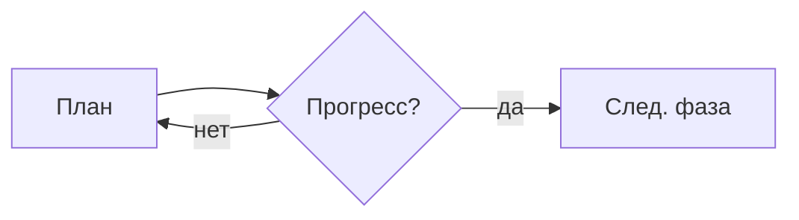

# Инструменты схем и графиков

Что использовать для схем/диаграмм/отчётов. Кратко, чтобы все агенты применяли одно и то же.

## Когда что применять

| Задача                                                                                              | Инструмент                           |
| --------------------------------------------------------------------------------------------------- | ------------------------------------ |
| Векторная схема в PDF: блоки, цветные зоны, стрелки, легенды (схемы в отчётах)                      | **Typst + CeTZ**                     |
| Деревья решений, блок-схемы, графы со стрелками                                                     | **Fletcher** (Typst)                 |
| Графики/оси/кривые в PDF                                                                            | **cetz-plot** (Typst)                |
| Быстрая схема прямо в чате (обсуждение, план)                                                       | **Mermaid**                          |
| Интерактивный отчёт/дашборд с таблицами и графиками, который остаётся в библиотеке и правится потом | **Pages (Cursor Pages / `.canvas`)** |

## Подключение (Typst)

Нужен компилятор `typst` (CLI, `brew install typst`); PDF: `typst compile file.typ`.

```typst
#import "@preview/cetz:0.5.3"          // блоки, зоны, стрелки
#import "@preview/fletcher:0.5.8" as fletcher: diagram, node, edge  // деревья, блок-схемы
#import "@preview/cetz-plot:0.1.4": plot, diagram                       // графики
```

Fletcher использует рендер CeTZ: `#fletcher.diagram(node((0,0) [A]), edge((0,0), (1,0) [-> B]))`.
График: `#plot.add(...)` внутри `cetz-plot`-канваса (оси, легенда из коробки).

## Mermaid (в чате)



Другие типы: `sequenceDiagram`, `graph TD`, `mindmap`.

## Правила

- Чат/обсуждение → Mermaid; финальный PDF-отчёт → Typst (CeTZ/Fletcher/cetz-plot); живой артефакт с данными → Pages `.canvas`.
- **Лекции в приложении → React/SVG-компоненты диаграмм (не PDF, не Mermaid)**: обёртка `DiagramBlock` + граф `DiagramFlow` (`src/components/theory/`), токены `--ta-*`, обе темы, чтение на 390px.
- Схемы в PDF-отчётах проекта делаются через Typst, не скриншотами.
- Держать сниппеты минимальными: один инструмент на одну задачу.
