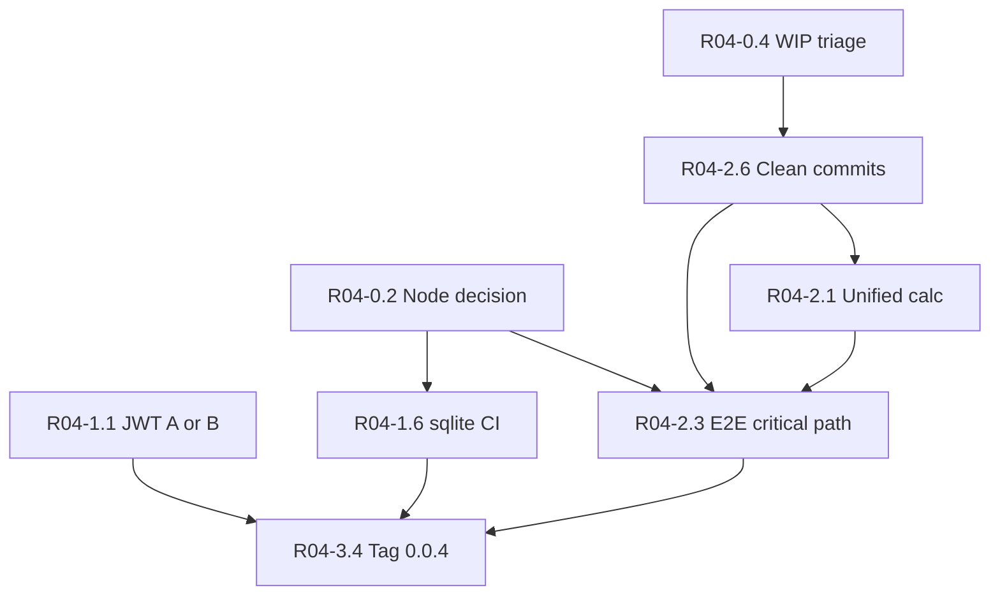

# План релиза 0.0.4 — Web_Calculator (Периодизация)

Дата плана: 2026-10-24 (обновлено: доступ через вкладку **Context** проекта TreningCalculator). Режим: **только план**, без изменений кода.  
Репозиторий: `~/Desktop/Calculator/Web_Calculator`, ветка `refactor/bundle-optimization`.

---

## 0. Факты (опора плана)

Источники: сообщение Steve (2026-10-24), [гигиена](file:///cursor/stores/self/docs/calculator-hygiene-pass.md) / `internal/hygiene-pass-result.md`, [аудит безопасности](file:///cursor/stores/self/docs/security-audit.md), [security-fixes](file:///cursor/stores/self/internal/security-fixes-result.md), инциденты dev (vite-5173, alien17 login).

| Область | Факт |
|--------|------|
| Стек | React 19, Vite 7, TS strict, Express 5, better-sqlite3, shared-пакет, node:test, Playwright smoke |
| Версия в package | **0.0.3** (после гигиены); цель — **0.0.4** |
| Коммиты (известные) | `a542e945`, `e94e7d10`, `d839c2f4` (гигиена); `8bc6e23a`, `8741ffb6` (security); Steve указывает HEAD **8741ffb6** |
| CI | `.github/workflows/ci.yml`, Node **22** в workflow |
| Качество (Steve) | lint 0/0, **274** node:test pass, `npm audit` **0**, dist **~3,9 МБ** |
| Качество (гигиена) | dist **4,12 МБ**, 259 тестов — расхождение: после security +274 тестов; dist перепроверить `npm run build && du -sh dist` |
| Безопасность | ingest `:7373` снят; WC-03…06, 08–10 частично закрыты; **WC-01 JWT localStorage открыт**; webhook без MAC/replay |
| Боли (Steve) | JWT `webTokenStorage.ts:30-31`; дубль calc `server/calc.js` vs `packages/shared/.../calc.ts`; Theory chunk ~506 КБ + zod; **4** e2e; грязное дерево **178** записей; `releases/` **323 МБ**; Node **v26.8.1** локально vs **.nvmrc 22** |
| Dev-стабильность (24.10) | `npm run dev` проксирует API на **:3002**; параллельный API на **:3001** и битый `iconv-lite` на :3002 ломали login через UI при рабочем пароле в БД |
| Ограничения | Не трогать `canon/`, `_archive-non-web/` без задачи; не коммитить `.env*`, `gym.db`, `workspace-files/`; без ломающих публичных API |

---

## 0.1. Вопросы без которых план — гадание

**Ответь до старта Phase 1 (можно одним сообщением):**

1. **Node:** фиксируем **22 LTS** (как CI) и подгоняем локальную машину, или сознательно переходим на **26** и меняем CI/Docker?  
   *Рекомендация плана по умолчанию:* **22 LTS** — уже в CI, предсказуемые prebuild `better-sqlite3`, меньше сюрпризов на деплое.

2. **JWT (WC-01):** для **0.0.4** делаем **httpOnly cookie + CSRF** (крупная задача) или **принимаем риск** с ADR + усилением CSP/Eruda (уже DEV-only) и переносом cookie на **0.0.5**?  
   *Рекомендация по умолчанию:* **ADR + hardening без cookie** в 0.0.4, cookie — отдельный мини-релиз 0.0.5, если не блокер для прод-деплоя.

План ниже разветвлён: в задачах P0-JWT указаны варианты **A (cookie)** / **B (ADR)**.

---

## 1. Цель релиза 0.0.4 и критерии готовности

**Цель:** воспроизводимый, безопасный для деплоя веб-релиз с зелёным CI, единым расчётным ядром, smoke e2e на критичном пути и чистой историей git без мусора в рабочей папке.

**Критерии (измеримые):**

1. **CI green** на выбранной версии Node: `typecheck`, `test` (≥274), `lint`, `build`; e2e smoke в CI или documented gate перед tag.
2. **`dist/` ≤ 5 МБ**, без mp4 в бандле; main entry gzip в пределах текущего BASELINE (или обновлённого в CHANGELOG).
3. **Security gate:** нет открытых P0 из аудита без ADR или фикса; webhook с idempotency + защита от replay (минимум по `eventId`/hash payload); file workspace — symlink/path audit.
4. **Один источник 1RM:** server вызывает shared `calc.ts`; parity-тест расширен (Epley + Brzycki, граничные кейсы).
5. **Playwright:** ≥1 сценарий «ввод веса → расчёт → сохранение» + существующие 4 smoke; релизный чеклист в CHANGELOG **0.0.4**.

---

## 2. Вне скоупа 0.0.4

- Swift **Swith** / **PeriodizationCore**, iOS **JournalApp** (кроме smoke «открывается dev URL»).
- Новые системы периодизации в v3 (контент/code gap из PLAN) — после 0.0.4.
- Полная миграция JWT → cookie, если выбран вариант **B (ADR)**.
- Перенос `canon/` / рефакторинг memory-bank.
- Platega end-to-end в prod (только контракт webhook + sandbox-тест по чеклисту).
- Удаление `releases/` из диска без архивации артефактов (только «вынести из repo path»).

---

## 3. Фазы

### Phase 0 — Baseline и стабильный dev (1–2 дня)

| ID | Задача | Зачем | Где | Как проверить | Риск | Оценка |
|----|--------|-------|-----|---------------|------|--------|
| R04-0.1 | Зафиксировать **golden snapshot**: SHA, `npm run typecheck/test/lint/build`, `du dist`, `npm audit` | Единая точка «до 0.0.4» | корень, CI | Лог в `docs/release-0.0.4-baseline.md` | Низкий | S |
| R04-0.2 | **Node decision** + `.nvmrc`, `engines` в package, CI matrix (одна версия) | CI ≠ local ломает sqlite/native | `.nvmrc`, `.github/workflows/ci.yml`, `package.json` | Чистый `npm ci && npm rebuild better-sqlite3 && npm test` на выбранной Node | **Высокий** если 26 без CI | M |
| R04-0.3 | Документ **dev-one-stack**: только `npm run dev` (5173+3002), не параллельный `server` на 3001 | Login/UI 500 (iconv-lite) | README, `scripts/dev-all.mjs` | `curl :5173/api/health`; login alien17 test | Средний | S |
| R04-0.4 | **WIP inventory** (178 записей): 3 корзины — `.cursor/rules` удаления, untracked canon/plans, tmp | Блокирует чистые коммиты | `git status` | Таблица в baseline doc | Низкий | S |
| R04-0.5 | `releases/` → вне repo (архив на Desktop/backups) + `.gitignore` если нужно | 323 МБ, шум | `releases/` | `du`, git clean | Низкий | S |

### Phase 1 — P0 безопасность и стабильность (3–7 дней)

| ID | Задача | Зачем | Где | Как проверить | Риск | Оценка |
|----|--------|-------|-----|---------------|------|--------|
| R04-1.1 | **JWT:** вариант **A** — httpOnly + SameSite + CSRF double-submit; **B** — ADR `docs/adr/jwt-localstorage.md` + checklist XSS | WC-01 | `webTokenStorage.ts`, `server/app.js` auth routes, `initEruda.ts` | E2e login; audit пункт закрыт или ADR signed | **A: высокий** регресс mobile/PWA | A: L; B: S |
| R04-1.2 | **CSP:** `style-src` без лишнего; `connect-src` для split-deploy (env `API_ORIGIN`) | WC-02, WC-14 | `server/security.js` | Заголовки prod preview; smoke fetch API | Средний | M |
| R04-1.3 | Webhook: **idempotency key** (payment id + status), **replay window**, отказ дубликата; опционально HMAC body | WC-07 | `server/billing.js`, tests | `tests/billing.test.ts` + новые кейсы replay | Средний | M |
| R04-1.4 | File workspace: symlink escape, path normalize, тесты traversal | WC-04 остаток | `server/file-workspace.js` | `tests/file-workspace` / security-hardening | Средний | M |
| R04-1.5 | Rate limit webhook/checkout (мягкий) или документированный accept | WC-15 | `server/app.js` | 429 не ломает legit webhook | Низкий | S |
| R04-1.6 | **better-sqlite3** rebuild в CI (`npm ci` + optional `npm rebuild`) на Node из R04-0.2 | Native bind | CI workflow | CI green на чистом runner | Выский | S |

### Phase 2 — P1 корректность и качество (5–10 дней)

| ID | Задача | Зачем | Где | Как проверить | Риск | Оценка |
|----|--------|-------|-----|---------------|------|--------|
| R04-2.1 | **Единый calc:** удалить дубль формул в `server/calc.js`, re-export/import shared | Расхождение Epley/Brzycki | `server/calc.js`, `packages/shared/src/utils/calc.ts`, `calcValidators.ts` | `tests/calculation-parity.test.ts` расширен | Средний | M |
| R04-2.2 | **Theory + zod:** аудит импортов; вынести runtime-zod или заменить на static types для theory data | 506 КБ chunk | `TheoryTab`, `theory.ts`, bundle analyzer | `dist/assets/TheoryTab-*.js` размер ↓ | Средний | M |
| R04-2.3 | E2E: **критичный путь** calculator (вес → 1RM → save journal/split) | 4 smoke мало | `e2e/smoke.spec.ts` или `e2e/calculator-flow.spec.ts` | Playwright CI/local | Средний | M |
| R04-2.4 | Тесты **offline-outbox** (network fail → queue → flush) | Надёжность mobile | `packages/shared/.../offlineOutbox.ts`, `api.ts` | node:test + опционально e2e | Средний | M |
| R04-2.5 | Тесты **useServerConnection**, **useTheme** (smoke logic) | Регрессии UI state | `src/hooks/` | coverage hooks в CI | Низкий | M |
| R04-2.6 | Коммиты **WIP → 3 PR/commits**: (1) cursor rules cleanup (2) canon plans ignore/commit policy (3) tmp scripts удалить | Чистая ветка | git | `git status` clean кроме намеренного | Низкий | M |

### Phase 3 — P2 производительность и гигиена (3–5 дней)

| ID | Задача | Зачем | Где | Как проверить | Риск | Оценка |
|----|--------|-------|-----|---------------|------|--------|
| R04-3.1 | PWA: стратегия кэша / prompt update | Stale assets | vite-plugin-pwa config | Lighthouse + manual update | Низкий | M |
| R04-3.2 | Theory lazy + manualChunks fine-tune | TTI на mobile | `vite.config.ts` | build report | Низкий | S |
| R04-3.3 | Обновить **README, ARCHITECTURE, STRUCTURE, DEPLOYMENT, CHANGELOG** под 0.0.4 | Операционная готовность | `docs/` | Review checklist | Низкий | M |
| R04-3.4 | Tag **v0.0.4**, release notes, push (OAuth workflow scope!) | Публикация | git, GitHub | Tag + CI on tag | Push scope | S |

### Phase 4 — Релиз и пост-релиз (1 день)

| ID | Задача | Зачем | Где | Как проверить | Риск | Оценка |
|----|--------|-------|-----|---------------|------|--------|
| R04-4.1 | Smoke на **production-like**: `npm run build && npm run preview` или Docker | Не только dev | Docker/README | Manual + health | Низкий | S |
| R04-4.2 | Регрессия **public tunnel** (`public-run.mjs`) | WC-03 | scripts | JWT_SECRET required | Низкий | S |
| R04-4.3 | Backlog **0.0.5**: JWT cookie (если B), новые periodization systems, JournalApp parity | Roadmap | `docs/` | — | — | S |

---

## 4. Матрица зависимостей

- **Node (R04-0.2)** блокирует достоверный CI и пересборку **better-sqlite3**.
- **WIP (R04-0.4–0.5, R04-2.6)** блокирует осмысленные коммиты P1/P2.
- **JWT (R04-1.1)** блокирует формулировку security gate в CHANGELOG; вариант A сдвигает дату tag.
- **Unified calc (R04-2.1)** желательно до расширения e2e calculator-flow.

---

## 5. Первый шаг на сегодня

1. Ответить на **два вопроса** (Node 22 vs 26; JWT A vs B).  
2. Выполнить **R04-0.1 + R04-0.3** на Mac: один `npm run dev`, проверка login через `:5173`, записать baseline.  
3. **R04-0.4**: выгрузить `git status --short | wc -l` и разложить 178 записей по трём корзинам (без коммита canon).

---

## 6. Риски и открытые вопросы

| Риск | Митигация |
|------|-----------|
| Push GitHub без **workflow** OAuth scope | PAT с workflow или push через CLI после `gh auth refresh` |
| Node 26 vs 22 — падение native на CI | Зафиксировать 22, `engines`, документ «nvm use» |
| JWT cookie ломает текущий Bearer-клиент / iOS WebView | Feature flag, dual mode на один релиз, или отложить (B) |
| Theory без zod — runtime validation дырки | Оставить zod только на API boundary, не на static theory |
| Грязное дерево — случайный commit canon | Pre-commit path guard, `.gitignore` для `canon/memory-bank/plans/*` если не track |
| Локальный login 500 при двух API | README «one stack»; health check script |
| Steve dist 3.9 vs 4.12 MiB | Пересобрать на HEAD и зафиксировать в baseline |

**Открытые вопросы:** целевой хостинг 0.0.4 (Docker / tunnel / Vercel+API split)? Нужен ли **premium/billing** в smoke e2e? Допускается ли **ADR по JWT** для prod или cookie обязателен?

---

*План не меняет код. Следующий шаг после утверждения — Phase 0 на ветке `refactor/bundle-optimization` или ответвление `release/0.0.4`.*
