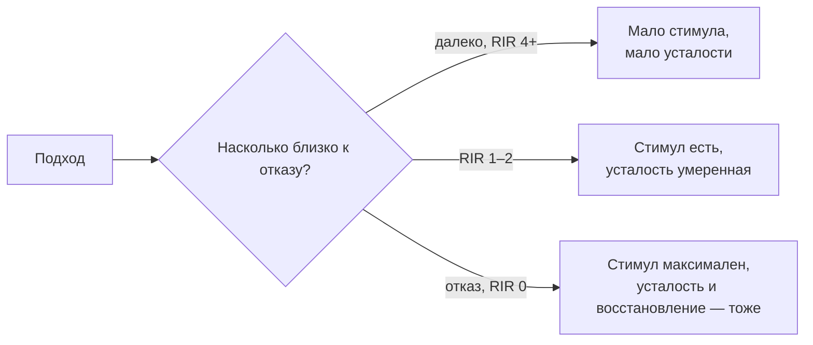
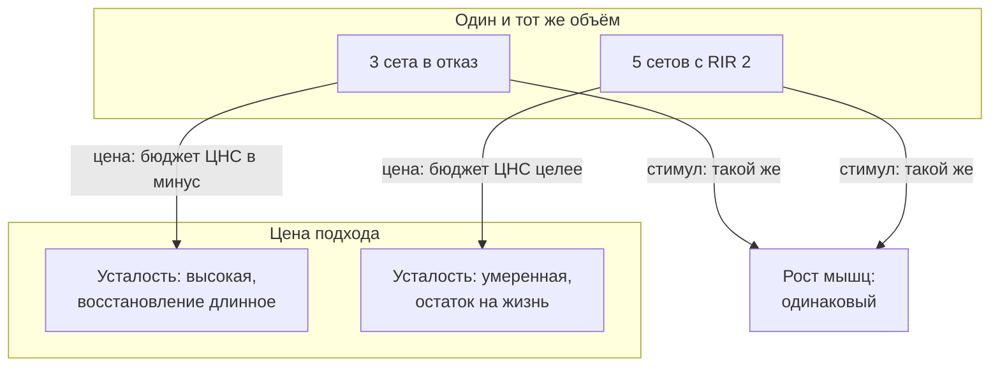
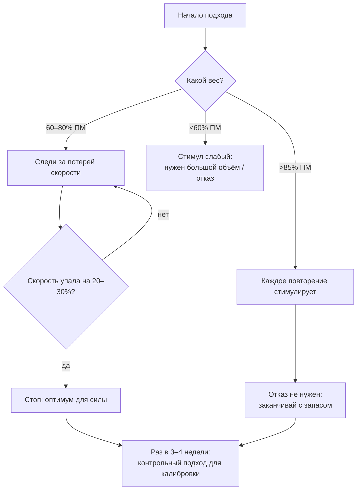

# Отказ, RIR и порог потери скорости: сколько «до отказа» действительно нужно?

> **О чём статья:** сколько «до отказа» действительно нужно для роста мышц и силы, и почему потеря скорости (VL) — объективная альтернатива оценке «на глаз». Голос и общая линия самоучителя — `THROUGHLINE.md`.

**TL;DR**

- До отказа доходить каждый подход не нужно: рост мышц одинаков при запасе в 1–2 повторения (RIR 1–2), а для **силы** отказ даже вреден.
- Объективная альтернатива «на глазку» — **потеря скорости** (VL): остановить подход при падении скорости на 20–30% — зона оптимума для силы.
- Большие веса (>85% ПМ) делают вопрос «до отказа или нет» почти бессмысленным — там каждое повторение уже стимулирующее.
- Главная цена отказа — не мышцы, а нервная система: она одна на тренировку и на жизнь. Дешевле сделать 4–5 сетов с запасом, чем 3 в отказ.

---

## Уровень 1 — Просто: что такое «отказ» и зачем его считать

Представь: ты в зале, штанга идёт вниз, и вот-вот последнее повторение. Момент, когда ты больше не можешь сделать ни одного чистого повторения, — это **отказ**. Всё «на глаз» вокруг него измеряется одной цифрой — RIR, «запас повторений до отказа».

Подход «в отказ» = RIR 0. Подход «с запасом 2 повторения» = RIR 2 — то есть ты остановился, хотя мог бы выжать ещё два. Всё, это вся арифметика, которая нужна для старта.

Зачем её считать? Потому что близость к отказу — это «ручка громкости» тренировки: она меняет и результат, и цену подхода. Поверни ручку до упора — получишь чуть больше стимула и сильно больше усталости. И усталость эта достаётся не только мышцам, но и нервной системе — о цене поговорим ниже.

### Что запомнить

- RIR 0 — отказ, RIR 2 — «ещё 2 повторения в запасе».
- Отказ — не обязательное условие роста, а один из его «регуляторов».
- Чем ближе к отказу — тем больше и стимул, и усталость. А платишь за это нервной системой.

**Проверка:** подход 10 повторений, из которых ты мог сделать 12. Какой это RIR? _(RIR 2.)_

---

## Уровень 2 — Подробно: числа и зоны

Теперь цифры. Они собраны из конспектов Yeti — это обобщения мета-анализов и авторские зоны.

### Таблица-числа: зоны близости к отказу

| Параметр          | Значение         | Что означает                                                      |
| ----------------- | ---------------- | ----------------------------------------------------------------- |
| Вес >85% ПМ       | любое повторение | стимулирующее с первого повторения, отказ не нужен                |
| Вес 60–70% ПМ     | —                | для стимула нужен объём работы близко к отказу                    |
| RIR 1–2           | тот же рост      | при уравненном объёме рост мышц как у отказа                      |
| VL 20–30%         | оптимум для силы | RIR ~2–3; U-образная связь VL↔1ПМ                                 |
| VL ~30%           | тяжёлая зона     | RIR ~1; работает для силы и гипертрофии, но дольше восстановление |
| VL 35–50%         | отказная зона    | максимум утомления, для силы менее эффективна                     |
| VL <5%            | лёгкая зона      | разгрузка, техника, поддержка                                     |
| Ошибка оценки RIR | ~1 повторение    | люди недооценивают себя в среднем на 1 повторение                 |

VL (velocity loss, потеря скорости) — это то же самое «насколько близко к отказу», но измеренное секундомером: в отказном подходе скорость последних повторений падает примерно на 40–50% от исходной.

### Таблица «Что утверждается → насколько подтверждено → исследования»

| Утверждение                                                                        | Статус                                     | Исследования (в данных)                             |
| ---------------------------------------------------------------------------------- | ------------------------------------------ | --------------------------------------------------- |
| RIR 1–2 даёт тот же рост мышц, что отказ, при равном объёме                        | подтверждено (в конспекте: «исследования») | ссылка не найдена в данных — требует ручного поиска |
| Сила: далёкие от отказа группы (RIR 4–6, RIR 1–3) растут в силе лучше отказных     | подтверждено (в конспекте)                 | ссылка не найдена в данных — требует ручного поиска |
| Циклирование RIR 4→3→2→1 не хуже постоянного RIR 1 (10 недель)                     | подтверждено (в конспекте)                 | ссылка не найдена в данных — требует ручного поиска |
| VL 20–30% — оптимум для силы (мета-анализ 2023, 9 исследований, 336 тренирующихся) | подтверждено                               | ссылка не найдена в данных — требует ручного поиска |
| Обзор 2023 (19 исследований): небольшое преимущество умеренных VL-порогов          | подтверждено                               | ссылка не найдена в данных — требует ручного поиска |
| Гипертрофия: при уравнивании объёма разницы между RIR 2 и отказом нет              | подтверждено                               | ссылка не найдена в данных — требует ручного поиска |
| VL объективнее RIR как мера утомления                                              | мнение автора                              | —                                                   |
| Зоны VL (<5% / 20–30% / ~30% / 35–50%)                                             | мнение автора (обобщение)                  | —                                                   |

> ⚠️ **Важно про ссылки:** в конспектах Yeti исследования называются словами («мета-анализ 2023», «9 исследований, 336 участников»), но URL в данных отсутствуют. Это не выдумка и не пропуск — так устроен корпус. Полный список тезисов «без ссылки» см. `no-link-claims.md`.

### Что запомнить

- Для силы «золотая зона» — VL 20–30%, то есть примерно RIR 2–3.
- Для роста мышц отказ и RIR 2 равнозначны при одинаковом объёме — выбирай по восстановлению.
- Каждый подход в отказ — это «кредит» усталости, который надо гасить.

**Проверка:** ты тренируешься в 75% ПМ и останавливаешься, когда штанга стала заметно медленнее. Примерно какой это VL и RIR? _(~20–30% VL, RIR 2–3 — оптимальная зона для силы.)_

---

## Уровень 3 — Вглубь: механизмы, исследования, практика

### Почему отказ не обязателен

Логика конспектов такая: стимул роста — это рекрутирование высокопороговых двигательных единиц, а оно происходит по мере утомления подхода. При большом весе (>85% ПМ) рекрутирование полное с первого повторения.

При средних весах (60–80% ПМ) нужное рекрутирование «накапливается» к концу подхода. Отсюда два равных пути: дойти до отказа или сделать на 1–2 подхода больше с запасом.

Для силы картина другая: качество повторений (скорость, мощность) важнее «дожатия». Мета-анализ 2023 показал U-образную связь: и «далеко от отказа» (<5% VL), и «в отказ» (~40–50% VL) — хуже, чем 20–30% VL.

### Бюджет ЦНС: почему 4–5 сетов не до отказа лучше 3 сетов в отказ

Вот где эта статья становится не про «приёмчик», а про устройство всего самоучителя. Усталость от подхода до отказа — это не только мышцы. Тяжёлые отказные подходы сильно тратят нервную систему, а она у тебя **одна** — и на тренировку, и на работу, и на сон.

А что ты покупаешь за эту цену? Почти ничего: при равном объёме стимул у отказа и RIR 1–2 одинаковый. То есть отказ — это доплата без дополнительного товара.

Отсюда конкретный обмен, который лежит в основе всей схемы периодизации: **те же 3 «рабочих» подхода объёма лучше набрать 4–5 сетами с запасом 1–2 повторения, чем 3 сетами в отказ.** Стимул тот же, а нервная система ушла «в кредит» гораздо меньше — и остаток бюджета достаётся жизни.

Почему это важно для жизни, а не только для зала: перетренировался → хуже сон → хуже восстановление → хуже рост. Замкнутый круг, в котором каждая тренировка «на износ» делает следующую хуже. Тратить ЦНС так, чтобы весь следующий день тупить, — нет смысла: ты платишь днём жизни за повторение, которое ничего не добавило.

### Как автор предлагает контролировать RIR (5 инструментов)

1. Контрольная точка: отказной/проходочный подход раз в 3–4 недели — калибровка.
2. Веса под ≤12 повторений — оценка точнее, чем в многоповторке.
3. Оценивать ближе к концу подхода — после ~70% объёма погрешность мала.
4. По скорости: отказ ≈ потеря 40–50% скорости от исходной.
5. RPE-калькулятор для планирования лёгких/средних/тяжёлых недель.

### Чего данные не говорят

- Конспекты не называют конкретные исследования — ни одного URL в данных канала Yeti нет. Все «исследования» здесь привязаны по описанию, а не по ссылке.
- Размеры эффектов в обзоре 2023 «небольшие» — преимущество умеренных порогов над отказом статистически не доказано.
- Циклирование RIR показало преимущество в одном 10-недельном исследовании на трицепсе — переносить на всё сразу осторожно.
- Зоны VL — авторская интерпретация данных, а не рекомендация из мета-анализа как таковая.

### Список исследований

В этой теме URL исследований пока не найдены. Тезисы, где автор ссылается на исследования словами («мета-анализ 2023», «исследование 10 недель»), перечислены в `no-link-claims.md` с пометкой «ссылка не найдена в данных — требует ручного поиска». После проверки названий и ссылок они пополнят этот список — источником здесь считается только научная публикация (название + URL).

### Что запомнить

- Стимул и утомление — две стороны одной ручки: отказ покупает стимул дороже всех.
- VL — объективная замена «ощущениям»: секундомер честнее самооценки.
- Силу растят умеренные подходы (VL 20–30%) и большой объём, а не героические отказы.

---

## Куда это ведёт

Ты сейчас понял регулятор громкости одной тренировки — RIR и потерю скорости. Но за каждым отдельным подходом стоит общий бюджет: нервная система одна на тренировки, стресс и сон, и отказ тратит его быстрее всего. Это первая опора всей книги: **дозируй не только подход, но и день** — и ты сможешь тренироваться месяцами, а не выгорать за месяц «максимальных» тренировок.

Дальше по маршруту — **«Нервная система — одна на всё»** (`C-most-nervnaya-sistema.md`): там бюджет ЦНС раскрыт целиком — со стрессом, сном и маркерами, по которым ты «слышишь» его дома за минуту. А когда увидишь, что тренировки и восстановление — единая система, пойдёшь читать **«Почему год, а не тренировка: арифметика прогресса»** (`D-pochemu-god-a-ne-trenirovka.md`): там запас в RIR 4 лёгкого дня и RIR 2 тяжёлого складываются в циклы, которые дают +40 кг рабочего веса за год.
