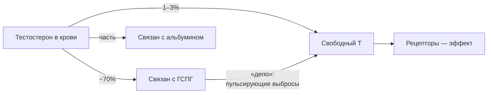
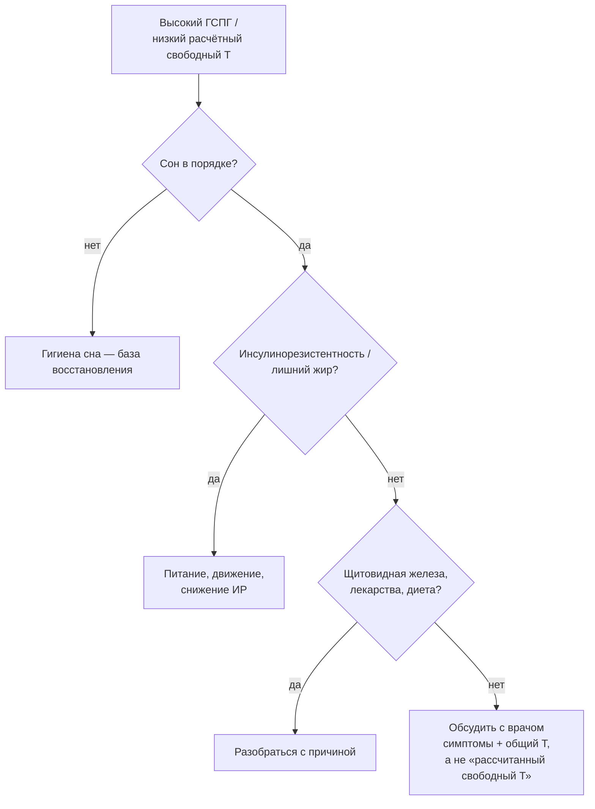

# ГСПГ и свободный тестостерон: почему «мало свободного Т» — не диагноз

> **О чём статья:** свободного тестостерона в крови всего 1–3% — и это норма; ГСПГ — транспорт и депо, а не «вредитель», и решение о ЗГТ принимают по симптомам и рекомендациям, а не по одной цифре свободной фракции. Голос и общая линия самоучителя — `THROUGHLINE.md`.

**TL;DR**

- Свободного тестостерона в крови всего 1–3% — и это норма, а не дефицит: он живёт минуты и тут же расходуется.
- ГСПГ — не «вредитель», а транспорт и депо тестостерона; по данным, низкий ГСПГ скорее маркер метаболических проблем.
- «Мало свободного Т — колоться» — рутина, которую данные не подтверждают; сам автор считает её необоснованной в 95% случаев.

---

## Уровень 1 — Просто: что такое ГСПГ и «свободный Т»

Начни с картинки из зала, а не из лаборатории. Сдал анализы, видишь «тестостерон ниже, чем хотелось бы», и кто-то уже объясняет: «это ГСПГ связывает твой гормон, вот виновник». Звучит логично. Теперь посмотри, как всё устроено на самом деле.

Тестостерон в крови почти весь «пристёгнут» к белкам-перевозчикам. Главный из них — ГСПГ, глобулин, связывающий половые гормоны. Свободная (несвязанная) часть — это те самые 1–3%, которые традиционно считаются «рабочими». Отсюда популярная логика: «высокий ГСПГ → мало свободного → надо лечить».

Автор канала утверждает: эта логика — упрощение, которое живёт в кабинетах, но плохо сходится с данными. Чтобы понять почему, нужно увидеть, что ГСПГ — не тюрьма для гормона, а его склад с выдачей.

### Что запомнить

- ГСПГ — белок-перевозчик, он связывает ~70% тестостерона.
- «Свободный Т» — крошечная, постоянно обновляющаяся фракция.
- Высокий ГСПГ сам по себе — не автоматический повод для ЗГТ.

**Проверка:** если ГСПГ «связывает» тестостерон, почему организм делает его так много? _(Потому что это транспорт и депо: организм хранит Т связанным и выдаёт порциями.)_

---

## Уровень 2 — Подробно: числа и главный кейс

### Таблица-числа: что говорят конспекты

| Показатель                      | Значение            | Комментарий                                                             |
| ------------------------------- | ------------------- | ----------------------------------------------------------------------- |
| Связан с ГСПГ                   | ~70% общего Т       | основная «связанная» фракция                                            |
| Свободная фракция               | 1–3%                | норма, не дефицит                                                       |
| Период полураспада свободного Т | 10–20 минут         | поэтому его «мало» в каждый момент                                      |
| Кейс из литературы              | общий Т 4,8 нмоль/л | при неопределяемом ГСПГ — нормальное развитие, сперматогенез, отцовство |
| «ЗГТ необоснованно»             | в 95% случаев       | оценка автора для ситуации «высокий ГСПГ при нормальном общем Т»        |

### Таблица «Что утверждается → насколько подтверждено → исследования»

| Утверждение                                                                             | Статус                                        | Исследования (из данных)                                                                                                                                                                                                                                                                                                                                                                                                                                                                                                                                                                                                                                                     |
| --------------------------------------------------------------------------------------- | --------------------------------------------- | ---------------------------------------------------------------------------------------------------------------------------------------------------------------------------------------------------------------------------------------------------------------------------------------------------------------------------------------------------------------------------------------------------------------------------------------------------------------------------------------------------------------------------------------------------------------------------------------------------------------------------------------------------------------------------- |
| Т связан ГСПГ ~70%, свободных 1–3%                                                      | подтверждено                               | [NCBI Bookshelf](https://www.ncbi.nlm.nih.gov/books/NBK279000/), [Endocrine Reviews](https://academic.oup.com/edrv/article/38/4/302/3897170)                                                                                                                                                                                                                                                                                                                                                                                                                                                                                                                                 |
| Кейс: нет ГСПГ → низкий общий Т, нормальный мужчина и фертильность                      | подтверждено (клинический случай)          | [PMC5136390](https://pmc.ncbi.nlm.nih.gov/articles/PMC5136390/), [PMC9983358](https://pmc.ncbi.nlm.nih.gov/articles/PMC9983358/)                                                                                                                                                                                                                                                                                                                                                                                                                                                                                                                                             |
| Свободный Т живёт 10–20 минут; хранение связанным + пульсирующие выбросы                | подтверждено (физиология клиренса)         | [клиренс и метаболизм Т](https://www.sciencedirect.com/science/article/pii/B9780128010280002245), [периоды полураспада ГСПГ](https://www.sciencedirect.com/science/article/abs/pii/0022473189905116)                                                                                                                                                                                                                                                                                                                                                                                                                                                                         |
| ГСПГ сам действует как гормон (собственные эффекты)                                     | частично подтверждено, активно изучается   | [Rosner W. и др.](https://www.sciencedirect.com/science/article/abs/pii/S0303720709004134), [Cell 2005](https://www.cell.com/fulltext/S0092-8674(05)00861-5)                                                                                                                                                                                                                                                                                                                                                                                                                                                                                                               |
| «Мало свободного Т — колоться»                                                          | мнение автора, расходится с рекомендациями | [AUA guideline](https://www.guidelinecentral.com/guideline/22047/), [EAU](https://europepmc.org/article/med/34183196), [EAA guidelines](https://onlinelibrary.wiley.com/doi/full/10.1111/andr.12770), [Society for Endocrinology](https://onlinelibrary.wiley.com/doi/epdf/10.1111/cen.14633)                                                                                                                                                                                                                                                                                                                                                                                |
| ГСПГ зависит от питания и обмена: углеводы, кетодиета, ИР, ожирение, тиреоидные гормоны | подтверждено                               | [углеводы](https://www.sciencedirect.com/science/article/abs/pii/S1043276015000831), [кетодиета](https://www.sciencedirect.com/science/article/abs/pii/S0303720709005036), [VLCKD и ГСПГ (ECE2022)](https://www.endocrine-abstracts.org/ea/0081/ea0081rc14.8), [ГСПГ и ИР](https://onlinelibrary.wiley.com/doi/full/10.1111/cen.12086), [фитоэстрогены](https://www.sciencedirect.com/science/article/pii/B9780123820327100529), [Болезнь Грейвса и репродуктивная функция](https://cyberleninka.ru/article/n/bolezn-greyvsa-i-reproduktivnaya-funktsiya-u-zhenschin/viewer), [ИМТ/ожирение—ГСПГ](https://eje.bioscientifica.com/view/journals/eje/176/4/393.xml?rss=1#bib4) |
| Низкий ГСПГ — маркер метаболического синдрома                                           | подтверждено                               | [SHBG и лептин/адипонектин](https://www.nature.com/articles/s41598-017-03078-0), [защита от метсиндрома](https://pubmed.ncbi.nlm.nih.gov/30046278/), [SHBG и ожирение у мышей](https://pubmed.ncbi.nlm.nih.gov/32795655/), [SHBG и сердечно-сосудистая система](https://pubmed.ncbi.nlm.nih.gov/34335746/)                                                                                                                                                                                                                                                                                                                                                                   |
| Низкий ГСПГ связан с риском ИБС; диагностическая ценность ГСПГ растёт                   | активно изучается                          | [SHBG and Risk of CHD](https://pubmed.ncbi.nlm.nih.gov/36702572/), [New Insights in SHBG](https://pubmed.ncbi.nlm.nih.gov/40427034/)                                                                                                                                                                                                                                                                                                                                                                                                                                                                                                                                         |
| ГСПГ у спортсменов / влияние тренированности                                            | подтверждено ограниченно                   | [s00421-021-04692-7](https://link.springer.com/article/10.1007/s00421-021-04692-7), [интервалы у элитных велосипедистов](https://onlinelibrary.wiley.com/doi/full/10.1111/sms.13672), [6 недель тренировок у седентарных мужчин](https://www.tandfonline.com/doi/full/10.3109/13685538.2015.1046123)                                                                                                                                                                                                                                                                                                                                                                         |
| ААС подавляют ГСПГ                                                                      | подтверждено                               | [ААС и ГСПГ](https://academic.oup.com/endo/article-abstract/114/6/2100/2538442?redirectedFrom=fulltext)                                                                                                                                                                                                                                                                                                                                                                                                                                                                                                                                                                      |
| ДГТ регулирует уровень ГСПГ (обратная связь андрогенов)                                 | подтверждено                               | [SHBG 1974](https://onlinelibrary.wiley.com/doi/abs/10.1111/j.1365-2265.1974.tb03298.x?sid=nlm%3Apubmed), [DHT и ГСПГ 1989](https://onlinelibrary.wiley.com/doi/abs/10.1111/j.1365-2265.1989.tb02236.x), [обзорные ссылки подкаста](https://journals.sagepub.com/doi/pdf/10.1177/000456329002700603), [мегалин и андроген-рецепторы (JSCR)](https://www.ovid.com/jnls/nsca-jscr/abstract/10.1519/jsc.0b013e318202e45d~megalin-and-androgen-receptor-gene-expression-in-young-and?redirectionsource=fulltextview)                                                                                                                                                             |

### Что запомнить

- Свободная фракция 1–3% — физиологическая норма, а не «потеря».
- ГСПГ — транспорт и депо; его уровень реагирует на питание, жир, щитовидку, лекарства.
- Клинические общества (AUA, EAU, EAA) назначают ЗГТ по симптомам и общему Т, а не по «рассчитанному свободному Т».

**Проверка:** у пациента высокий ГСПГ и «низкий рассчитанный свободный Т» при нормальном общем Т. Какой шаг по логике конспекта будет правильнее — сразу ЗГТ или поиск причин высокого ГСПГ? _(По логике конспекта — сначала поиск причин: ИР, ожирение, щитовидка, диета, лекарства.)_

---

## Уровень 3 — Вглубь: механизмы, рекомендации, нюансы

### Механика: почему «мало свободного» — это нормально

Вот здесь картинка из зала помогает в лаборатории. Свободный тестостерон — расходуемая фракция: как рабочий вес в подходе, он тратится, а не лежит на полке. Он быстро покидает сосудистое русло (полураспад 10–20 минут), и организм компенсирует это депо: связанная форма «отдаёт» гормон по потребности.

Крайний случай подтверждает логику: человек с генетически неопределяемым ГСПГ имеет низкий общий Т, но остаётся нормальным мужчиной. Значит, для мужских функций достаточно ничтожно малого свободного потока — вопрос в регуляции, а не в «объёме бака».

### Что двигает ГСПГ вверх и вниз

По разбору «ГСПГ и обмен веществ»: инсулинорезистентность и ожирение снижают ГСПГ, тиреоидные гормоны повышают, диеты меняют уровень (VLCKD — через ИР), анаболические стероиды подавляют.

Отсюда практический вывод автора: высокий ГСПГ — это чаще симптом метаболического контекста, чем самостоятельная «болезнь свободного Т». Заметь, как это похоже на остальную книгу: причина обычно не там, где её ищут по одному анализу.

### Чего данные не говорят

- Тезис «ГСПГ не враг» расходится с частью клинических рекомендаций — сам конспект помечает: «доказательная база неоднозначна».
- Комплекс ГСПГ+Т, возможно, имеет собственные эффекты, но наука их ещё не полностью описала — это открытый вопрос, а не установленный факт.
- Оценка «в 95% случаев необоснованно» — мнение автора, а не число из исследования.
- Одна из ссылок описания (Cell, 2005) не открылась для проверки названия (Cloudflare) — она приведена так, как названа в источнике.

### Список исследований

Формат: название · URL. В списке — только научные публикации и официальные рекомендации: источником считается исследование, а не разбор. Если название получить не удалось, указано рабочее описание темы.

1. [NCBI Bookshelf — глава справочника](https://www.ncbi.nlm.nih.gov/books/NBK279000/)
2. [Статья из Endocrine Reviews, 38(4)](https://academic.oup.com/edrv/article/38/4/302/3897170)
3. [Sex Hormone Binding Globulin Modifies Testosterone Action and Metabolism in Prostate Cancer Cells](https://pmc.ncbi.nlm.nih.gov/articles/PMC5136390/)
4. [Regulation of Prostate Androgens by Megalin and 25-hydroxyvitamin D Status: Mechanism for High Prostate Cancer Risk…](https://pmc.ncbi.nlm.nih.gov/articles/PMC9983358/)
5. [Megalin and Androgen Receptor Gene Expression in Young and Old Human Skeletal Muscle Before and After Three Sequential Exercise Bouts](https://www.ovid.com/jnls/nsca-jscr/abstract/10.1519/jsc.0b013e318202e45d~megalin-and-androgen-receptor-gene-expression-in-young-and?redirectionsource=fulltextview)
6. [The Metabolic Clearance Rate and the Metabolism of Testosterone](https://www.sciencedirect.com/science/article/pii/B9780128010280002245)
7. [Периоды полураспада ГСПГ](https://www.sciencedirect.com/science/article/abs/pii/0022473189905116)
8. [Сам ГСПГ действует как гормон (Rosner W. et al.)](https://www.sciencedirect.com/science/article/abs/pii/S0303720709004134)
9. [Статья из Cell (2005)](https://www.cell.com/fulltext/S0092-8674(05)00861-5)
10. [AUA Evaluation and Management of Testosterone Deficiency Guideline](https://www.guidelinecentral.com/guideline/22047/)
11. [European Association of Urology Guidelines on Sexual and Reproductive Health—2021 Update: Male Sexual Dysfunction](https://europepmc.org/article/med/34183196)
12. [European Academy of Andrology (EAA) guidelines on investigation, treatment and monitoring of functional hypogonadism…](https://onlinelibrary.wiley.com/doi/full/10.1111/andr.12770)
13. [Society for Endocrinology guidelines for testosterone replacement therapy in male hypogonadism](https://onlinelibrary.wiley.com/doi/epdf/10.1111/cen.14633)
14. [Влияние углеводов на уровень ГСПГ](https://www.sciencedirect.com/science/article/abs/pii/S1043276015000831)
15. [Реакция ГСПГ на различные диеты (кетодиета)](https://www.sciencedirect.com/science/article/abs/pii/S0303720709005036)
16. [Insulin resistance prevents SHBG increase after VLCKD in non-diabetic obese male subjects (ECE2022)](https://www.endocrine-abstracts.org/ea/0081/ea0081rc14.8)
17. [Does the Ketogenic Diet Improve the Quality of Ovarian Function in Obese Women?](https://www.mdpi.com/2072-6643/14/19/4147)
18. [Sex hormone binding globulin and insulin resistance](https://onlinelibrary.wiley.com/doi/full/10.1111/cen.12086)
19. [Фитоэстрогены](https://www.sciencedirect.com/science/article/pii/B9780123820327100529)
20. [Болезнь Грейвса и репродуктивная функция у женщин](https://cyberleninka.ru/article/n/bolezn-greyvsa-i-reproduktivnaya-funktsiya-u-zhenschin/viewer)
21. [ИМТ/ожирение и ГСПГ (European Journal of Endocrinology)](https://eje.bioscientifica.com/view/journals/eje/176/4/393.xml?rss=1#bib4)
22. [Lower SHBG level is associated with higher leptin and lower adiponectin levels as well as metabolic…](https://www.nature.com/articles/s41598-017-03078-0)
23. [Protective Effect of Sex Hormone-Binding Globulin against Metabolic Syndrome…](https://pubmed.ncbi.nlm.nih.gov/30046278/)
24. [Classic and Novel Sex Hormone Binding Globulin Effects on the Cardiovascular System in Men](https://pubmed.ncbi.nlm.nih.gov/34335746/)
25. [Sex hormone-binding globulin overexpression protects against high-fat diet-induced obesity in transgenic male mice](https://pubmed.ncbi.nlm.nih.gov/32795655/)
26. [Sex Hormone-Binding Globulin and Risk of Coronary Heart Disease in Men and Women](https://pubmed.ncbi.nlm.nih.gov/36702572/)
27. [New Insights in the Diagnostic Potential of Sex Hormone-Binding Globulin (SHBG) — Clinical Approach](https://pubmed.ncbi.nlm.nih.gov/40427034/)
28. [The effects of three types of exercise training on steroid hormones in physically inactive middle-aged adults: a randomized controlled trial](https://link.springer.com/article/10.1007/s00421-021-04692-7)
29. [Systemic and muscular responses to effort-matched short intervals and long intervals in elite cyclists](https://onlinelibrary.wiley.com/doi/full/10.1111/sms.13672)
30. [Six weeks of conditioning exercise increases total, but not free testosterone in lifelong sedentary aging men](https://www.tandfonline.com/doi/full/10.3109/13685538.2015.1046123)
31. [Relative Binding Affinity of Anabolic-Androgenic Steroids](https://academic.oup.com/endo/article-abstract/114/6/2100/2538442?redirectedFrom=fulltext)
32. [Sex Hormone Binding Globulin: Origin, Function and Clinical Significance](https://journals.sagepub.com/doi/pdf/10.1177/000456329002700603)
33. [Sex hormone-binding globulin (1974)](https://onlinelibrary.wiley.com/doi/abs/10.1111/j.1365-2265.1974.tb03298.x?sid=nlm%3Apubmed)
34. [Dihydrotestosterone regulates plasma sex-hormone-binding globulin in prepubertal males (1989)](https://onlinelibrary.wiley.com/doi/abs/10.1111/j.1365-2265.1989.tb02236.x)

### Что запомнить

- Свободный Т — фракция «на минуту», а не «на жизнь»: его мало всегда, это норма.
- Уровень ГСПГ — зеркало обмена: питание, жир, щитовидка, лекарства двигают его заметно.
- Решение о ЗГТ принимают симптомы + общий Т + рекомендации обществ, а не один расчёт свободной фракции.

---

## Куда это ведёт

Ты сейчас понял, что «мало свободного Т» — чаще симптом, чем диагноз, и что решение принимают по симптомам, сну и обмену, а не по одному расчёту. Заметь: это та же опора, что и во всей книге — **система снимает догадки**. Не нужно быть одарённым диагностом и не нужно паниковать по одному анализу: восстановление (сон, стресс — см. `C-most-nervnaya-sistema.md`) и обмен работают как единый бюджет, и приводить их в порядок — дешевле и честнее, чем «лечить цифру».

Дальше по маршруту — **«Нервная система — одна на всё»** (`C-most-nervnaya-sistema.md`): недосып из этой статьи — там, в бюджете ЦНС, рядом с перетреном и жизненным стрессом. А чтобы увидеть, зачем вообще собирать эту систему в порядок, дойди до **«Почему год, а не тренировка: арифметика прогресса»** (`D-pochemu-god-a-ne-trenirovka.md`): там сила, восстановление и здоровье складываются в одну цель — тренировку на долголетие.
