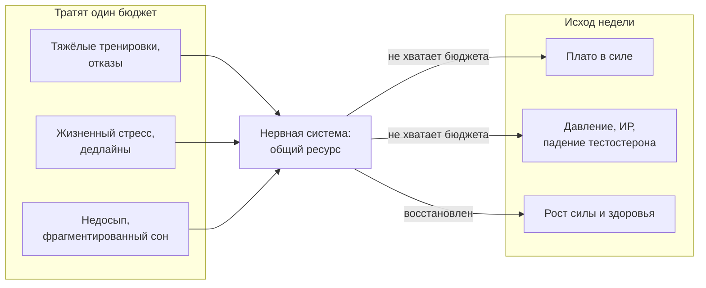
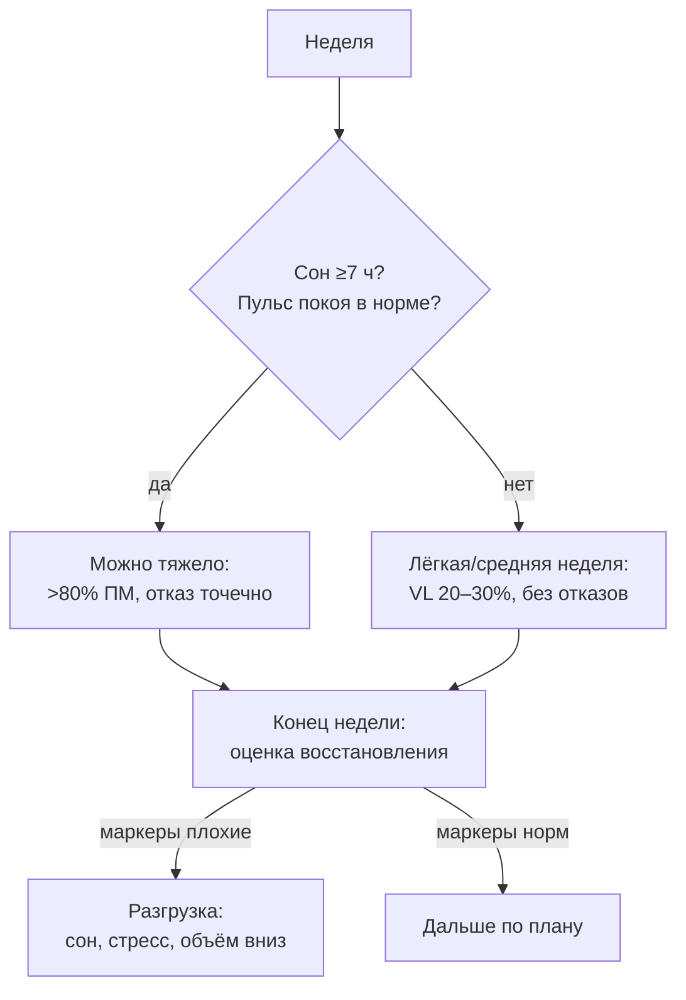

# Нервная система — одна на всё: тренировки, стресс и сон

> **О чём статья:** тренировочное утомление и жизненный стресс обрабатывает одна нервная система — перекос в одной сфере виден в другой; сон и снижение хронического стресса — условие работы всего каскада, а не «ЗОЖ-мелочь». Голос и общая линия самоучителя — `THROUGHLINE.md`.

**TL;DR**

- Тренировочное утомление и жизненный стресс обрабатываются одной и той же нервной системой — перекос в одной сфере виден в другой.
- У Yeti это «КПД тренировок после стресса и отказов», у Егорова — «симпатикотония как корень давления и инсулинорезистентности».
- Общий знаменатель обоих каналов — восстановление: сон и снижение хронического стресса не «ЗОЖ-мелочь», а условие работы всего каскада.

---

## Уровень 1 — Просто: почему «всё связано»

Представь нервную систему как общий бюджет — теперь ты уже видел эту картину в статье про отказ. Тяжёлые подходы до отказа, ссора на работе, короткая ночь — все тратят один и тот же бюджет. И нет «отдельной спортивной ЦНС» и «отдельной бытовой»: система-то одна.

Yeti смотрит на это со стороны спортзала: усталая нервная система хуже «заряжает» мышцы. Егоров — со стороны клиники: хронически активированная симпатика повышает давление и портит обмен веществ. Два разных человека, две разных профессии — и одинаковый вывод.

Итог, который стоит унести в зал: восстановление — не отдых от тренировок, а часть тренировки.

### Что запомнить

- Нервная система одна: тренировки, стресс и сон конкурируют за один ресурс.
- «Перегруз» в жизни снижает отдачу от тренировок — и наоборот.
- Сон и стресс — такие же «тренировочные переменные», как объём и вес.

**Проверка:** тяжёлая неделя на работе без сна + плановый отказной цикл. Что по логике статьи разумнее сдвинуть? _(Отказную работу — утомление копится, а бюджет восстановления уже израсходован.)_

---

## Уровень 2 — Подробно: числа и маркеры

### Таблица-числа

| Показатель                 | Значение                 | Смысл                                                 |
| -------------------------- | ------------------------ | ----------------------------------------------------- |
| Покойный пульс             | >60 уд/мин               | маркер хронической симпатической активации (у автора) |
| Сон 5–6 часов              | −10–15% тестостерона     | «эквивалент старения на 10–15 лет»                    |
| Зона >80% ПМ               | отказ не нужен           | каждое повторение стимулирующее                       |
| Отказ                      | точечно, раз в ~4 недели | либо один подход в конце тренировки                   |
| Контрольная активация      | 1 неделя из месяца       | поддержание навыка полной активации в зоне >80% ПМ    |
| Возрастная норма падения Т | ~1% в год после 30       | с чем сравнивать эффект недосыпа                      |

### Таблица «Что утверждается → насколько подтверждено → исследования»

| Утверждение                                                                                | Статус                                        | Исследования (из данных)                                                                                                                                                                   |
| ------------------------------------------------------------------------------------------ | --------------------------------------------- | ------------------------------------------------------------------------------------------------------------------------------------------------------------------------------------------ |
| Хроническая симпатикотония → давление → эндотелий → атеросклероз → ИР                      | подтверждено (связи; клинический вес спорен)  | [статья 1](https://www.sciencedirect.com/science/article/pii/S1279770723023138?via%3Dihub), [статья 2](https://www.sciencedirect.com/science/article/abs/pii/S0091743506000557?via%3Dihub) |
| Покойный пульс >60 — самостоятельный фактор риска ССЗ                                      | подтверждено (маркер)                         | ссылка не найдена в данных — требует ручного поиска                                                                                                                                        |
| Хронический стресс повреждает кавернозные тела (крысы)                                     | подтверждено (эксперимент)                    | [Effects of Chronic Stress on Penile Corpus Cavernosum of Rats](https://onlinelibrary.wiley.com/doi/10.2164/jandrol.111.014225)                                                            |
| Сон 5–6 ч → −10–15% тестостерона                                                           | подтверждено (по отдельным исследованиям)     | ссылка не найдена в данных — требует ручного поиска                                                                                                                                        |
| Апноэ — независимый фактор ↓Т и ЭД; ЗГТ может усугублять апноэ                             | подтверждено (в конспекте)                    | ссылка не найдена в данных — требует ручного поиска                                                                                                                                        |
| Утомление ЦНС (отказы, многоповторка, кардио, когнитивная нагрузка) снижает КПД тренировок | мнение автора / частично                      | ссылка не найдена в данных (упомянут обзор 2022)                                                                                                                                           |
| Силовая фаза (1–3ПМ) перед гипертрофией улучшает и то, и другое                            | одно 8-недельное исследование                 | ссылка не найдена в данных — требует ручного поиска                                                                                                                                        |
| Восстановление — общий ресурс тела                                                         | мнение автора: синтез двух каналов (гипотеза) | —                                                                                                                                                                                          |

### Что запомнить

- Пульс покоя выше 60 и плохой сон — маркеры, по которым «слышно» симпатику.
- Недосып измеримо бьёт по тестостерону — не только по самочувствию.
- Отказы и стресс — оба про ЦНС: планировать их надо вместе, а не по отдельности.

**Проверка:** какой из трёх «пожирателей бюджета» ты можешь измерить дома за минуту? _(Покойный пульс.)_

---

## Уровень 3 — Вглубь: механизмы и где авторы расходятся с наукой

### Механизм со стороны Егорова

Хронический стресс держит симпатику включённой. Норадреналин действует на сосуды и почки: растёт давление, повреждается эндотелий, запускается атеросклероз. Параллельно — инсулинорезистентность и тяга к углеводам.

Автор подчёркивает: лечить у такого пациента «холестерин» статинами, не разобравшись со стрессом и сном, — это устранение следствия. Конспект честно помечает: клинический вес этой линии представлен сильнее консенсуса.

### Механизм со стороны Yeti

По автору, нейронная адаптация — не помеха, а предшественник роста: сначала система учится генерировать большое усилие, потом растут мышцы. Утомление ЦНС — от отказов, многоповторки, «мусорного» объёма и даже умственной работы перед залом — снижает отдачу.

Практические следствия — и вот тут видна вся схема книги: тяжёлое — первым в тренировке, отказ — точечно (раз в ~4 недели, а не каждый подход), лёгкие недели — инструмент разгрузки нервной системы, а не «потерянная тренировка». Именно поэтому в периодизации лёгкий день идёт с запасом RIR ~4: он держит навык, не сжигая бюджет.

### Чего данные не говорят

- Тезис Yeti «нейронная адаптация драйвит гипертрофию» — радикальный: часть науки считает связь силы и массы независимыми процессами. В конспекте это обозначено как позиция автора на основе обзора 2022, но URL обзора в данных нет.
- Цифры «−10–15% тестостерона от недосыпа» взяты из отдельных исследований, названных в видео без ссылок — сам конспект их помечает осторожно.
- Связь «ЗГТ → апноэ» описана в литературе, но степень риска индивидуальна.
- «Восстановление как единый ресурс» — это синтез двух каналов: у каждого автора своя терминология, общих исследований в данных нет.

### Список исследований

1. [Статья 1 — симпатикотония и сосудистый каскад](https://www.sciencedirect.com/science/article/pii/S1279770723023138?via%3Dihub)
2. [Статья 2 — симпатикотония и сосудистый каскад](https://www.sciencedirect.com/science/article/abs/pii/S0091743506000557?via%3Dihub)
3. [Effects of Chronic Stress on Penile Corpus Cavernosum of Rats](https://onlinelibrary.wiley.com/doi/10.2164/jandrol.111.014225)

У статей 1–2 названия получить не удалось — даны рабочие описания по таблице утверждений; при проверке ссылок заменю их на точные названия.

Тезисы без ссылок (сон, пульс, обзор 2022, 8-недельное исследование) — в `no-link-claims.md`: «ссылка не найдена в данных — требует ручного поиска».

### Что запомнить

- Нервная система одна на тренировки, стресс и сон — планируй их как единый бюджет.
- Измеримые маркеры просты: пульс покоя, длительность сна, скорость штанги.
- В плохую неделю снижай нагрузку заранее — это управление, а не слабость.

---

## Куда это ведёт

Ты сейчас увидел бюджет целиком: отказы из статьи про RIR (`A-otkaz-rir-poterya-skorosti.md`), жизненный стресс и недосып — всё это списывает с одного счёта. Значит, управлять надо не «каждой тренировкой отдельно», а всем циклом сразу — так, чтобы бюджет никогда не уходил в минус и ты не выгорал и не бросал движения. Это и есть периодизация.

Дальше по маршруту — **«Почему год, а не тренировка: арифметика прогресса»** (`D-pochemu-god-a-ne-trenirovka.md`). Там бюджет, который ты научился беречь, складывается в циклы по 8 недель: лёгкий день RIR ~4, тяжёлый RIR 2, 5 циклов в год — и на выходе +40 кг рабочего веса, а не «максимум на каждой тренировке». Ну а в конце — ответ на вопрос, зачем всё это: сила как страховка позвоночника и долголетия.
