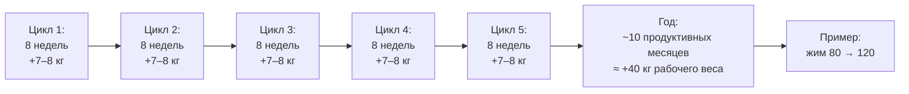
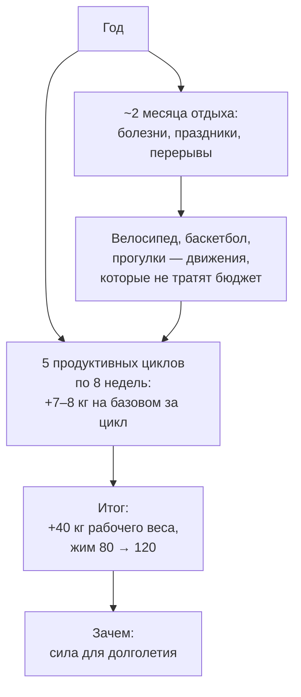
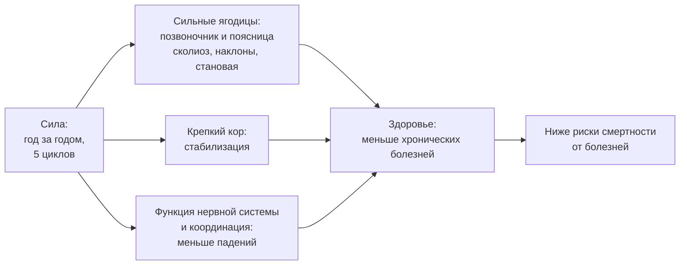

# Почему год, а не тренировка: арифметика прогресса

> **Источник:** статья собрана на личном манифесте автора самоучителя (его экспертные оценки и личные примеры — так и помечены в тексте). Фактура о силе и долголетии — из конспектов: Yeti «Мифы: вред силовых для суставов и сухожилий» (`gZhlZmHhHnU`), Егоров «Сколько мышц нужно, чтобы дожить до 100 лет?» (`xDxoL_siXQM`), «Эта нагрузка снижает риск смерти на 170%» (`-0uU9xJM17Q`), «Как нам всем тренироваться в 2026 году?» (`LFy-dwBfUV4`). Голос и общая линия самоучителя — `THROUGHLINE.md`.

**TL;DR**

- Горизонт прогресса — полгода/год, а не одна тренировка. Одна тренировка ничего не «доказывает»: и хорошая, и плохая — это один кадр из фильма длиной в год.
- Арифметика года: цикл 8 недель (2 месяца), базовое движение +5–10 кг за цикл (в среднем 7–8), в году ~10 продуктивных месяцев. 5 циклов × 7–8 кг ≈ +40 кг рабочего веса за год — оценка автора.
- Два месяца в году «не считаются» — и это нормально: месяц отдыха с велосипедом, баскетболом и прогулками идёт на пользу, а не в минус.
- Зачем всё это: сила снижает риски смертности от болезней, сильные ягодицы держат позвоночник и поясницу, кор — стабилизацию. Тренировка — для долголетия.

---

## Уровень 1 — Просто: один кадр или целый фильм

Вот как выглядит ошибка, на которой сгорает большинство. Ты вернулся в зал после перерыва, первая тренировка идёт отлично — веса будто сами прут. И ты решаешь: «значит, каждая тренировка должна быть такой». Через месяц такой работы ты выгорел, потому что после перерыва каждая тренировка и так даёт максимальный стимул — эта щедрость не бесконечна.

Теперь правильная картина. Тренировка — это кадр, а прогресс — фильм длиной в год. Кадр может быть средненьким, фильм — всё равно отличным. Схема периодизации, которую ты уже видел в статьях про RIR и нервную систему, устроена именно так: лёгкий день (RIR ~4, достаточный объём — не терять навык), и чем ближе тяжёлый день — тем меньше объём, выше интенсивность, меньше запас (тяжёлый день: RIR 2 при 5 ПМ). Она работает, потому что дозирует всё: никакой перетрен, никакой болезни от перегруза.

А теперь арифметика, ради которой всё затевается:



Каждый блок — не подвиг, а плановая работа. Складывается подвиг.

### Что запомнить

- Одна тренировка — кадр; прогресс живёт в циклах по 8 недель.
- Лёгкий день (RIR ~4) и тяжёлый (RIR 2) — не противоречие, а дозирование одного плана.
- Складывать кадры в фильм — навык: он осваивается в этом самоучителе, а не «по ощущениям».

**Проверка:** после 3 месяцев перерыва ты прибавляешь на каждой тренировке. Что это значит и что делать? _(Стимул сейчас максимальный сам по себе — значит, цель не «выжать максимум каждый раз», а не бросать движения и работать в запасе: месяц на максимуме — и ты выгорел.)_

---

## Уровень 2 — Подробно: арифметика года в числах

### Таблица-числа

| Показатель                            | Значение                         | Смысл                                                                  | Откуда                      |
| ------------------------------------- | -------------------------------- | ---------------------------------------------------------------------- | --------------------------- |
| Длина цикла                           | 8 недель / 2 месяца              | единица планирования, а не «неделя»                                    | оценка автора               |
| Прирост базового движения за цикл     | 5–10 кг (в среднем 7–8)          | плановый, не «удачный» результат                                       | оценка автора               |
| Продуктивные месяцы в году            | ~10 из 12                        | 2 месяца уходят на отдых/болезни/праздники                             | оценка автора               |
| Циклов в году                         | 5                                | 10 продуктивных месяцев ÷ 2                                            | оценка автора               |
| Итог года                             | 5 × 7–8 ≈ +40 кг рабочего веса   | на базовых движениях                                                   | оценка автора               |
| Пример-иллюстрация                    | жим 80 → 120 за год              | «стоял на 70 и не жал 100» → победа                                    | оценка автора (иллюстрация) |
| Личный пример автора                  | ягодичный мост 130 × 4 → 200 × 4 | за 2 года на этой логике                                               | личный пример автора        |
| Сила vs мышечная масса для долголетия | эффект силы ~в 2 раза больше     | по смертности от всех причин; масса работает опосредованно, через силу | конспект `gZhlZmHhHnU`      |

Прочитай нижние три строки отдельно. Пример с жимом — не обещание, а иллюстрация арифметики: у большинства, кто годами стоит на 70 и не может пожать 100, +40 кг рабочего веса за год — это победа. Пример с мостом — реальный личный результат автора, и он нарисован той же цифрой в 7–8 кг за цикл, просто растянутой на два года.

```chart
{"kind":"line","title":"Год как 5 циклов, а не 5 подвигов","aria":"График: кумулятивный прирост рабочего веса по пяти 8-недельным циклам, примерно по 7–8 килограммов за цикл, суммарно около 40 килограммов за год.","xLabels":["Цикл 1","Цикл 2","Цикл 3","Цикл 4","Цикл 5"],"series":[{"name":"+7–8 кг за цикл, кумулятивно","values":[8,16,24,32,40]}],"yLabel":"+ кг рабочего веса"}
```

### Таблица «Что утверждается → насколько подтверждено → исследования»

| Утверждение                                                                                                                       | Статус                                                                | Исследования (в данных)                             |
| --------------------------------------------------------------------------------------------------------------------------------- | --------------------------------------------------------------------- | --------------------------------------------------- |
| Цикл 8 недель; +5–10 кг (в среднем 7–8) на базовом движении за цикл                                                               | экспертная оценка автора                                              | —                                                   |
| ~10 продуктивных месяцев в году; отдых — часть плана, а не срыв                                                                   | экспертная оценка автора                                              | —                                                   |
| 5 циклов × 7–8 кг ≈ +40 кг за год; жим 80 → 120                                                                                   | экспертная оценка автора (иллюстрация)                                | —                                                   |
| Ягодичный мост 130 × 4 → 200 × 4 за 2 года                                                                                        | личный пример автора                                                  | —                                                   |
| Сила снижает смертность от всех причин с эффектом ~в 2 раза большим, чем мышечная масса; масса влияет опосредованно через силу    | тезис конспекта Yeti; в конспекте помечено «проверить первоисточники» | ссылка не найдена в данных — требует ручного поиска |
| Мышцы и физическая активность связаны с долголетием (мышцы как «насос», разгружающий сердце; активность снижает риски смертности) | тезисы конспектов Егорова                                             | ссылка не найдена в данных — требует ручного поиска |

> ⚠️ **Про честность данных:** в реестре `study-links.jsonl` по теме «сила/активность и смертность» URL нет — тезисы о долголетии здесь привязаны к конспектам по описанию, а не по ссылке. Числа циклов — экспертная оценка автора, а не исследование; она проверена его собственным примером, но в чужих данных не подтверждена. В конспекте `gZhlZmHhHnU` сама авторская пометка требует перепроверки первоисточников перед включением в теорию — так и оставляем.

### Что запомнить

- Единица планирования — цикл 8 недель; прирост 5–10 кг (в среднем 7–8) — плановая норма, а не удача.
- +40 кг рабочего веса за год складывается из 5 обычных циклов, а не из 5 подвигов.
- Тезис «сила для долголетия важнее массы» — из конспекта, без URL в данных: держим честность, не выдумываем ссылки.

**Проверка:** в месяце выпало две недели болезни. Провален год? _(Нет: в году ~10 продуктивных месяцев, на болезни/отдых/праздники отведено 2 — модель это уже учитывает.)_

---

## Уровень 3 — Вглубь: почему схема работает и что делать в «пустые» месяцы

### Схема снимает догадки

Вот самый недооценённый плюс всей этой конструкции. Когда план на цикл уже рассчитан — веса, объём, запас RIR, — тебе не нужно каждый раз решать заново «дожать или хватит», «сегодня тяжело или легко». Не нужно быть одарённым и не нужно вкладывать особые когнитивные усилия: расчёт уже сделан, твоя работа — прийти и выполнить.

Сравни с типичной альтернативой: каждую тренировку решать по ощущениям. Это дорого стоит именно нервной системой — ты постоянно принимаешь решения на уставшей голове, и ошибаешься в обе стороны: то недотягиваешь, то выгораешь. Схема снимает с тебя эту нагрузку — оставляет только дисциплину прихода.

И заметь, как здесь сходятся все предыдущие главы: бюджет ЦНС (статьи A и C) — это про то, почему нельзя «на износ» каждый раз; запас RIR в лёгком дне — про то, как держать объём без перетрена; тяжёлый день с RIR 2 — про то, где живёт интенсивность. Арифметика года — это всё, сложенное в столбик.

### Что делать в месяцы отдыха

Два месяца в году «не считаются» — и вот здесь важно не сорваться в крайность. «Не считаются» не значит «лежу на диване и забросил движения». Движения не бросаем — просто снимаем с них максимальную нагрузку. Месяц отдыха с велосипедом, баскетболом и прогулками идёт на пользу: другое движение разгружает нервную систему, а тело продолжает работать. Ты возвращаешься в цикл живым, а не «отдохнувшим от спорта».



### Зачем вообще сила: от приседаний до смертности

И вот финальный ответ, зачем складывать кадры в фильм. По данным конспектов, сила снижает риски смертности от всех причин, причём эффект у неё примерно вдвое больше, чем у мышечной массы (масса работает опосредованно — через силу: сила вмещает и функцию нервной системы, и координацию, от которой меньше падений у пожилых). А на уровне тела, который ты чувствуешь каждый день: сильные ягодицы — это крепкий позвоночник и поясница (сколиоз, наклоны, становая), крепкий кор — это стабилизация всего, что ты делаешь стоя и сидя.



Прочитай эту схему снизу вверх и сверху вниз. Сверху вниз — это твой план: год циклов → сильные ягодицы и кор → здоровье. Снизу вверх — это твоя мотивация в лёгкий день с RIR 4, когда не хочется: каждый такой подход — это не «просто поддержать форму», а вклад в правый верхний блок.

### Чего данные не говорят

- Арифметика «5 циклов × 7–8 кг ≈ +40 кг» — модель автора, построенная на его опыте; в данных корпуса нет исследования, которое подтверждает именно эти цифры для всех.
- Тезис «сила снижает смертность в ~2 раза эффективнее массы» назван в конспекте Yeti без URL, и сам конспект требует проверки первоисточника — в этой статье он приведён как тезис конспекта, а не установленный факт.
- Конспекты Егорова о мышцах и долголетии (`xDxoL_siXQM`, `-0uU9xJM17Q`) описывают механизмы словами; URL на конкретные исследования в реестре по этой теме отсутствуют.
- Пример «жим 80 → 120» — иллюстрация модели, а не средний гарантированный результат: индивидуальный прирост зависит от стартовой точки и стажа.

### Список исследований

По теме «сила/мышцы/активность и смертность» в реестре `study-links.jsonl` валидных URL не найдено — ни у Yeti (в его данных ссылок нет в принципе), ни в описаниях использованных видео Егорова. Тезисы этой статьи о долголетии привязаны к конспектам:

| Источник                                  | Видео                                                                 | Что взято                                                                                                                                              |
| ----------------------------------------- | --------------------------------------------------------------------- | ------------------------------------------------------------------------------------------------------------------------------------------------------ |
| Конспект (тезисы, логика, закономерности) | `gZhlZmHhHnU` «Мифы: вред силовых для суставов и сухожилий» (Yeti)    | сила vs масса для долголетия (~2× по эффекту на смертность от всех причин); сила вмещает функцию ЦНС и координацию; пометка «проверить первоисточники» |
| Конспект                                  | `xDxoL_siXQM` «Сколько мышц нужно, чтобы дожить до 100 лет?» (Егоров) | мышцы и долголетие, мышцы как «насос», разгружающий сердце                                                                                             |
| Конспект                                  | `-0uU9xJM17Q` «Эта нагрузка снижает риск смерти на 170%» (Егоров)     | физическая активность и снижение рисков смертности от всех причин                                                                                      |
| Конспект                                  | `LFy-dwBfUV4` «Как нам всем тренироваться в 2026 году?» (Егоров)      | нагрузка, которую сохраняешь в 60–70 лет                                                                                                               |

Числа циклов (+7–8 кг, 10 продуктивных месяцев, +40 кг, жим 80 → 120, мост 130 × 4 → 200 × 4) — экспертная оценка и личный пример автора самоучителя; в исследованиях не привязаны и не должны выдаваться за данные.

### Что запомнить

- Прогресс живёт в циклах, а не в тренировках: план уже рассчитан, догадываться не нужно.
- Два месяца отдыха в году — часть плана: движение не бросаем, максимум снимаем.
- Сила — страховка позвоночника, кора и, по данным конспектов, долголетия.

---

## Куда это ведёт

Это последняя глава маршрута, и здесь вся книга сворачивается в одну мысль. Ты умеешь дозировать подход (статья A: RIR и VL), беречь общий бюджет ЦНС (статья C: сон, стресс, отказ точечно), не гадать по анализам (статья B: решение по системе, а не по одной цифре) — и теперь видишь, зачем: **горизонт — год, а не тренировка**. Пять обычных циклов дают +40 кг рабочего веса; жим 80 → 120; мост 130 × 4 → 200 × 4 — без подвигов, без перетрена, без выгорания. И всё это не ради самих килограммов: сила — это позвоночник, кор и снижение рисков смертности. Тренировка для долголетия.

Замыкается круг так: вернись в `A-otkaz-rir-poterya-skorosti.md` — но теперь «остановись за 1–2 повторения до отказа» читается не как приём, а как условие того самого года: 4–5 сетов с запасом вместо 3 в отказ — это и есть те 5 циклов, которые складываются в +40 кг и в здоровье на десятилетия.
