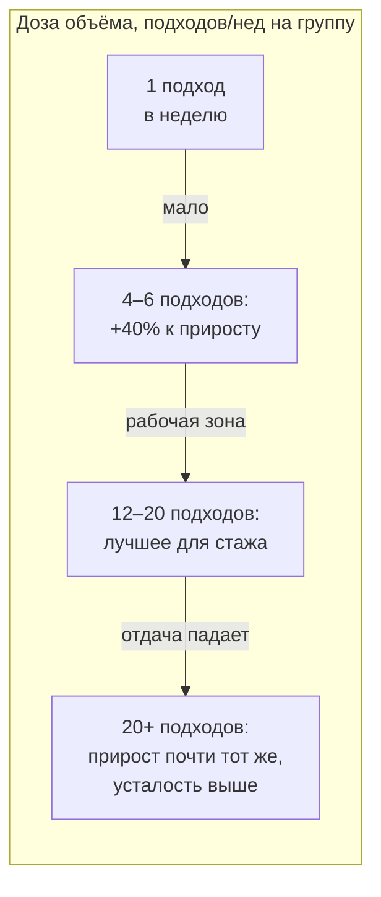
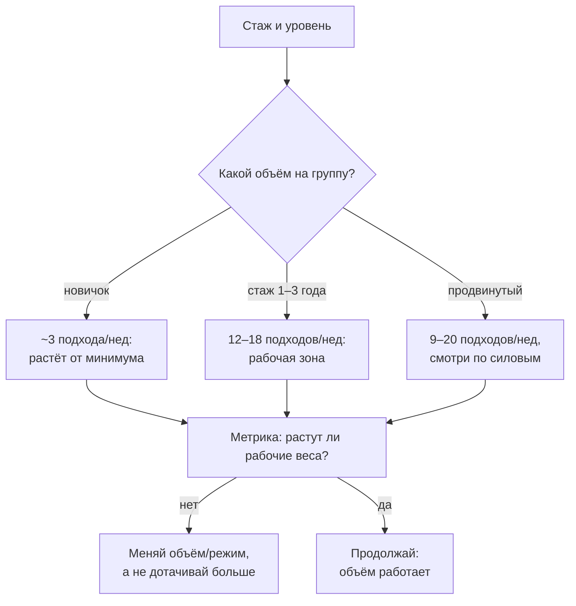

# Сколько подходов в неделю: объём — это доза

> **О чём статья:** объём — это доза стимула, как лекарство: слишком мало не работает, слишком много — платишь усталостью за прирост, которого нет. Где проходит рабочая зона по данным конспектов, и почему у этой кривой убывающая отдача. Голос и общая линия самоучителя — `THROUGHLINE.md`.

**TL;DR**

- Объём работает как доза: 4–6 подходов в неделю на мышечную группу дают примерно на 40% больший прирост, чем 1 подход, — но дальше отдача падает.
- Для стажа больше года рабочая зона — 12–20 подходов в неделю; больше 20 — сопоставимый результат за большую цену.
- Убывающая отдача действует на все стимулы — объём, белок, калории: чем выше тренированность, тем больше «доза» ради меньшего прироста.
- Прогрессия рабочих весов — единственная надёжная метрика: если силы не растут — роста нет.

---

## Уровень 1 — Просто: доза, а не «чем больше, тем лучше»

Представь, что объём — это лекарство. Таблетка в минимальной дозе не лечит, в рабочей дозе лечит, а в десятикратной не лечит лучше — зато бьёт по печени. С тренировочным объёмом ровно та же картина, только «печень» у тебя — нервная система и суставы.

Данные конспектов рисуют эту кривую так: 4–6 подходов в неделю на мышечную группу дают прирост примерно на 40% больше, чем один подход. Дальше кривая растёт всё медленнее: у людей со стажем больше года средние объёмы 12–20 подходов в неделю лучше, чем меньше 12, а за 20 подходами дополнительный прирост в основном заканчивается.

Отсюда первый практический вывод, который стоит унести в зал: «больше» и «лучше» — не синонимы. Больше — это всегда и больше усталости, а усталость ты платишь из того же бюджета, из которого платишь за сон и жизнь.



```chart
{"kind":"bar","title":"Доза объёма: подходы на группу в неделю","aria":"Столбчатая схема: сколько подходов в неделю на мышечную группу дают рабочий объём — от одного подхода до двадцати и более.","bars":[{"label":"1 подход","value":1},{"label":"4–6","value":6,"min":4,"valueText":"4–6"},{"label":"12–20","value":20,"min":12,"valueText":"12–20"},{"label":"20+","value":20,"min":20,"open":true,"valueText":"20+"}],"yLabel":"подходов в неделю"}
```

### Что запомнить

- Объём — доза: у неё есть рабочая зона, а не «чем больше, тем лучше».
- 4–6 подходов в неделю на группу ≈ +40% к приросту против 1 подхода.
- За 20 подходами в неделю прирост почти не растёт, а цена растёт.

**Проверка:** ты делаешь на грудь 25 рабочих подходов в неделю вместо прежних 12. Ожидай ли удвоения результата? _(Нет: 12–20 — уже рабочая зона; дальше прирост почти не растёт, а усталость растёт.)_

---

## Уровень 2 — Подробно: числа и зоны объёма

Теперь цифры. Они из конспекта Yeti «Число подходов для силы и массы» (актуальный обзор объёма 2025) и из его же гайда по силовому тренингу.

### Таблица-числа: зоны объёма

| Показатель                             | Значение                                           | Смысл                                                  | Где в данных           |
| -------------------------------------- | -------------------------------------------------- | ------------------------------------------------------ | ---------------------- |
| 4–6 подходов/нед на группу             | ≈ +40% прироста vs 1 подход                        | надёжная база; 2–3 подхода — посередине                | конспект `QSyZQPrOmNc` |
| Стаж >1 года                           | 12–20 подходов/нед лучше <12                       | систематический обзор 2022 в пересказе                 | конспект `QSyZQPrOmNc` |
| Более 20 подходов/нед                  | сопоставимый прирост (бицепс, квадрицепс)          | больший — только для трицепса                          | конспект `QSyZQPrOmNc` |
| Тренированные, присед ≥1,25 массы тела | 16/24/32 подхода/нед — дозозависимо                | прирост 1ПМ и толщины мышц, лучше у группы 32          | конспект `QSyZQPrOmNc` |
| Экстремальный объём                    | до 52 подходов/нед на одно движение                | прирост приседа 11,8 / 18 / 26 кг по группам           | конспект `QSyZQPrOmNc` |
| Аналог на женщинах (жим ногами)        | 22 / до 38 подходов: 51 / 67 / 78 кг               | но размер эффекта сопоставим (ES 27/35/38)             | конспект `QSyZQPrOmNc` |
| Контрпример                            | 12/18/24 подхода на ноги                           | лучший прирост приседа в группе 18 (+25 кг)            | конспект `QSyZQPrOmNc` |
| Рабочая сводка автора                  | 12–18 сетов/нед на группу                          | практическая зона                                      | конспект `QSyZQPrOmNc` |
| Объём новичка vs продвинутого          | новичку ~3, продвинутому ~9–20                     | минимально необходимый объём растёт с тренированностью | конспект `QSyZQPrOmNc` |
| Режимы по числу повторений             | 1–5 → сила; 6–12 → гипертрофия; 15+ → выносливость | примерно ≥90% / 67–80% / <65% ПМ                       | конспект `2IW5fq8CnAs` |
| Исследование на тренированных          | 90% ПМ 4×3–5 vs 70% ПМ 4×10–12                     | 1ПМ жима +15% против +5%; масса рук +5% против +2%     | конспект `2IW5fq8CnAs` |

Прочитай нижнюю строку дважды. Группы делали одинаковый объём работы, но разный по весу: тяжёлая малоповторка дала втрое больший прирост 1ПМ — и при этом больше массы рук. Для тренированного человека правильный режим не «оптимизация», а необходимость: неправильный может дать регресс.

### Таблица «Что утверждается → насколько подтверждено → исследования»

| Утверждение                                                              | Статус                                                | Исследования                                        |
| ------------------------------------------------------------------------ | ----------------------------------------------------- | --------------------------------------------------- |
| 4–6 подходов/нед ≈ на 40% лучше 1 подхода на группу                      | подтверждено (в конспекте: «надёжные данные»)         | ссылка не найдена в данных — требует ручного поиска |
| Стаж >1 года: 12–20 подходов/нед лучше <12                               | подтверждено (систематический обзор 2022 в пересказе) | ссылка не найдена в данных — требует ручного поиска |
| 16/24/32 подхода/нед — прирост дозозависим у тренированных               | подтверждено (в конспекте)                            | ссылка не найдена в данных — требует ручного поиска |
| До 52 подходов/нед на одно движение работает при специализации           | подтверждено (в конспекте)                            | ссылка не найдена в данных — требует ручного поиска |
| Режим 90% ПМ 4×3–5 даёт больше силы, чем 70% ПМ 4×10–12, у тренированных | подтверждено (в конспекте)                            | ссылка не найдена в данных — требует ручного поиска |
| 15+ повторений тормозят силовую адаптацию                                | мнение автора («газ и тормоз одновременно»)           | ссылка не найдена в данных — требует ручного поиска |
| 12–18 сетов/нед — рабочая зона                                           | оценка автора (сводка)                                | —                                                   |
| Убывающая отдача действует на все стимулы                                | мнение автора (обобщение)                             | —                                                   |

> ⚠️ **Важно про ссылки:** конспекты Yeti называют исследования словами («систематический обзор 2022», «исследование с прогрессией объёма»), но URL в данных отсутствуют — так устроен корпус. Тезисы без ссылок перечислены в `no-link-claims.md`.

### Что запомнить

- Рабочая зона растёт со стажем: новичку хватит ~3 подходов в неделю, продвинутому нужно 9–20.
- Экстремальные объёмы работают только на одном движении и у подготовленных — не переноси 52 подхода на всю программу.
- Рост 1ПМ тянет за собой рабочие веса: без прогрессии веса любой объём «незачёт».

**Проверка:** стаж 3 года, на группу 8 подходов в неделю, силы стоят. Первая гипотеза по логике статьи? _(Объём ниже рабочей зоны для стажа — логично поднять в район 12–18, следя по силовым.)_

---

## Уровень 3 — Вглубь: убывающая отдача и два механизма роста

### Кривая, которая работает на всё сразу

Главная мысль обзора объёма шире, чем «сколько подходов»: эффект убывающей отдачи действует на все стимулы без исключения — объём, белок, калории, гормоны. Новичок растёт от 3 подходов в неделю и 1 г белка на килограмм. Профи с 20-летним стажем получает при 20+ подходах и 4–5 г белка на килограмм прирост в 5 раз меньший — 1–2 кг за год.

При этом ни один стимул не заменяет другой полностью: объём, белок, калории и гормоны — «сигнал расти», а не строительный материал. Они частично взаимозаменяемы, но без любого из них прогресс меньше. И у каждого стимула свой ограничитель, и ограничители индивидуальны: у белка это ЖКТ, у объёма — суставы и сухожилия. В какой-то момент система просто не сможет «усвоить» больше — либо старение, либо травма.

Отсюда же и вторая половина гайда: объём — лишь половина уравнения. Вторая — механическое напряжение. Рост мышцы запускают два механизма: механическая нагрузка (работает через рецепторы напряжения напрямую) и метаболический стресс (закисление, пампинг многоповторки). Напряжение — главный: среди тех, кто «выезжает на пампинге», нет людей, сопоставимых с пауэрлифтерами и тяжелоатлетами. А прогрессия рабочих весов — единственная надёжная метрика всего процесса: если рабочие веса не растут, никакие «принципы» ничего не стоят.



### Чего данные не говорят

- Конспект сам помечает противоречие: рабочие диапазоны 4–6 / 12–20 / 12–18 подходов расходятся с другими конспектами того же канала (6–8 подходов). В статье приведены числа обзора объёма как есть — противоречие не сглажено.
- Все «исследования» здесь названы словами; ни одного URL в данных канала Yeti нет.
- Дозозависимость на экстремальных объёмах показана на одном движении (приседания) — переносить это на всю программу данных не позволяют.
- Число «+40%» — формулировка из конспекта; исходный мета-анализ в данных не назван.

### Список исследований

По теме «объём тренировок и прирост силы/массы» в реестре `study-links.jsonl` валидных URL не найдено — у конспектов Yeti ссылок на исследования нет в принципе. Тезисы статьи (обзор 2022, исследования 16/24/32 и 52 подходов, исследование 90% vs 70% ПМ) перечислены в `no-link-claims.md` с пометкой «ссылка не найдена в данных — требует ручного поиска». После проверки названий и ссылок они пополнят этот список — источником считается только научная публикация (название + URL).

### Что запомнить

- Убывающая отдача — универсальный закон: чем ты тренированнее, тем дороже каждый следующий килограмм.
- Напряжение важнее стресса: тяжёлая малоповторка у тренированных дала +15% к 1ПМ против +5% у объёмной.
- Мера истины одна — рабочие веса. Не растут — меняй дозу.

---

## Куда это ведёт

Ты сейчас понял, что объём — это доза с рабочей зоной, а не «чем больше, тем лучше». Но объём — это деталь более широкой опоры всей книги: **схема снимает догадки**. Расчёт подходов, весов и запаса уже сделан — тебе не нужно каждый раз заново решать, «хватит ли», и не нужно быть одарённым, чтобы прогрессировать.

Дальше по маршруту — **«Отказ, RIR и порог потери скорости»** (`A-otkaz-rir-poterya-skorosti.md`): там вторая половина дозы каждого подхода — насколько близко к отказу его доводить. Объём задаёт количество, RIR — качество: вместе они определяют и стимул, и цену, которую ты платишь нервной системой.
