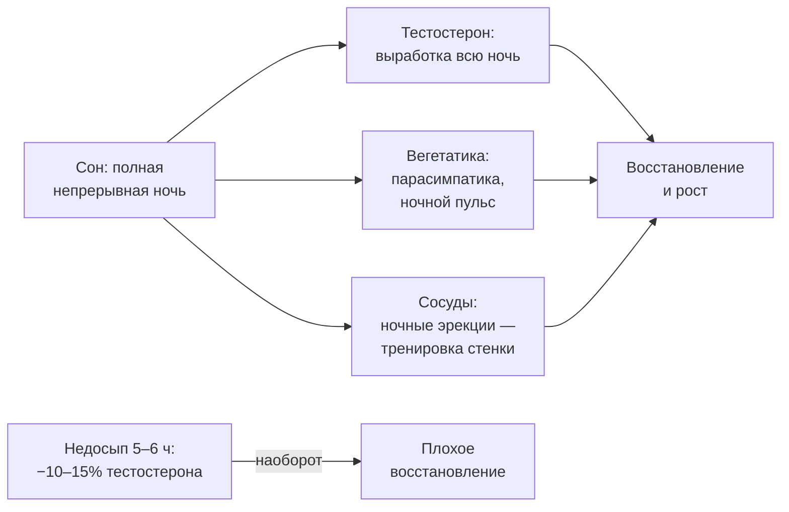
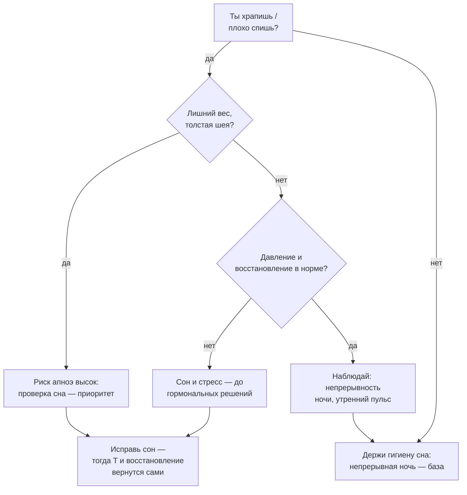

# Сон: половина тренировки происходит ночью

> **О чём статья:** сон — не отдых от тренировок, а их продолжение: тестостерон вырабатывается всю ночь, недосып измеримо бьёт по гормонам и сосудам, а апноэ сводит на нет и восстановление, и фармакологию. Голос и общая линия самоучителя — `THROUGHLINE.md`.

**TL;DR**

- Сон по 5–6 часов регулярно = −10–15% тестостерона — эквивалент «старения на 10–15 лет» (возрастная норма падения ~1% в год после 30).
- Тестостерон вырабатывается в течение всей ночи: нужна непрерывная архитектура сна, поэтому сдавать гормон вечером — бессмысленно.
- Храп почти всегда означает апноэ в той или иной степени — а апноэ независимо снижает и тестостерон, и восстановление.
- Никакая фармакология не заменяет гигиену сна: красивые цифры в анализах на фоне недосыпа не решают проблему восстановления.

---

## Уровень 1 — Просто: почему ночь — часть тренировки

Ты уже видел бюджет нервной системы в статьях про отказ и стресс: она одна и на тренировку, и на жизнь. Теперь добавь сюда ночь. Пока ты спишь, происходит то, чего не сделать в зале: тестостерон вырабатывается в течение всей ночи, гормон роста выходит на пик, сосуды и нервная система возвращают свой баланс. Пропустил ночь — пропустил часть тренировки, которую в зале не «добьёшь».

Теперь цена. Регулярный сон по 5–6 часов — это падение тестостерона на 10–15%. Чтобы почувствовать масштаб: с возрастом тестостерон падает примерно на 1% в год после 30. То есть системный недосып «старит» тебя на 10–15 лет по гормональной оси — а ты в это же время надеешься расти в силе.



```chart
{"kind":"bar","title":"Цена недосыпа: тестостерон","aria":"Столбчатый график: уровень тестостерона при полноценном сне — 100 процентов, при сне 5–6 часов — минус 10–15 процентов; для сравнения, норма старения — около 1 процента в год.","bars":[{"label":"Полный сон","value":100},{"label":"Сон 5–6 ч","value":87,"valueText":"−10–15%"},{"label":"Старение, год","value":99,"valueText":"−~1%"}],"yLabel":"тестостерон, % от нормы"}
```

### Что запомнить

- Сон — часть тренировочного процесса, а не его отмена.
- 5–6 часов сна = −10–15% тестостерона; норма старения — лишь ~1% в год.
- Полная непрерывная ночь важнее «сколько-то сна суммарно».

**Проверка:** тебе «хватило» 5,5 часа сна, утром ты собираешься на тяжёлую тренировку. Что по логике статьи теряется ещё до зала? _(Выработка тестостерона за ночь — до 10–15% от нормы; восстановительный бюджет уже подрезан.)_

---

## Уровень 2 — Подробно: числа и группы риска

### Таблица-числа

| Показатель                 | Значение                                       | Смысл                                                               | Где в данных           |
| -------------------------- | ---------------------------------------------- | ------------------------------------------------------------------- | ---------------------- |
| Сон 5–6 часов регулярно    | −10–15% тестостерона                           | максимальное падение фиксировалось с 14 до 22 ч наблюдения          | конспект `9Z9i3SkUJAU` |
| Возрастная норма падения Т | ~1% в год после 30                             | «эквивалент старения на 10–15 лет»                                  | конспект `9Z9i3SkUJAU` |
| Храп                       | ≈ 90% сопровождается апноэ                     | в той или иной степени                                              | конспект `9Z9i3SkUJAU` |
| Сдача тестостерона         | вечером — бессмысленно                         | байка «вечером можно» неверна: выработка идёт всю ночь              | конспект `9Z9i3SkUJAU` |
| Апноэ сна                  | независимый фактор ↓Т и эректильной дисфункции | лечить ЭД экзогенным Т, не исправив сон, — симптоматическое лечение | конспект `9Z9i3SkUJAU` |
| Группы риска апноэ         | лишний вес, толстая шея, ЗГТ                   | ЗГТ расслабляет мышцы глотки, задерживает жидкость                  | конспект `9Z9i3SkUJAU` |
| «Тонкая шея»               | маркер метаболического здоровья                | авторская позиция                                                   | конспект `9Z9i3SkUJAU` |

### Таблица «Что утверждается → насколько подтверждено → исследования»

| Утверждение                                                                  | Статус                                                                       | Исследования                                        |
| ---------------------------------------------------------------------------- | ---------------------------------------------------------------------------- | --------------------------------------------------- |
| Недосып 5–6 ч → −10–15% тестостерона                                         | подтверждено (в конспекте: «по исследованиям»), с осторожной пометкой автора | ссылка не найдена в данных — требует ручного поиска |
| Тестостерон вырабатывается в течение всей ночи; нужен непрерывный сон        | подтверждено (физиология секреции в пересказе)                               | ссылка не найдена в данных — требует ручного поиска |
| Апноэ — независимый фактор снижения Т и эректильной дисфункции               | подтверждено (в конспекте)                                                   | ссылка не найдена в данных — требует ручного поиска |
| Фрагментированный сон → нарушение ночных спонтанных эрекций → ЭД от недосыпа | мнение автора (механизм)                                                     | ссылка не найдена в данных — требует ручного поиска |
| ЗГТ повышает риск апноэ (расслабление глотки, задержка жидкости)             | подтверждено (в конспекте), степень риска индивидуальна                      | ссылка не найдена в данных — требует ручного поиска |
| Фармакология не заменяет гигиену сна                                         | мнение автора                                                                | —                                                   |

> ⚠️ **Важно про ссылки:** по теме сна в реестре `study-links.jsonl` валидных URL нет. Конспект Егорова называет исследования словами («есть минимум два исследования», «по исследованиям») — так и оставляем с честной пометкой.

### Что запомнить

- Цифра −10–15% — это про регулярный недосып, а не про одну плохую ночь.
- Храп — не «особенность», а сигнал проверить сон на апноэ.
- Эректильная дисфункция от недосыпа лечится сном, а не экзогенным тестостероном.

**Проверка:** храпишь, спишь 6 часов, тестостерон «низковат». С чего по логике статьи начать? _(Гигиена сна и проверка на апноэ — до любых гормональных решений.)_

---

## Уровень 3 — Вглубь: механизмы и цена фрагментации

### Почему непрерывность важнее суммы часов

Ключевая механика конспекта: тестостерон вырабатывается не «в какой-то час сна», а в течение всей ночи — поэтому нужна полная архитектура сна, непрерывная. Каждое просыпание разрезает эту выработку. Отсюда практическая проверка, о которой редко говорят: ночные спонтанные эрекции — встроенная «тренировка» сосудов, и при фрагментированном сне этот механизм ломается первым. Эректильная дисфункция может развиться от недосыпа, а не от «низкого тестостерона», — и назначение экзогенного Т без исправления сна лишь прикрывает симптом.

### Апноэ: почему «тяжи долго восстанавливаются»

Апноэ сна — это остановки дыхания во сне: гипоксия, микропробуждения, активация симпатики. Итог — высокое давление, плохое восстановление, снижение гормона роста и тестостерона. Отсюда объяснение, которое автор даёт для зала: те, кто «долго восстанавливается после тренировок», часто страдают не из-за размера мышц, а из-за системно плохой работы тела во сне.

Группы риска при этом прозаичны: лишний вес (в том числе «качки с пузом»), толстая шея, приём тестостерона (ЗГТ расслабляет мышцы глотки и задерживает жидкость). А «тонкая шея» как маркер метаболического здоровья — позиция автора, а не установленный факт.



### Чего данные не говорят

- Цифры «−10–15%» взяты из отдельных исследований, названных в видео без ссылок; сам конспект помечает их осторожно.
- Связь «ЗГТ → апноэ» описана в литературе, но степень риска индивидуальна — в статье это тезис конспекта, не установленный факт.
- «Тонкая шея как маркер метаболического здоровья» — авторская позиция без данных в корпусе.
- Механизм «недосып → ЭД напрямую, минуя тестостерон» — интерпретация автора; специальных исследований в данных нет.

### Список исследований

По теме «сон, тестостерон, апноэ» в реестре `study-links.jsonl` валидных URL не найдено. Тезисы статьи перечислены в `no-link-claims.md` с пометкой «ссылка не найдена в данных — требует ручного поиска». Источником считается только научная публикация (название + URL); после проверки ссылок список пополнится.

### Что запомнить

- Непрерывная ночь — условие ночной гормональной работы; резать её — резать тренировку.
- Храп + лишний вес + плохое восстановление — повод проверяться на апноэ до всякой гормональной терапии.
- Сон нельзя «добить» фармацевтикой — это дешёвый и самый недооценённый рычаг восстановления.

---

## Куда это ведёт

Ты сейчас увидел, что ночь — это половина тренировочного процесса: тестостерон, сосуды, вегетатика — всё чинится (или ломается) во сне. Но сон — лишь одна строка в бюджете, за которым ты следишь в этой книге: **нервная система одна на тренировки, стресс и сон**, и недосып вычитает из того же счёта, что и отказные подходы.

Дальше по маршруту — **«Нервная система — одна на всё»** (`C-most-nervnaya-sistema.md`): там недосып встречается с жизненным стрессом и тренировочным утомлением, и по маркерам (пульс покоя, сон, скорость штанги) ты научишься слышать этот общий бюджет дома, за минуту.
