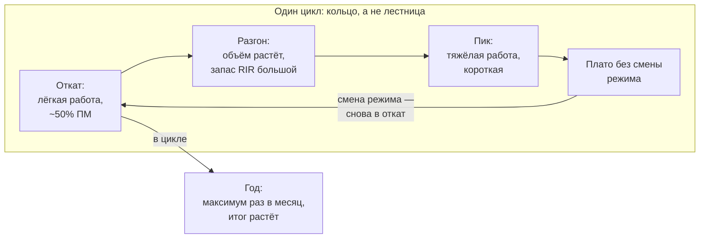
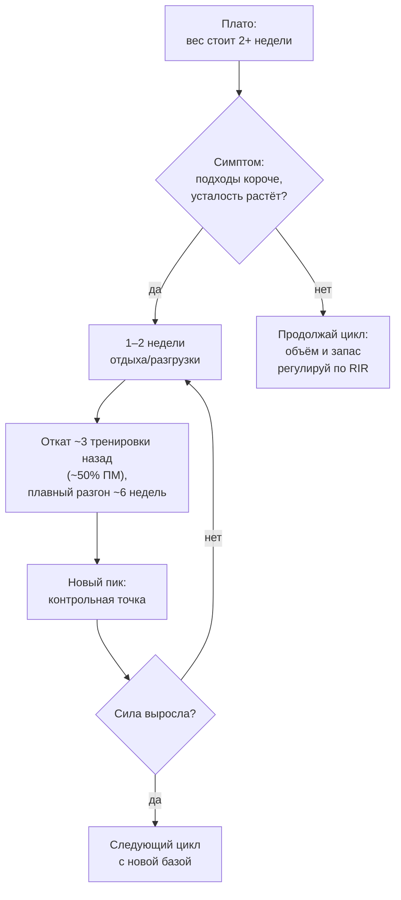

# Плато — это не потолок: почему работает периодизация

> **О чём статья:** плато — сигнал смены режима, а не предел возможностей. Наука о периодизации раскрывается только в долгосрочной перспективе: на коротких дистанциях «бомбёжка на максимум» выглядит лучше — и это иллюзия, которую данные опровергают за 24–30 недель. Голос и общая линия самоучителя — `THROUGHLINE.md`.

**TL;DR**

- Сила выходит на плато через 1–2 года отказного тренинга: ~80% всего 6-летнего прогресса человек получает за первый год (данные на 14 600 человек).
- Отдых и разгрузка не «сжигают» результат: группы с двумя паузами по 3 недели вышли на тот же итог за полгода при меньшем объёме работы.
- Механизм плато — притупление анаболического отклика при постоянной стимуляции; интервалы отдыха возвращают чувствительность к сигналу.
- Волнообразная периодизация превосходит линейную у тренированных; на пике стоит быть не более ~20% времени цикла (оценка автора).

---

## Уровень 1 — Просто: почему «каждый раз на максимум» перестаёт работать

Вот как выглядит ошибка. Ты топчешься у одного веса месяцами, потому что «откат назад = потеря времени», и с каждым месяцем платишь всё больше сил за всё меньший прирост. Между тем крупнейшее долгосрочное исследование силовой адаптации (14 600 человек, 6,8 года наблюдений) рисует жёсткую картину: у отказных тренировок ~80% прогресса выходит за первый год, а дальше — плато.

Периодизация — это ответ на плато, а её принцип виден в арифметике цикла: организм может выходить на пик примерно раз в 4–8 недель, значит, большая часть времени должна уходить на разгон к пику, а не на сам пик. Лёгкие и средние недели — это не «потерянные тренировки», а топливо, из которого через несколько недель собирается тяжёлая.

### Что запомнить

- Плато — сигнал сменить режим, а не «генетический потолок».
- На пике — не более ~20% времени цикла: пик периодичен, а не постоянен.
- Лёгкие и средние недели — часть механизма роста, а не компромисс.

**Проверка:** 2+ недели стоишь на одном весе, и подходы стали короче (80×8 → 80×6). Что это значит? _(Организм в большом стрессе и пробивает результат вниз: нужна разгрузка и откат назад по линейной схеме.)_

---

## Уровень 2 — Подробно: данные долгих исследований

### Таблица-числа

| Показатель                          | Значение                                                                          | Смысл                                                                                               | Где в данных           |
| ----------------------------------- | --------------------------------------------------------------------------------- | --------------------------------------------------------------------------------------------------- | ---------------------- |
| Крупнейшее исследование адаптации   | N=14 600, ~6,8 года, 1 тренировка/нед, подходы до отказа                          | плато силы через 1–2 года                                                                           | конспект `u2eoz_xOywc` |
| Первый год                          | ~70–80% всего 6-летнего прогресса                                                 | следующие 4 года — лишь 30–50% от первого года                                                      | конспект `u2eoz_xOywc` |
| Пример масштаба                     | 70×1 → 90 за 1–2 года → ~100–105 за 6 лет                                         | арифметика отказа                                                                                   | конспект `u2eoz_xOywc` |
| Исследование 24 недели              | 2 паузы по 3 недели — итог равен непрерывной группе                               | при меньшем объёме работы (выше КПД)                                                                | конспект `XIcaHZuDuWg` |
| На 9-й неделе                       | непрерывная группа «впереди» в ~1,5 раза                                          | короткое исследование сделало бы ложный вывод против периодизации                                   | конспект `XIcaHZuDuWg` |
| Исследование 30 недель              | 10 тренировка — 10 отдых — 10 тренировка vs 20 непрерывно                         | к 30-й неделе результаты уравнялись; сила даже чуть лучше у отдыхавших                              | конспект `XIcaHZuDuWg` |
| Поддержание массы                   | 1/3 от объёма набора                                                              | при достаточной интенсивности — без выраженной атрофии                                              | конспект `XIcaHZuDuWg` |
| Мета-анализ 2022 (5 исследований)   | периодизация > непериодической для силы; волнообразная > линейной у тренированных | для гипертрофии в уравненных дизайнах «не влияет», но сдвиг в пользу периодизации виден на графиках | конспект `XIcaHZuDuWg` |
| Пик                                 | раз в 4–8 недель, ≤20% времени цикла                                              | оценка автора                                                                                       | конспект `7oBZ0uuvpa8` |
| Сила вдали от отказа                | 80% ПМ (возможный на 8) можно делать на 4 повторения                              | этого достаточно для силового стимула                                                               | конспект `7oBZ0uuvpa8` |
| Цикл Энди Болтона (становая 457 кг) | последние 10 недель начинаются с ~50% ПМ                                          | разгон и накопление — раньше зоны 80%+                                                              | конспект `7oBZ0uuvpa8` |
| Пауэрлифтеры, 15 лет (~2000 чел)    | ~35 кг в сумме за год (~10 кг на движение)                                        | сильнейшие растут в 2 раза медленнее, но никто не стоит                                             | конспект `u2eoz_xOywc` |
| Практика автора                     | +5–10 кг в каждом движении за первый 12-недельный цикл                            | у людей, годами стоявших в плато                                                                    | оценка автора          |

### Таблица «Что утверждается → насколько подтверждено → исследования»

| Утверждение                                                             | Статус                                                      | Исследования                                        |
| ----------------------------------------------------------------------- | ----------------------------------------------------------- | --------------------------------------------------- |
| Периодизация проявляется только в долгосрочной перспективе (>12 недель) | подтверждено (в конспекте)                                  | ссылка не найдена в данных — требует ручного поиска |
| Отдых 3–10 недель не ухудшает итоговый результат за 6–7 месяцев         | подтверждено (в конспекте)                                  | ссылка не найдена в данных — требует ручного поиска |
| Мета-анализ 2022: периодизация лучше непериодической схемы для силы     | подтверждено (5 исследований)                               | ссылка не найдена в данных — требует ручного поиска |
| Волнообразная периодизация > линейной у тренированных                   | подтверждено (анализ подгрупп)                              | ссылка не найдена в данных — требует ручного поиска |
| Плато силы через 1–2 года; 80% прогресса за первый год                  | подтверждено (модель по N=14 600 в пересказе)               | ссылка не найдена в данных — требует ручного поиска |
| Поддержание массы на 1/3 объёма набора                                  | подтверждено (в конспекте)                                  | ссылка не найдена в данных — требует ручного поиска |
| Притупление отклика через десенситизацию mTOR-пути                      | мнение автора (механизм по аналогии с рецепторами гормонов) | —                                                   |
| Пик раз в 4–8 недель, ≤20% времени на пике                              | оценка автора                                               | —                                                   |
| Метод Шрёдера (постоянные повторные попытки одного веса) не работает    | мнение автора (опыт его и знакомых)                         | —                                                   |

> ⚠️ **Важно про ссылки:** ни у Yeti (в его данных ссылок нет в принципе), ни в этих разборах URL на конкретные публикации не найдены. Числа 24- и 30-недельных исследований названы словами — так и оставляем с пометкой «требует ручного поиска».

### Что запомнить

- Короткие исследования «стирают» эффект периодизации: на 9-й неделе непрерывная группа выглядит вдвое лучше, к 24-й — они равны.
- Максимум раз в месяц, остальное время — подводка: меньше износ, меньше риски перетрена и плато.
- Отказной тренинг исчерпывает себя за 1–2 года; дальше прогресс — через циклирование.

**Проверка:** увидел 12-недельное сравнение «периодизация vs линейная», разницы нет. Какой вывод из этого следует по логике статьи? _(Ничего: горизонт слишком короткий — в первые 6–12 недель все растут одинаково, вопрос решается в годах.)_

---

## Уровень 3 — Вглубь: механизм, критика, откат

### Почему постоянная стимуляция перестаёт работать

Механизм, который предлагает конспект: постоянная стимуляция синтеза белка снижает чувствительность сигнальных путей — как рецепторы гормонов при хронически высокой концентрации гормона. Это гомеостаз: система реагирует на изменение, а не на уровень. В исследованиях с паузами анаболический отклик у непрерывных групп падал после ~20-й недели, а у групп с отдыхом — сохранялся: за оставшееся время они догоняли и перегоняли.

Отсюда и практический вывод автора: максимальные веса тянуть не каждую неделю, а раз в месяц; остальное время — подводка. «Человек, который делает 100% работы, чтобы получить 1% изменений, против человека, который делает 50% работы ради того же 1%» — разница в КПД огромна и складывается в годы.

### Периодизация — пакет, а не одна переменная

Самая острая часть разбора — критика методологии: RCT сравнивает по одной переменной, а периодизация — это пакет вмешательств (вариация интенсивности, редкие тяжёлые заходы, работа вдали от отказа, разные объёмы по неделям). Каждый элемент имеет свой размер эффекта, но суммарный эффект пакета в исследованиях не измеряется — поэтому «периодизация не влияет на гипертрофию в уравненных дизайнах» вовсе не значит «периодизация бесполезна»: сдвиг в пользу периодизации виден на лесных графиках даже там, где авторы обзора его не констатируют.

И практический протокол пробития плато из конспекта: 1–2 недели отдыха/разгрузки, затем откат на ~3 тренировки назад по линейной схеме (со ~50% ПМ) и плавный выход на новый пик за ~6 недель. Главный барьер здесь психологический — «страх упущенной выгоды»: кажется, что откат — потеря времени, поэтому люди топчутся у одного веса месяцами.

### Чего данные не говорят

- Долгосрочных исследований (>6 мес) с поддерживающей работой вместо полного отдыха нет — идея «одной системе отдыхаем, другой поддерживаем» остаётся гипотезой автора.
- Тезис «отказные схемы созданы для оздоровительных целей» — риторическое усиление автора; конспект сам помечает его как сильную интерпретацию.
- Цифры исследования N=14 600 взяты из пересказа автора — конспект сам требует проверки первоисточника.
- Для гипертрофии в уравненных дизайн-исследованиях влияние периодизации формально «не влияет» — сдвиг виден только в авторском разборе графиков.

### Список исследований

По теме «периодизация и плато» в реестре `study-links.jsonl` валидных URL не найдено. Тезисы статьи (исследование 24 и 30 недель, мета-анализ 2022 с 5 исследованиями, модель N=14 600, 15-летнее исследование пауэрлифтеров) перечислены в `no-link-claims.md` с пометкой «ссылка не найдена в данных — требует ручного поиска».

### Что запомнить

- Плато — это накопленная усталость и притупившийся отклик; чинится отдыхом и откатом, а не «взял себя в руки».
- Сила накапливается вдали от отказа: 80% ПМ на 4 повторения — уже силовой стимул.
- Судить о периодизации можно только по контрольным точкам в 6–12 месяцев, а не по соседней неделе.

---

## Куда это ведёт

Ты сейчас понял главный механизм всей книги: **периодизация — плавная волна, а не два фиксированных дня**. Пик редок, разгон — основное содержание цикла, откат — инструмент, а не поражение. Именно поэтому в арифметике года пять обычных циклов дают +40 кг рабочего веса без единого подвига.

Дальше по маршруту — **«Сколько раз в неделю тренировать мышцу — и как делить упражнения»** (`H-chastota-split-fullbody.md`): периодизация задаёт _волну_ нагрузки, а частота и сплит — _раскладку_ этой волны по неделям и тренировкам. Без правильной раскладки даже хорошая волна расходуется в усталости, а не в приростах.
