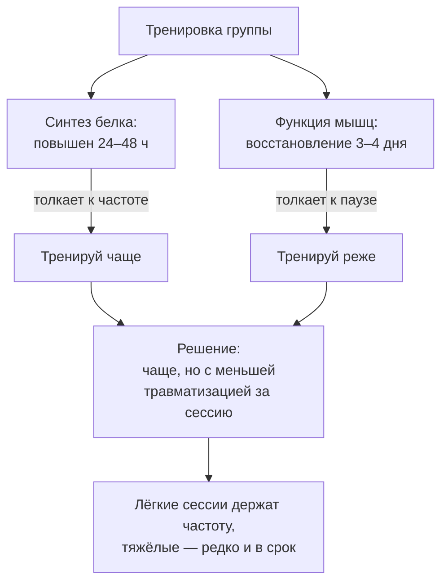
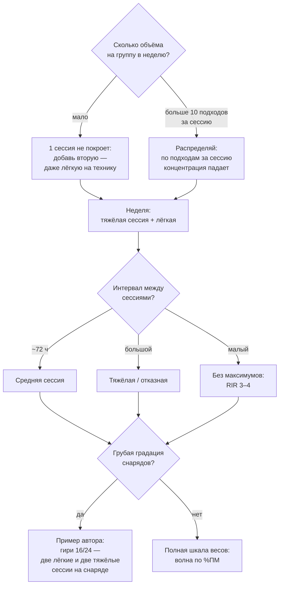

# Сколько раз в неделю тренировать мышцу — и как делить упражнения

> **О чём статья:** частота тренировок группы в неделю: что решает объём, а что частота; сплит против фуллбоди; конфликт «синтез белка живёт 24–48 часов, а восстановление занимает 3–4 дня» и как его решают лёгкие и тяжёлые тренировки. Голос и общая линия самоучителя — `THROUGHLINE.md`.

**TL;DR**

- Первичен объём: при уравненном недельном объёме частота сама по себе даёт мизерный эффект для гипертрофии.
- Для силы и двигательного навыка частота важнее: в исследовании на 22 взрослых прирост силы был в 2 раза больше у группы с высокой частотой.
- Синтез мышечного белка повышен 24–48 часов после тренировки, а полное восстановление занимает 3–4 дня — конфликт, который решается распределением лёгких и тяжёлых сессий.
- Главный разрыв — «1 vs 2+»: одна тренировка группы в неделю хуже, чем две-три; выше 4 раз в неделю дополнительной пользы нет.

---

## Уровень 1 — Просто: конфликт двух часов

Вот картина, которую нужно сложить в голове. После тренировки синтез мышечного белка повышен 24–48 часов — первые 24 часа дают основную часть, потом остаточные проценты, а после 72 часов эффект мизерный. Казалось бы: тренируй каждую группу раз в 2 суток.

Но есть вторая цифра: полное восстановление нервно-мышечной функции занимает 3–4 дня. После 3 подходов в отказ сверхкомпенсация наступает к 72 часам, после 7 подходов в отказ — только к 96 часам. Синтезу нужно «часто», мышцам — «редко». Этот конфликт и есть вся тема частоты: решается он не выбором «сплит или фуллбоди навсегда», а распределением лёгких и тяжёлых тренировок между днями.



```chart
{"kind":"bar","title":"Два таймера восстановления","aria":"Столбчатый график времени восстановления функции мышцы: при запасе RIR 3–4 — 24–48 часов, при RIR около 2 — около 48 часов, после 3 подходов в отказ — к 72 часам, после 7 подходов в отказ — к 96 часам.","bars":[{"label":"RIR 3–4","value":36,"valueText":"24–48 ч"},{"label":"RIR ~2","value":48,"valueText":"~48 ч"},{"label":"3 отказа","value":72,"valueText":"72 ч"},{"label":"7 отказа","value":96,"valueText":"96 ч"}],"yLabel":"восстановление функции, ч"}
```

### Что запомнить

- Синтез белка живёт 24–48 часов; восстановление функции — 3–4 дня. Это два разных «таймера».
- Частота — инструмент компоновки объёма, а не самостоятельный стимул гипертрофии.
- Конфликт «часто vs редко» решается лёгкими и тяжёлыми сессиями, а не выбором лагеря.

**Проверка:** ты сделал тяжёлую отказную тренировку ног из 7 подходов в понедельник. Когда по таймеру восстановления разумнее следующий тяжёлый день для ног? _(Не раньше ~96 часов: после 7 подходов в отказ сверхкомпенсация только к этому сроку.)_

---

## Уровень 2 — Подробно: что говорят мета-анализы и исследования

### Таблица-числа

| Показатель                              | Значение                                                    | Смысл                                                        | Где в данных           |
| --------------------------------------- | ----------------------------------------------------------- | ------------------------------------------------------------ | ---------------------- |
| Синтез миофибриллярного белка           | повышен 24–48 ч; после 72 ч — мизерный                      | первые 24 ч — основная часть, 24–48 ч — остаточные ~13–20%   | конспект `AlvQ2bkdA6I` |
| Восстановление болезненности            | 3–4 дня (некоторые протоколы — до 96 ч)                     | в том числе у тренированных                                  | конспект `AlvQ2bkdA6I` |
| Сверхкомпенсация функции                | 3 подхода в отказ → к 72 ч; 7 подходов → к 96 ч             | объём отказа двигает таймер                                  | конспект `AlvQ2bkdA6I` |
| RIR и восстановление (сводка автора)    | RIR 3–4 → 24–48 ч; RIR ~2 → 48 ч; отказ → 72 ч              | запас повторений определяет скорость                         | конспект `AlvQ2bkdA6I` |
| Базовые vs изоляция                     | становая: восстановилась лишь половина за 24 ч, 60% за 48 ч | разгибания на блоке — большинство за 2 суток                 | конспект `AlvQ2bkdA6I` |
| Мета-анализ Шонфилда (2016/2017)        | 1 р/нед хуже, чем 2–3; 2 vs 3 и 3 vs 4–5 — без разницы      | главный разрыв «1 vs 2+»                                     | конспект `AlvQ2bkdA6I` |
| Объём за сессию                         | >10 подходов на группу — концентрация рассеивается          | большой объём выгоднее распределять на сессии                | конспект `AlvQ2bkdA6I` |
| Пре-принт 2024                          | небольшой эффект частоты для силы, независимый от объёма    | через частую отработку техники; >4 р/нед — доп. пользы нет   | конспект `AlvQ2bkdA6I` |
| Исследование (22 взрослых, стаж >6 мес) | частая группа: прирост силы в 2 раза больше                 | +18% к объёму качественной работы; гипертрофия — без разницы | конспект `aWAShk6gr5o` |
| Потеря КПД сплита                       | ~20% качества объёма                                        | оценка автора (экстраполяция)                                | конспект `aWAShk6gr5o` |
| Рабочая зона запаса                     | RIR 1–4                                                     | рост и минимальное накопление усталости                      | конспект `AlvQ2bkdA6I` |

Прочитай строку про RIR ещё раз — она связывает эту статью со всей книгой. Частота «дорогая» не сама по себе: дорогие отказные сессии редко помещаются в недельный график, а лёгкие с запасом RIR 3–4 можно ставить почти каждый день. Именно так «частота» и «бюджет ЦНС» соединяются в одну раскладку недели.

### Таблица «Что утверждается → насколько подтверждено → исследования»

| Утверждение                                                          | Статус                                                                  | Исследования                                        |
| -------------------------------------------------------------------- | ----------------------------------------------------------------------- | --------------------------------------------------- |
| Синтез белка повышен 24–48 ч после тренировки                        | подтверждено (в конспекте)                                              | ссылка не найдена в данных — требует ручного поиска |
| При уравненном объёме частота не влияет на гипертрофию               | подтверждено (большинство исследований в пересказе)                     | ссылка не найдена в данных — требует ручного поиска |
| 1 тренировка группы в неделю хуже, чем 2–3                           | подтверждено (мета-анализ Шонфилда в пересказе)                         | ссылка не найдена в данных — требует ручного поиска |
| Частота даёт небольшой независимый эффект для силы через технику     | подтверждено (пре-принт 2024 в пересказе)                               | ссылка не найдена в данных — требует ручного поиска |
| Прирост силы ×2 у частой группы при том же объёме                    | подтверждено (исследование на 22 взрослых)                              | ссылка не найдена в данных — требует ручного поиска |
| Потеря ~20% качества объёма в сплите                                 | мнение автора (экстраполяция)                                           | —                                                   |
| Частые тренировки «поднимают синтез белка» у натурала между сессиями | мнение автора (признаёт: данные не показывают пользы при равном объёме) | ссылка не найдена в данных — требует ручного поиска |
| RIR 1–4 — рабочая зона подходов                                      | мнение автора                                                           | —                                                   |

> ⚠️ **Важно про ссылки:** конспекты Yeti называют работы словами («мета-анализ Шонфилда», «пре-принт 2024», «сетевой мета-анализ режимов»), но URL в данных отсутствуют. Тезисы без ссылок — в `no-link-claims.md`.

### Что запомнить

- Тренируй каждое движение минимум 2 раза в неделю; второй раз — лёгкие веса на технику, и это уже заметно улучшит навык и 1ПМ.
- Базовые движения восстанавливаются дольше изоляции: «долбить» в отказ можно разгибания, а не становую.
- Тестировать частоту нужно на себе: кому-то подходит высокая частота, кому-то сплит.

**Проверка:** в сплите ты бьёшь грудь раз в неделю тремя упражнениями подряд. Что по данным происходит с каждым следующим упражнением? _(Каждый последующий подход в утомлении даёт меньший вклад — теряется порядка 20% качества объёма, оценка автора.)_

---

## Уровень 3 — Вглубь: свежие подходы, навык и выбор сплита

### КПД свежего подхода

Механизм, который объясняет преимущество частоты для силы, простой до примитива: свежий подход качественнее уставшего. В сплите ты делаешь три упражнения на одну группу друг за другом — и каждое следующее даёт меньший вклад. В фуллбоди ты каждый раз подходишь к штанге свежим. Автор оценивает эту потерю примерно в 20% качества объёма — и честно помечает: это его экстраполяция, а не измерение.

Вторая причина — двигательный навык. При частых тренировках нейронная адаптация к движению развивается быстрее; в сплите между тренировками группы проходит 1–2 недели, и навык деградирует. А навык — это будущий 1ПМ: ты можешь поднять больше только то, что умеешь поднимать технично.

Почему автор всё же строит программу вокруг силы, а не вокруг гипертрофии напрямую: силовой прогресс предсказуем и измерим — ты либо растёшь в весах, либо стоишь. Гипертрофия идёт «побочным эффектом» силовых циклов. Для натурала частые тренировки — способ периодически поднимать синтез белка, избегая долгих фаз низкого синтеза; сам конспект признаёт, что при равном объёме исследований этой пользы не видно, и честно оставляет это гипотезой.

### Как собрать это в раскладку недели

Если в зале есть полный набор снарядов, раскладка проста: тяжёлая и лёгкая сессия одного движения в неделю. А если градация снарядов грубая — например, в зале только гири 16 и 24 кг (пример автора: 16 уже легко, 10–12 повторений; 24 — почти отказ)? Тогда плавная волна строится на чередовании: две лёгкие сессии на 16 кг (максимальная скорость, минимальная потеря техники, 6–8 повторений вместо возможных 10–12) и две тяжёлые на 24 кг. Грубая градация снаряда — не приговор частоте: она сама задаёт волну.

И помни про таймеры восстановления: между понедельником и четвергом (~72 часа) планируй среднюю сессию, после большого интервала — тяжёлую, а там, где интервал мал, максимальных тренировок не ставить. Это же правило закрывает вопрос «базовые или изоляция»: становой нужен длинный интервал, разгибаниям хватит и двух суток.



### Чего данные не говорят

- Длинных исследований частоты (>6 мес) автор не нашёл — возможно, разница проявится на больших сроках; это его спекуляция, так и помечено.
- Польза частоты для гипертрофии натурала через «подпиливание синтеза белка» — авторская гипотеза: исследования при равном объёме её не подтверждают.
- Цифра ~20% потери качества объёма — экстраполяция автора, не измерение.
- Сводка «RIR → время восстановления» (24/48/72 ч) — авторская обобщение; конкретного исследования в конспекте не названо.

### Список исследований

По теме «частота тренировок, сплит/фуллбоди» в реестре `study-links.jsonl` валидных URL не найдено — у конспектов Yeti ссылок на исследования нет в принципе. Тезисы (мета-анализ Шонфилда 2016/2017, сетевой мета-анализ режимов, исследование на 22 взрослых, пре-принт 2024) перечислены в `no-link-claims.md` с пометкой «ссылка не найдена в данных — требует ручного поиска».

### Что запомнить

- Частота для силы — это частая практика движения; для гипертрофии решает недельный объём.
- Лёгкие сессии — не «пустые»: они держат навык и частоту, не сжигая бюджет восстановления.
- Химику хватает редкого мощного стимула (синтез белка повышен всю неделю); натуралу частота с запасом — логичный выбор, но данные это строго не доказали.

---

## Куда это ведёт

Ты сейчас раскладываешь волну нагрузки по неделе: где тяжёлая сессия, где лёгкая, где средняя, и почему между ними именно такие интервалы. Это деталь большой опоры — **бюджет ЦНС и плавная волна периодизации**: раскладка существует, чтобы бюджет никогда не уходил в минус и ты не выгорал.

Дальше по маршруту — **«RPE и авторегуляция: план, который слышит твоё состояние»** (`I-rpe-avtoregulyaciya.md`). Раскладка недели — это план; но план выполняет живой человек с недосыпом, стрессом и удачными днями. RPE — тот инструмент, который соединяет раскладку с твоим фактическим состоянием: когда снизить, а когда, наоборот, реализовать пиковую кондицию.
