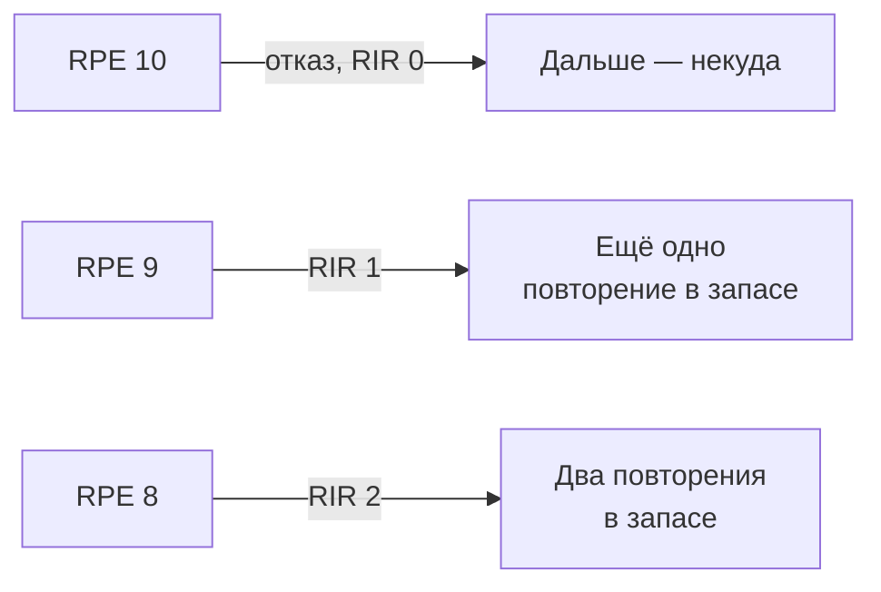
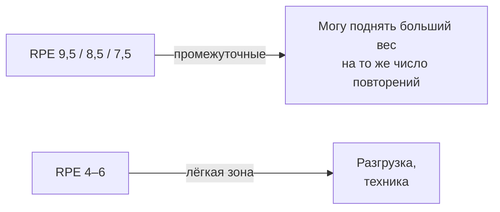
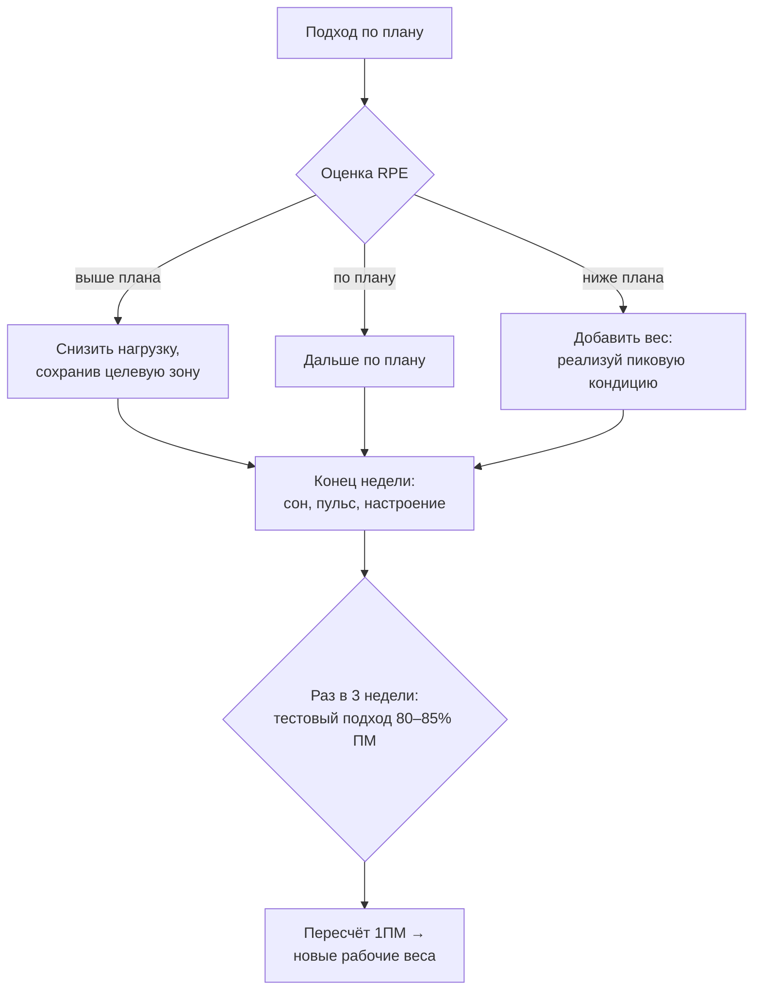

# RPE и авторегуляция: план, который слышит твоё состояние

> **О чём статья:** RPE — главный доступный каждому инструмент планирования и авторегуляции: он превращает «сегодня тяжело/легко» из ощущения в число, по которому правятся веса и дни цикла. Голос и общая линия самоучителя — `THROUGHLINE.md`.

**TL;DR**

- RPE — перевёрнутый RIR с уточнением: RPE 10 = отказ (RIR 0), 9 = RIR 1, 8 = RIR 2; промежуточные значения (9,5; 8,5; 7,5) фиксируют «могу поднять больший вес на то же число повторений».
- Предписания по RPE работают лучше предписаний по %ПМ: %ПМ задаёт только вес, а RPE ещё и фактическую близость к отказу.
- Исследование из конспекта: зоны RPE 4–6 и 7–9 (без отказов) дали лучшие приросты силы, чем отказные протоколы; лёгкая зона сопоставилась с тяжёлой.
- Авторегуляция нужна с опытом: новичку подходит фиксированный план, тренированному — нет, темп прогресса индивидуален.

---

## Уровень 1 — Просто: одна шкала вместо угадывания

Ты уже знаешь RIR — запас повторений до отказа. RPE — та же шкала, перевёрнутая: RIR 0 — это RPE 10, RIR 1 — это RPE 9, RIR 2 — это RPE 8. Зачем вторая шкала, если есть первая? Потому что RPE умеет то, чего RIR не умеет: он различает не только «сколько повторений в запасе», но и «какой вес при этом».

Пример: ты выжал 120×4 и остановился. Если бы мог поднять 125×4 — это одно значение; если бы и 120×4 давалось с трудом — совсем другое. Промежуточные значения шкалы (9,5; 8,5; 7,5) именно это и фиксируют. Сначала — человеческими словами: «насколько тяжело было», потом — термин: RPE, шкала воспринимаемой нагрузки, унаследованная из кардиологии.

### Что запомнить

- RPE 10 = RIR 0, RPE 9 = RIR 1, RPE 8 = RIR 2: одна арифметика, два взгляда.
- Промежуточные RPE различают «тяжёлый вес» и «тяжёлый день» — RIR этого не видит.
- Шкала пришла из кардиологии: Борга 6–20, сокращённая до 0–10.

**Проверка:** подход, после которого ты мог бы поднять больший вес на то же число повторений, но не на большее их количество. Какой это RPE? _(Промежуточное значение, например RPE 9,5.)_

---

## Уровень 2 — Подробно: почему RPE лучше %ПМ

### Таблица-числа

| Показатель             | Значение                                                                | Смысл                                                                              | Где в данных                          |
| ---------------------- | ----------------------------------------------------------------------- | ---------------------------------------------------------------------------------- | ------------------------------------- |
| История шкалы          | Борга 6–20 → 0–10                                                       | коррелировала с ЧСС                                                                | конспект `C2AMozKpHxI`                |
| Соответствие           | RPE 10 = RIR 0; 9 = 1; 8 = 2                                            | «RPE ≈ перевёрнутый RIR»                                                           | конспект `C2AMozKpHxI`                |
| Исследование зон       | RPE 4–6 и RPE 7–9 (без отказов) — лучшие приросты силы                  | отказная группа (9–10) проиграла; лёгкая зона дала прирост, сопоставимый с тяжёлой | конспект `C2AMozKpHxI`                |
| Систематический обзор  | субъективная оценка состояния точнее объективных маркеров (лактат, ЧСС) | ЦНС может быть утомлена стрессом/недосыпом при «нормальных» анализах               | конспект `C2AMozKpHxI`                |
| Систематические обзоры | 2021 и 2025: авторегуляция > фиксированной нагрузки                     | преимущество по силе                                                               | конспект `jVKAV1QWL9E`                |
| Ранжирование методов   | ARPEP > RPE-оценка > YBT (1ПМ-тесты)                                    | ARPEP точен, но накапливает нервное напряжение                                     | конспект `jVKAV1QWL9E`                |
| Пересчёт весов         | каждые 3 недели по тестовому подходу                                    | вместо тестовой недели раз в 4 недели                                              | конспект `jVKAV1QWL9E`, `2IW5fq8CnAs` |
| Тестовый подход        | 80–85% ПМ, ~6–8 повторений, до отказа                                   | перед ним можно сделать сингл +5–10 кг                                             | конспект `2IW5fq8CnAs`                |
| Пример автора          | «120×4 стало ощущаться как RPE выше плана»                              | фактический дневной максимум ниже → снизить нагрузку, сохранив целевую зону        | конспект `C2AMozKpHxI`                |

### Таблица «Что утверждается → насколько подтверждено → исследования»

| Утверждение                                                                          | Статус                                                               | Исследования                                        |
| ------------------------------------------------------------------------------------ | -------------------------------------------------------------------- | --------------------------------------------------- |
| RPE-предписания эффективнее предписаний только по %ПМ                                | подтверждено (в конспекте)                                           | ссылка не найдена в данных — требует ручного поиска |
| Зоны RPE 4–6 и 7–9 без отказов лучше для силы, чем отказные протоколы                | подтверждено (в конспекте)                                           | ссылка не найдена в данных — требует ручного поиска |
| Субъективная оценка состояния точнее лактата/ЧСС в предсказании состояния спортсмена | подтверждено (систематический обзор в пересказе)                     | ссылка не найдена в данных — требует ручного поиска |
| Авторегуляция лучше фиксированной нагрузки (обзоры 2021, 2025)                       | подтверждено (в конспекте); эффект заметнее в коротких исследованиях | ссылка не найдена в данных — требует ручного поиска |
| ARPEP — лучший метод из сравненных                                                   | подтверждено (в конспекте), с оговоркой о нервном напряжении         | ссылка не найдена в данных — требует ручного поиска |
| RPE заменяет постоянные проходки как инструмент контроля                             | мнение автора                                                        | —                                                   |
| RIR-окно 1–4 в связке с RPE — рабочая зона                                           | мнение автора                                                        | —                                                   |

> ⚠️ **Важно про ссылки:** ни один URL по теме RPE/авторегуляции в данных не найден; исследования названы словами («систематический обзор», «систематические обзоры 2021 и 2025»).

### Что запомнить

- %ПМ — это план веса; RPE — план усилия. Второе надёжнее, потому что учитывает день.
- Постоянные проходки неприменимы: после 3 подряд — падение силовых и накопленная усталость. RPE заменяет их.
- По RPE можно оценивать прогресс без тестов: если на средней тренировке RPE не растёт от подхода к подходу — рабочие веса можно добавить.

**Проверка:** по плану 120×5 с RPE 8, а 120×5 вышло с RPE 9,5. Что это значит и что делать? _(Фактический дневной максимум ниже плана: снизить нагрузку, сохранив целевую зону, — не выдавливать план силой воли.)_

---

## Уровень 3 — Вглубь: две задачи RPE и три метода авторегуляции

### Две задачи одной шкалы

Первая задача — сопоставление: связать интенсивность и диапазон повторений с целевой зоной нагрузки — лёгкой, средней, тяжёлой — при построении циклов. Вторая — авторегуляция: соединить план с текущим состоянием. Если 120×4 ощущается как RPE выше плана — фактический дневной максимум ниже, снижай нагрузку, сохранив зону. Если RPE ниже плана — организм в пиковых кондициях, и этот запас надо реализовывать: новый стимул в условиях оптимального восстановления — редкая возможность. Формула автора: «не пропускать моменты пиковых кондиций и не игнорировать сигналы недовосстановления».

### Три метода и у каждого цена

Ранжирование из конспекта о саморегуляции для опытных: (1) ARPEP — вес следующего подхода определяется числом повторений в предыдущем; точный метод, но накапливает нервное напряжение, потому что тянет подходы к отказу; (2) RPE-оценка — можно остановиться за 1–3 повторения до отказа, меньше нервного напряжения, но требует навыка оценки; (3) YBT — периодические 1ПМ-тесты. Инструмент автора — прогнозируемый дневной максимум: пересчёт рабочих весов от RPE-оценки каждого подхода на каждой тренировке.

Новичку авторегуляция не нужна: у него прогресс почти на каждой тренировке, и фиксированный план работает. С опытом всё меняется: 5 кг кто-то осваивает за 4 недели, кто-то за 12 — жёсткий план одному недодаёт стимула, другого загоняет в перетрен. Исследования противоречивы, и финальный совет конспекта честный: ориентироваться на то, какой метод точнее работает лично у тебя.

### Чего данные не говорят

- Исследование зон RPE 4–6 / 7–9 названо без URL — привязки к публикации в данных нет.
- Преимущество авторегуляции выражено сильнее в коротких исследованиях; в длинных сохраняется, но слабее.
- У каждого метода свои ограничения, исследования противоречивы — универсального «лучшего метода» данные не называют.
- Связка RPE↔повторения↔%ПМ зависит от упражнения и стажа; таблицы в конспекте нет — только принцип.

### Список исследований

По теме «RPE, авторегуляция» в реестре `study-links.jsonl` валидных URL не найдено. Тезисы статьи перечислены в `no-link-claims.md` с пометкой «ссылка не найдена в данных — требует ручного поиска».

### Что запомнить

- RPE — это мост между планом и реальностью: он показывает и «где ты», и «куда план больше не годится».
- ARPEP точнее, но дороже для нервной системы; RPE-оценка дешевле и требует лишь навыка.
- Авторегуляция — инструмент для опытных: сначала база, потом тонкая настройка.

---

## Куда это ведёт

Ты сейчас владеешь последним регулятором отдельной тренировки: объём задаёт дозу, RIR/VL — запас, RPE — связь с состоянием дня. Всё это детали опоры **«схема снимает догадки»**: тебе не нужно быть одарённым или тратить когнитивные усилия на угадывание — расчёт уже сделан, а RPE лишь подстраивает готовый план под живой день.

Дальше по маршруту — **«Быстрые и медленные волокна: где твоя генетика, а где ты»** (`J-volokna-genetika.md`). Регуляторы разобраны — теперь честный разговор о том, от чего они зависят сами: какие волокна растут от какого режима, что решает генетика и почему «неодарённость» — не приговор, а раскладка сроков.
