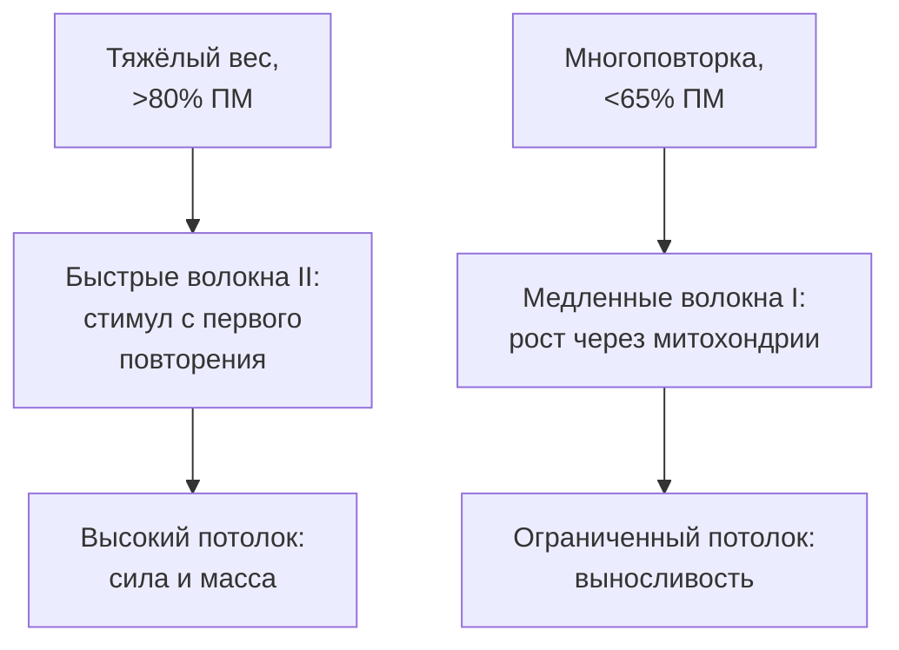
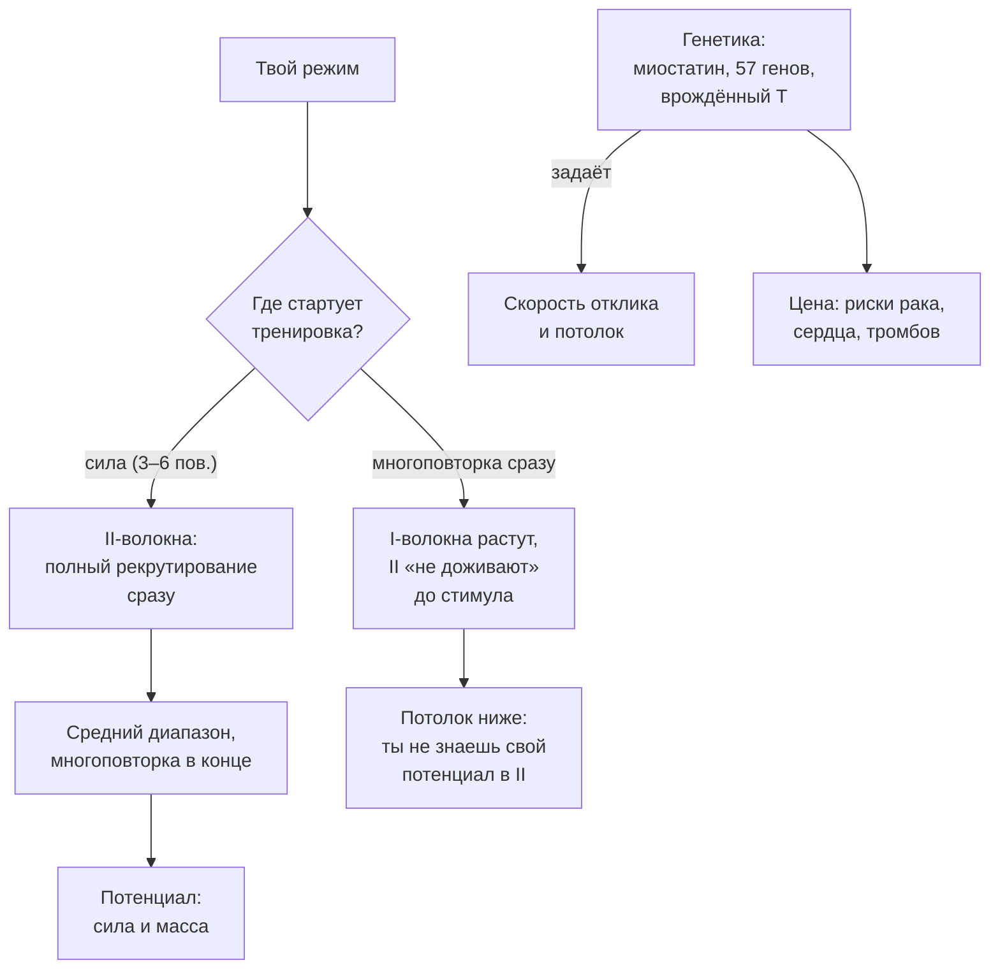

# Быстрые и медленные волокна: где твоя генетика, а где ты

> **О чём статья:** какие мышечные волокна растут от какого режима интенсивности, что определяет потолок роста и сколько в этом генетики — по данным конспектов, честно: в этой теме данных в корпусе мало, и часть цифр — пересказы исследований без ссылок. Голос и общая линия самоучителя — `THROUGHLINE.md`.

**TL;DR**

- Высокая интенсивность (>80% ПМ) преимущественно гипертрофирует быстрые волокна — они определяют силу и наибольший потолок роста; многоповторка растит в основном окислительные волокна I с ограниченным потолком.
- Потолок роста быстрых волокон ~на 50% выше, чем медленных (тезис конспекта, требующий проверки первоисточника).
- Генетика отвечает за анаболический отклик: главный ограничитель — миостатин; 57 генетических предикторов сухой массы названы исследованием 2024 (в пересказе).
- Цена «генетики мутанта» — повышенные риски (рак, гипертрофия сердца, тромбообразование): генетика мышц не равна здоровью.

---

## Уровень 1 — Просто: два типа волокон, две судьбы

Представь два типа бойцов в твоей мышце. Медленные волокна (I) — выносливые марафонцы: они первыми включаются в любую работу, но растут неохотно, а их «рост» — это чаще митохондрии, а не миофибриллы. Быстрые волокна (II) — штангисты: они включаются под нагрузку, но именно они определяют силу и наибольший потолок роста мышц.

Теперь главный практический факт из конспектов: даже при работе до отказа важен вес. Многоповторка «включает» быстрые волокна по мере утомления подхода — а при тяжёлом весе они получают стимул с первого повторения. Отсюда схема, которую ты уже видел в статье про объём: силовой режим в начале тренировки, средний — дальше, многоповторка — в конце, чтобы не утомить быстрые волокна заранее.

### Что запомнить

- Быстрые волокна определяют силу и потолок массы; медленные адаптируются выносливостно.
- Тяжёлый вес даёт стимул быстрым волокнам сразу, многоповторка — к концу подхода.
- Порядок в тренировке: сила → средний диапазон → многоповторка в конце.

**Проверка:** почему при «сопоставимой гипертрофии» в исследованиях 80% и 30% ПМ разница всё же есть? _(Прирост на низкой интенсивности собирается из волокон I с ограниченным потолком; суммарный эффект — почти ничья, а для силы и II-волокон перевес у высокой интенсивности.)_

---

## Уровень 2 — Подробно: числа исследований и гены

### Таблица-числа

| Показатель | Значение | Смысл | Где в данных |
| --- | --- | --- | --- |
| Исследование 2002 (27 нетренированных) | 3–5 / 9–11 / 20–28 ПМ | волокна I — сопоставимо (~+10–13 ES); IIa: +23 в силовой группе, у многоповторки вдвое меньше | конспект `m5Ets2w9Sfw` |
| Исследование 2010 | 4–10 ПМ vs 30–60% ПМ | I: +15 против −5; IIa: +18 против +15; IIx: +41 против +19 | конспект `m5Ets2w9Sfw` |
| Исследование 2011 | 80% vs 30% ПМ | выиграла низкая за счёт волокон I (+23 против +12), II почти без прибавки — суммарно почти ничья | конспект `m5Ets2w9Sfw` |
| Исследование 2016 | 75–90% vs 25–50% ПМ | +13/+18 против +11/+14 — перевес высокой интенсивности | конспект `m5Ets2w9Sfw` |
| Исследование 2012 (женщины) | медленный темп при той же интенсивности | ES +26 → +6; IIx: +37 → +19; замедленные повторения губительны | конспект `m5Ets2w9Sfw` |
| Пороги интенсивности | от ~60% ПМ — для гипертрофии; >80% ПМ — прицельно на высокопороговые ДЕ | для силы | конспект `m5Ets2w9Sfw` |
| Потолок волокон | способность к росту II ~на 50% выше, чем I | тезис конспекта, требует проверки первоисточника | конспект `m5Ets2w9Sfw` |
| Пауэрлифтеры vs бодибилдеры | соотношение II/I на ~20% выше; диаметр II-волокон вдвое больше | сдвиг от режима | конспект `m5Ets2w9Sfw` |
| Миостатин | нокаут → двойная масса с рождения | «мутанты»: бельгийские коровы, редкие дети — 4 случая на 100 млн | конспект `zTbK62fLa5w` |
| Одна «поломанная» копия миостатина | сильный отклик на нагрузки | пример: Эдди Холл, становая 500 кг, руки 60 см | конспект `zTbK62fLa5w` |
| Предикторы генетики | 57 генов, связанных с сухой массой и поперечником быстрых волокон (2024, биобанк) | по медленным — 100+, но большие люди — за счёт быстрых | конспект `zTbK62fLa5w` |
| Спорт и гены | российское исследование: 16 генов; японское: 12, из них 10 совпали | тяжёлая атлетика, пауэрлифтинг, спринт | конспект `zTbK62fLa5w` |
| Тестостерон и гены | 5 из 10 генов элитных атлетов — более высокий врождённый Т | наследуемость тестостерона >50% | конспект `zTbK62fLa5w` |

### Таблица «Что утверждается → насколько подтверждено → исследования»

| Утверждение | Статус | Исследования |
| --- | --- | --- |
| Высокая интенсивность растит II-волокна с перевесом (2010, 2016) | подтверждено (в конспекте) | ссылка не найдена в данных — требует ручного поиска |
| «Гипертрофия сопоставима» при низкой интенсивности — за счёт волокон I | подтверждено (исследование 2011 в пересказе) | ссылка не найдена в данных — требует ручного поиска |
| Замедленный темп обрушивает эффект даже при той же интенсивности | подтверждено (исследование 2012 в пересказе) | ссылка не найдена в данных — требует ручного поиска |
| Потолок роста II-волокон ~на 50% выше | мнение автора (ссылается на обзор; конспект помечает «проверить первоисточник») | ссылка не найдена в данных — требует ручного поиска |
| Миостатин — главный ограничитель роста; нокаут даёт двойную массу | подтверждено (клинические описания в пересказе) | ссылка не найдена в данных — требует ручного поиска |
| 57 генетических предикторов сухой массы и быстрых волокон | подтверждено (исследование 2024 в пересказе; конспект требует проверки первоисточника) | ссылка не найдена в данных — требует ручного поиска |
| Генетика «мутанта» несёт повышенные риски (рак, гипертрофия сердца, тромбообразование) | мнение автора (обобщение данных) | — |
| mTOR vs AMPK: длительная многоповторка активирует AMPK, который может глушить mTOR-путь | мнение автора (механизм) | — |

> ⚠️ **Важно про ссылки:** конспекты называют исследования только годами («исследование 2002», «исследование 2024») — URL в данных отсутствуют. Числа ES взяты из пересказа автора в конспекте, не из первоисточников.

### Что запомнить

- «Гипертрофия есть от всего» — не вся правда: от какой интенсивности и каких волокон — вот в чём вопрос.
- Генетика задаёт отклик (миостатин, 57 предикторов), но не отменяет работу: «один опухает от железа, другой всю жизнь остаётся на месте».
- Генетика мышц не равна здоровью: те же маркеры несут повышенные риски.

**Проверка:** тебе кажется, что «в многоповторке я тоже расту, значит интенсивность неважна». Что поправит эта статья? _(Рост на низкой интенсивности — это в основном волокна I; потенциал II-волокон ты просто не трогаешь — и не узнаешь его.)_

---

## Уровень 3 — Вглубь: рекрутирование, mTOR и честная мораль

### Рекрутирование по Хеннеману

Механизм из конспекта: двигательные единицы рекрутируются от слабых к сильным. В многоповторке быстрые волокна «не доживают» до стимула — они включаются к концу подхода, когда усталость уже съела качество повторений. В силовой работе стимул II-волокнам приходит сразу — вместе с полным рекрутированием. Отсюда и разница профилей атлетов: у бодибилдеров на объёмном режиме сдвиг в сторону окислительных волокон, у пауэрлифтеров соотношение II/I выше на ~20%, а диаметр быстрых волокон вдвое больше.

Дальше — биохимия сигналов. При объёме больше 10 повторений в подходе, длительно (6+ недель), повышается AMPK, который может глушить предпочтительный гипертрофический процесс через mTOR-путь; силовой тренинг с ним связан противоположно — фосфорилирование рибосомальной киназы коррелировало с приростами безжировой массы и 1ПМ приседа после 14 недель. И практический алгоритм максимальной массы из конспекта: сначала силовой потенциал (II-волокна — «90% пути»), затем период многоповторки для волокон I. Выстраивать весь процесс вокруг многоповторки бессмысленно — отклик падает.

### Генетика: «рандом», который не пересдается

Вторая половина статьи — про то, что ты не выбираешь. Миостатин — главный естественный ограничитель роста мышц; его нокаут даёт двойную массу с рождения, а поломка одной копии — обычного по виду человека с сильным откликом на нагрузки. Список из 57 генетических предикторов включает знакомые по всей книге имена: IGF-1, IGFBP-3 (связывает IGF-1 — «аналог ГСПГ» для фактора роста), рецептор пролактина, рибосомальная S6-киназа и сам mTOR.

Мораль конспекта — не мотивация, а арифметика. Во-первых, цена: генетика «мутанта» несёт повышенные риски — рост раковых опухолей, гипертрофия сердца, тромбообразование. Для долголетия предрасположенность к силовому спорту почти ничего не даёт, кроме защиты от саркопении. Во-вторых, раскладка сроков: после 50–60 лет преимущество переходит к «выносливым» генотипам. «Не расстраивайся из-за неодарённости» — это не утешение, а перенос горизонта.

### Чего данные не говорят

- Тема покрыта данными слабо: конспекты называют исследования только годами, без URL — ни один тезис этой статьи не привязан к конкретной публикации.
- Цифра «потолок II-волокон на 50% выше» — тезис конспекта, сам конспект требует проверки первоисточника.
- Числа ES из исследований 2002–2016 взяты из пересказа автора; первоисточники в корпусе не названы.
- Про саркоплазматическую гипертрофию, «снятие потолка» волокон I фармакологией (>600 мг тестостерона/нед) — утверждения автора со ссылкой на данные, которые в корпусе не приведены.

### Список исследований

По теме «типы мышечных волокон, генетика гипертрофии» в реестре `study-links.jsonl` валидных URL не найдено. Тезисы статьи (исследования 2002, 2010, 2011, 2012, 2013, 2016; исследование 2024 о 57 генах; российское и японское генетические исследования) перечислены в `no-link-claims.md` с пометкой «ссылка не найдена в данных — требует ручного поиска».

### Что запомнить

- Порядок работы в тренировке — не косметика: он решает, какие волокна получат стимул свежими.
- Генетика задаёт отклик и потолок, но не заменяет работу — и несёт свою цену в рисках.
- Горизонт у «неодарённых» не короче, а смещён: после 50–60 лет выигрывают выносливые генотипы.

---

## Куда это ведёт

Ты сейчас знаешь, что определяет твой отклик на нагрузку — и где заканчивается «всё решает техника выполнения». Это краешек опоры **«сила для долголетия»**: генетика мышц для долголетия почти ничего не даёт, зато сам тренинг — даёт, и дальше по маршруту станет видно, как именно.

Дальше — **«Арифметика тарелки: питание для массы и сушки»** (`K-pitanie-massa-sushka.md`). Волокна и гены определяют, как ты отвечаешь на стимул; но стимул «строится» не только в зале — без белка, калорий и правильного темпа набора даже идеальный отклик нечего будет «строить».
