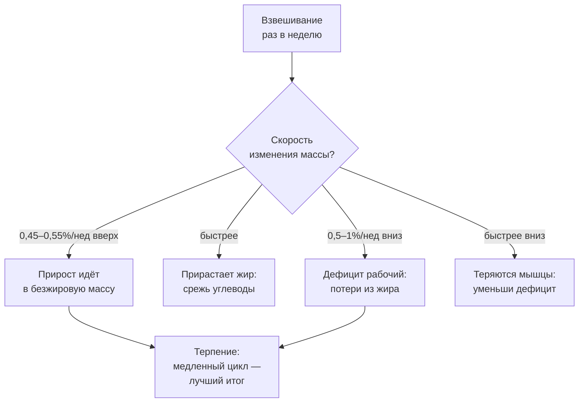
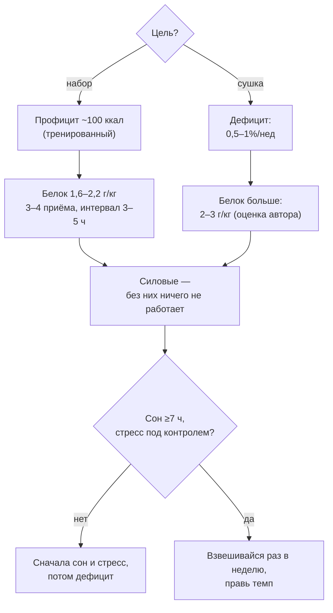

# Арифметика тарелки: питание для массы и сушки

> **О чём статья:** темп набора и сушки, белок и его раскладка по приёмам, углеводы и жиры — числа, при которых прирост идёт в мышцы, а не в жир, и потери в дефиците идут из жира, а не из мышц. Голос и общая линия самоучителя — `THROUGHLINE.md`.

**TL;DR**

- Темп набора 0,45–0,55% массы тела в неделю — маркер того, что весь прирост идёт в безжировую массу; выше — прирастает жир.
- Белок 1,6–2,2 г/кг (лучше считать на тощую массу), 3–4 приёма по 0,4–0,53 г/кг с интервалами 3–5 часов; в дефиците нужно больше — до ~3 г/кг (оценка автора).
- Сушка без силовых стоит 1 кг мышц на каждые ~3 кг потерянного жира; с силовыми — ~11% мышц / 89% жира в потерях.
- Недосып в дефиците переворачивает потери: вместо 17% мышц / 83% жира — 83% мышц / 17% жира.

---

## Уровень 1 — Просто: темп — это сигнал качества

Вот главная арифметика набора. Ты взвешиваешься раз в неделю и смотришь не на «сколько», а на «с какой скоростью». Исследование 2023 (в пересказе конспекта): если масса тела растёт примерно на 0,45–0,55% в неделю — весь прирост идёт в безжировую массу. Быстрее — прирастает жир. Это не «сделай так», это встроенный индикатор качества: скорость растёт — значит, ты жрёшь не для мышц.

Сушка работает зеркально: большой дефицит → больше потери мышц. «Быстро набрал — быстро скинул — мышц не останется»: медленный набор плюс медленная сушка дают лучший итоговый состав тела. Всё остальное — белок, углеводы, жиры, сон — раскладка этой вилки по тарелке.

### Что запомнить

- Взвешивайся раз в неделю; скорость, а не абсолют, — главный сигнал.
- 0,45–0,55% в неделю вверх — вся прибавка в мышцах; 0,5–1% в неделю вниз — потери из жира.
- «Медленно» в обе стороны — это не слабость, а план на лучшую композицию тела.

**Проверка:** ты весишь 80 кг и набираешь 1 кг в неделю. В какую сторону от нормы ты улетел и что это значит? _(1 кг ≈ 1,25%/нед — сильно выше 0,45–0,55%; прирост в основном идёт в жир.)_

---

## Уровень 2 — Подробно: макросы и дефицит в числах

### Таблица-числа: набор

| Показатель | Значение | Смысл | Где в данных |
| --- | --- | --- | --- |
| Темп набора | 0,45–0,55% массы тела в неделю | весь прирост — в безжировую массу (исследование 2023 в пересказе) | конспект `UUSQ9A8SGr0` |
| Профицит для тренированных | ~100 ккал/день | масштабируется по стажу | конспект `UUSQ9A8SGr0` |
| Новички на профиците | +3 кг сухой массы за 8 недель | значительный профицит работает только у новичков | конспект `UUSQ9A8SGr0` |
| Белок суточно | 1,6–2,2 г/кг | автор считает на тощую массу | конспект `UUSQ9A8SGr0` |
| Белок по приёмам | 3–4 приёма по 0,4–0,53 г/кг (40 г при 100 кг) | интервалы ~3–5 ч | конспект `UUSQ9A8SGr0` |
| Качество белка | ≥80% животного, ≤20% растительного | иначе аминокислотный профиль не покроется | конспект `UUSQ9A8SGr0` |
| Углеводы | 3–5 г/кг (силовые); 3–7 г/кг (бодибилдеры); до 8–12 г/кг при двух тренировках в день | рекомендации ACSM/ADA в пересказе | конспект `UUSQ9A8SGr0` |
| Кетодиета и набор | −3,26 кг массы тела, из них −2,26 кг мышц за 3–6 мес | на 14 элитных атлетах; 1ПМ −5,7%, обезжиренная масса −0,8 кг в сетевом мета-анализе | конспект `UUSQ9A8SGr0` |
| Жиры | 0,5–1 г/кг (в массонабор 1–1,5 г/кг) | прямой функции в росте нет — нужны для гормонов | конспект `UUSQ9A8SGr0` |

### Таблица-числа: сушка

| Показатель | Значение | Смысл | Где в данных |
| --- | --- | --- | --- |
| Темп потери веса | 0,5–1% массы тела в неделю (~0,7% оптимум) | больше 1–1,5%/нед — потеря мышц | конспект `7GtrKSdH7AA` |
| Сушка без силовых | −1 кг мышц на каждые ~3 кг жира | доля мышц в потерях ~33% | конспект `7GtrKSdH7AA` |
| Сушка с силовыми | ~11% мышц / 89% жира в потерях | просушка на 30 кг ≈ −3 кг мышц | конспект `7GtrKSdH7AA` |
| Белок в дефиците | 1,2 vs 2,4 г/кг: группа 2,4 г/кг вышла в рекомпозицию (+1 кг мышц) | в дефиците белка нужно больше, чем на наборе; граница размазана, до ~3 г/кг (оценка автора) | конспект `7GtrKSdH7AA` |
| Сон в дефиците | недосып (−1 ч 5 раз/нед; либо −2,5–3 ч/день) | потери переворачиваются: 83% мышц / 17% жира против 17/83 | конспект `7GtrKSdH7AA` |
| Тестостерон в дефиците | терапия Т (N≈80) — потеря только жировой массы | ААС/ГР/кленбутерол — антикатаболическое действие; натуральная сушка может быть только медленной | конспект `7GtrKSdH7AA` |
| Интервальное голодание | 3 приёма в 8-часовом окне | не удовлетворительно для синтеза; один большой приём — часть аминокислот окисляется | конспект `UUSQ9A8SGr0` |

### Таблица «Что утверждается → насколько подтверждено → исследования»

| Утверждение | Статус | Исследования |
| --- | --- | --- |
| Темп набора 0,45–0,55%/нед → прирост в безжировую массу | подтверждено (исследование 2023 в пересказе) | ссылка не найдена в данных — требует ручного поиска |
| Белок 1,6–2,2 г/кг; приёмы 0,4 г/кг с интервалом 3–5 ч | подтверждено (в конспекте) | ссылка не найдена в данных — требует ручного поиска |
| Кетодиета не подходит для набора массы (−2,26 кг мышц на кето у элитных атлетов) | подтверждено (исследование на 14 атлетах в пересказе) | ссылка не найдена в данных — требует ручного поиска |
| Силовые в дефиците снижают долю мышц в потерях с ~33% до ~11% | подтверждено (в конспекте) | ссылка не найдена в данных — требует ручного поиска |
| 2,4 г/кг белка в дефиците → рекомпозиция (+1 кг мышц) | подтверждено (рандомизированное исследование в пересказе) | ссылка не найдена в данных — требует ручного поиска |
| Недосып переворачивает соотношение потерь (17/83 → 83/17) | подтверждено (два исследования в пересказе) | ссылка не найдена в данных — требует ручного поиска |
| Белок в дефиците до ~3 г/кг | оценка автора | — |
| Жиры 0,5–1 г/кг (массонабор 1–1,5) | подтверждено (рекомендации в пересказе) | ссылка не найдена в данных — требует ручного поиска |

> ⚠️ **Важно про ссылки:** по теме питания в реестре `study-links.jsonl` валидных URL нет — исследования названы словами («исследование 2023», «мета-анализ 2022», «рандомизированное исследование»).

### Что запомнить

- Профицит масштабируется по стажу: тренированному хватает ~100 ккал — «ешь как новичок» на третьем году не нужно.
- В дефиците белка нужно больше, чем на наборе: избыток питательных веществ больше не защищает мышцы.
- Кето — инструмент похудения, не набора: на ней теряют мышцы даже элитные атлеты.

**Проверка:** сушишься без силовых тренировок и потерял 9 кг жира. Сколько мышц ты, скорее всего, потерял по пропорции из конспекта? _(~3 кг: без активности теряется ~1 кг мышц на 3 кг жира.)_

---

## Уровень 3 — Вглубь: механизмы и раскладка дня

### Почему белок любят по приёмам, а не по сумме

Механика из конспекта: синтез мышечного белка отвечают на аминокислоты, но у процесса есть потолок на приём — отсюда 0,4 г/кг за раз и 3–4 приёма. Один большой приём в день — часть аминокислот окисляется, то есть уходит в энергию, а не в синтез. Интервальное голодание с тремя приёмами в 8-часовом окне «не удовлетворительно для синтеза» — это не приговор ИГ как способу контролировать вес, а его несовместимость с задачей максимизировать рост мышц.

Вторая половина тарелки — углеводы: низкое потребление не улучшает синтез, но углеводы снижают распад белка, то есть делают выход в «чистый синтез» легче. Жиры прямой функции в росте не имеют — они нужны для гормонов: тестостерон падает при очень низком потреблении жиров и дефиците. Вот почему диапазон жиров жёстче белкового: ниже 0,5 г/кг опускаться не стоит.

### Сушка как управляемый процесс

Задача сушки — не «терять вес», а улучшать соотношение мышц к жиру; глаз видит именно процент жира относительно мышц, а не килограммы. Из этого следует весь список приоритетов: силовые тренировки (главный рычаг — доля мышц в потерях падает втрое), темп 0,5–1% в неделю, высокий белок, сон. И связка, которую ты уже встречал в статье про сон: сушиться в период стресса, недосыпа и двух смен — плохая идея. Сначала создать условия, в которых организм не стрессует, потом дефицит.

### Чего данные не говорят

- Ни один URL по теме питания в данных не найден — все «исследования» названы словами.
- Цифра темпа набора (0,45–0,55%) — из одного исследования 2023 в пересказе; диапазон проверен автором на практике, но одного исследования мало для «закона».
- Кето-цифры (−2,26 кг мышц, 1ПМ −5,7%) — из одного исследования на 14 атлетах и сетевого мета-анализа в пересказе; первоисточники не названы.
- Граница белка в дефиците «до ~3 г/кг» — авторская оценка; сам конспект признаёт её «размазанной».

### Список исследований

По теме «питание для массы и сушки» в реестре `study-links.jsonl` валидных URL не найдено. Тезисы статьи (исследование 2023 о темпе набора, мета-анализ 2022 по кето, исследование 1,2 vs 2,4 г/кг, исследования о сне в дефиците, терапия тестостероном N≈80) перечислены в `no-link-claims.md` с пометкой «ссылка не найдена в данных — требует ручного поиска».

### Что запомнить

- Приёмы белка — не ритуал, а физика синтеза: у процесса есть потолок на приём.
- Сон в дефиците — такой же фактор сохранения мышц, как белок и силовые.
- Фармакология в сушке меняет правила (антикатаболическое действие) — но это отдельная тема, не «лайфхак».

---

## Куда это ведёт

Ты сейчас умеешь собрать тарелку под задачу: темп задаёт качество прироста и потерь, белок — строительный бюджет, сон — охрану мышц. Это краешек большой арифметики книги: **горизонт — год, а не тренировка** — и питание считается в тех же циклах, что и веса.

Дальше по маршруту — **«Инсулинорезистентность: тихая поломка, которая идёт 20 лет»** (`L-insulinorezistentnost.md`). Питание для результата разобрано; теперь — питание и обмен для здоровья: как тихо, без симптомов, за десятилетия ломается чувствительность к инсулину и почему это «бич XXI века».
