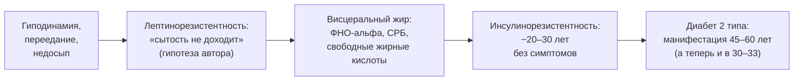
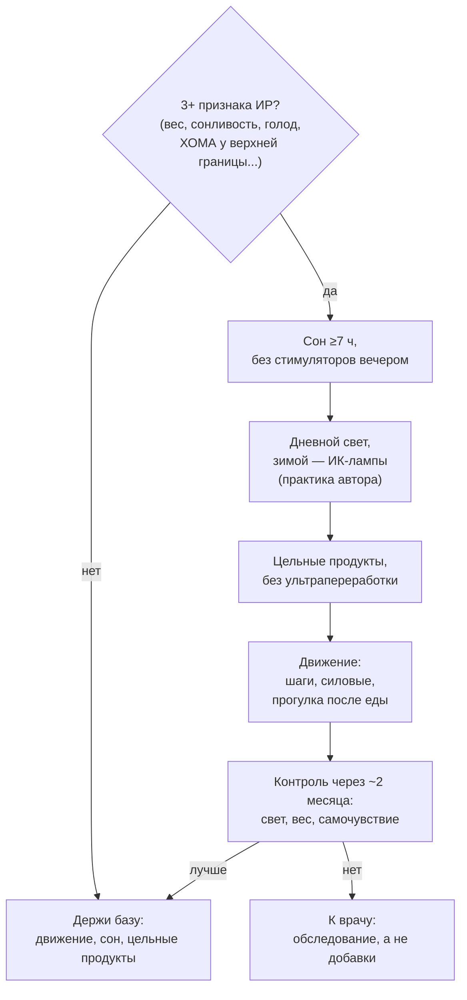

# Инсулинорезистентность: тихая поломка, которая идёт 20 лет

> **О чём статья:** инсулинорезистентность развивается бессимптомно 20–30 лет — от лептинорезистентности и висцерального жира до диабета 2 типа; как её заметить заранее и какими рычагами откатывать. Голос и общая линия самоучителя — `THROUGHLINE.md`.

**TL;DR**

- Лишний вес (>20% жира у мужчин, >30% у женщин) — «стопроцентный признак» ИР; но и худые при низкой активности (3000 шагов/день) могут иметь ИР.
- Последовательность нарушений: сначала лептинорезистентность, затем висцеральный жир, затем ИР/метаболический синдром — гипотеза автора, не общепринятый протокол.
- Одна ночь с 3–4 часами сна снижает чувствительность к инсулину примерно на 40% (по исследованиям, названным в конспекте без ссылок).
- ХОМА «в норме» (2,0–2,3) — не гарантия; низкий инсулин (ХОМА 0,6) — не диабет, а признак метаболической гибкости.

---

## Уровень 1 — Просто: болезнь, которая идёт без симптомов

Представь замок, который заклинивает медленно. Инсулинорезистентность — это снижение чувствительности всех тканей к инсулину: мышц, нервной системы, жировой ткани, миокарда, сосудов. Десятью годами раньше диабета ничего не болит — а замок уже клинит. По конспектам автора, диабет 2 типа «зреет» 20–30 лет, и всё это время человек живёт обычной жизнью, только всё хуже переносит еду, нагрузку и голод.

Порядок поломки, как его описывает автор: сначала лептинорезистентность (лептин растёт раньше инсулина — перестаёшь чувствовать сытость), затем висцеральный жир, затем собственно ИР и метаболический синдром. Отметим честно: лептиновая стадия — интересная, но не общепринятая в клинических протоколах гипотеза; остальная цепочка — общее место медицины.

### Что запомнить

- ИР — системная поломка всех тканей, а не «проблема с сахаром».
- У диабета 2 типа длинный бессимптомный «разгон» — 20–30 лет.
- 3+ признаков из списка ниже — повод менять образ жизни, а не лечить симптомы по одному.

**Проверка:** худой человек с сидячей работой и 3000 шагов в день просит у тебя «диету для профилактики диабета». Что по логике статьи важнее диеты? _(Активность: ИР бывает и у худых при низкой подвижности — движение прежде.)_

---

## Уровень 2 — Подробно: признаки, цифры, рычаги

### Таблица-числа

| Показатель | Значение | Смысл | Где в данных |
| --- | --- | --- | --- |
| Лишний вес как признак ИР | >20% жира у мужчин, >30% у женщин | «стопроцентный признак» | конспект `QsXYVUX4kto` |
| ИР у худых | активность ~3000 шагов/день, сидячая работа | вес — не единственный вход | конспект `QsXYVUX4kto` |
| ХОМА «в норме» | 2,0–2,3 | при висцеральном жире может быть формально в норме — «не успокаивайтесь» | конспект `QsXYVUX4kto` |
| Постпрандиальная сонливость | систематическая после еды | «инсулино-глюкозная кома»: выброс инсулина/глюкозы/СЖК | конспект `QsXYVUX4kto` |
| Диабет 2 типа у молодых | практика автора: парни 30–33 лет | «раньше немыслимо» | конспект `QsXYVUX4kto` |
| Одна ночь 3–4 ч сна | −~40% чувствительности к инсулину | сон «нельзя ничем заменить» | конспект `4P_aEPQvAWE` |
| Кейс: год хронического недосыпа | потеря 2 кг мышц, тургор кожи | пациентка 49 лет, тренировки и питание при этом в порядке | конспект `4P_aEPQvAWE` |
| Заявленный срок отката ИР | ~2 месяца системной работы | сон, свет, питание, движение | конспект `4P_aEPQvAWE` |
| Без изменений образа жизни | через 10–15 лет «всё сломается» | «таблетками не вылечишь» | конспект `4P_aEPQvAWE` |
| Кейс «низкий инсулин» | инсулин 2,5, глюкоза 5,0, ХОМА 0,6 | мужчина 48 лет на периодическом голодании — это НЕ диабет, а метаболическая гибкость | конспект `Rjy6MBjEWwc` |
| Диабет 1 типа | ~5% случаев диабета | аутоиммунное поражение бета-клеток, лечится только инсулином | конспект `Rjy6MBjEWwc` |
| Голодные паузы | 16–20 ч | роняют инсулин, запускают бета-окисление/кетоз | конспект `Rjy6MBjEWwc` |

### Таблица «Что утверждается → насколько подтверждено → исследования»

| Утверждение | Статус | Исследования |
| --- | --- | --- |
| Сон 3–4 ч на одну ночь → −~40% чувствительности к инсулину | подтверждено (в конспекте: «по исследованиям», без ссылки) | ссылка не найдена в данных — требует ручного поиска |
| Висцеральный жир выделяет ФНО-альфа, СРБ, СЖК → хроническое воспаление | подтверждено (в конспекте) | ссылка не найдена в данных — требует ручного поиска |
| Хронический кортизол выбрасывает глюкозу и разрушает мышцы | мнение автора (механизм) | ссылка не найдена в данных — требует ручного поиска |
| Лептинорезистентность — ранняя стадия перед ИР | мнение автора (гипотеза, не общепринятый протокол) | ссылка не найдена в данных — требует ручного поиска |
| Диабет 2 типа — заболевание образа жизни | мнение автора; конспект сам помечает упрощение генетического вклада | ссылка не найдена в данных — требует ручного поиска |
| «Метаболизм с возрастом ломается» — миф | мнение автора | — |
| 5 рычагов отката: свет, сон, цельные продукты, движение, контроль кортизола | мнение автора (протокол из клинического опыта) | — |

> ⚠️ **Важно про ссылки:** по теме инсулинорезистентности в реестре `study-links.jsonl` валидных URL нет; конспекты Егорова называют исследования словами, а часть цифр (40%, 2 месяца) — клинические обобщения автора.

### Что запомнить

- ХОМА «в норме» при висцеральном жире — не гарантия здоровья.
- Сонливость после еды — не «просто устал», а систематический сигнал метаболизма.
- ИР откатывается за ~2 месяца системной работы — но только рычагами образа жизни.

**Проверка:** у человека ХОМА 2,2, есть висцеральный жир и сонливость после еды. Можно ли успокоиться, «ведь анализ в норме»? _(Нет: по конспекту ХОМА 2,0–2,3 может быть формально в норме при уже идущем воспалении от висцерального жира.)_

---

## Уровень 3 — Вглубь: механизмы и протокол отката

### Почему недосып ломает инсулин сильнее, чем кажется

Механизм из конспекта: хронический кортизол (от недосыпа и стресса) выбрасывает глюкозу из печени и мышц и разрушает мышцы. Получается «двойная глюкоза»: сначала от кортизола, потом от еды сверху — и чувствительность к инсулину падает быстро. Кейс пациентки 49 лет — человек с многолетним стажем тренировок и хорошим питанием — показывает приоритет: её сломал год хронического недосыпа (климакс + чай вечером), а не диета. Вывод автора: сначала сон и убирание стимуляторов, а не добавки.

Вторая опора — дневной свет: яркий свет нужен для полноценной ночной выработки мелатонина (и, значит, сна), витамин D влияет на чувствительность к инсулину, инфракрасный спектр ускоряет метаболизм. Зимой автор рекомендует ИК-лампы 15–20 минут в день — это клиническая практика, а не установленная протокольная мера, так и помечаем.

### Питание и движение: почему «просто ешь меньше» не работает

Протокол питания из конспекта: начать с цельных продуктов (мясо, яйца, рыба, кисломолочное, овощи), отказ от ультрапереработанной еды и «протеиновых батончиков», сложные углеводы — позже в пирамиде. Длинные голодные паузы (16–20 ч) роняют инсулин и запускают бета-окисление — простой механизм снижения веса и метаболического здоровья. А вот страх «низкого инсулина» — миф: кейс мужчины 48 лет с инсулином 2,5 и ХОМА 0,6 — это максимум метаболической гибкости, а не «преддиабет наоборот».

И последний миф, который разбирает конспект: «метаболизм с возрастом ломается». По автору, люди ломают его сами — перееданием и падением активности. Это хорошая новость, спрятанная в пугающем списке признаков: замок, который клинит от образа жизни, откачивается образом жизни.

### Чего данные не говорят

- Трактовка «диабет 2 типа исключительно от образа жизни» упрощает вклад генетики — сам конспект помечает: «доказательная база неоднозначна».
- Лептиновая стадия как «первый шаг» — гипотеза автора, не общепринятый клинический протокол.
- Цифры «−40% чувствительности» и «2 месяца» — обобщения без URL в данных.
- Рекомендация ИК-ламп — клинический опыт автора, а не проверенная мера.

### Список исследований

По теме «инсулинорезистентность» в реестре `study-links.jsonl` валидных URL не найдено. Тезисы статьи (исследования о сне и чувствительности к инсулину, лептиновая стадия, кейс ХОМА 0,6) перечислены в `no-link-claims.md` с пометкой «ссылка не найдена в данных — требует ручного поиска».

### Что запомнить

- Приоритет рычагов не очевиден, но устойчив: сон и стресс — раньше питания, питание — раньше добавок.
- Низкий инсулин — не диагноз, а часто признак гибкости; страх «низких цифр» не обоснован.
- ИР — медленное накопление и быстрый откат: 20 лет наживать, ~2 месяца откатывать.

---

## Куда это ведёт

Ты сейчас видишь метаболизм как систему с долгой памятью: 20 лет невнимания — и «неожиданный» диагноз, который был предсказуем всю дорогу. Это краешек опоры **«сила для долголетия»**: тренировки и образ жизни работают не только на рабочие веса, но и на то, чтобы система не сломалась до старости.

Дальше по маршруту — **«Бляшка у здорового: физика сосудов»** (`M-sosudy-gemodinamika.md`). Метаболический фон — это химия; а у сосудов есть и физика: почему бляшки находят у ЗОЖ-мужчин 30–40 лет с нормальным липидным профилем — и что это меняет в твоих действиях.
