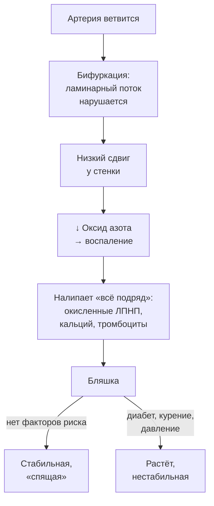
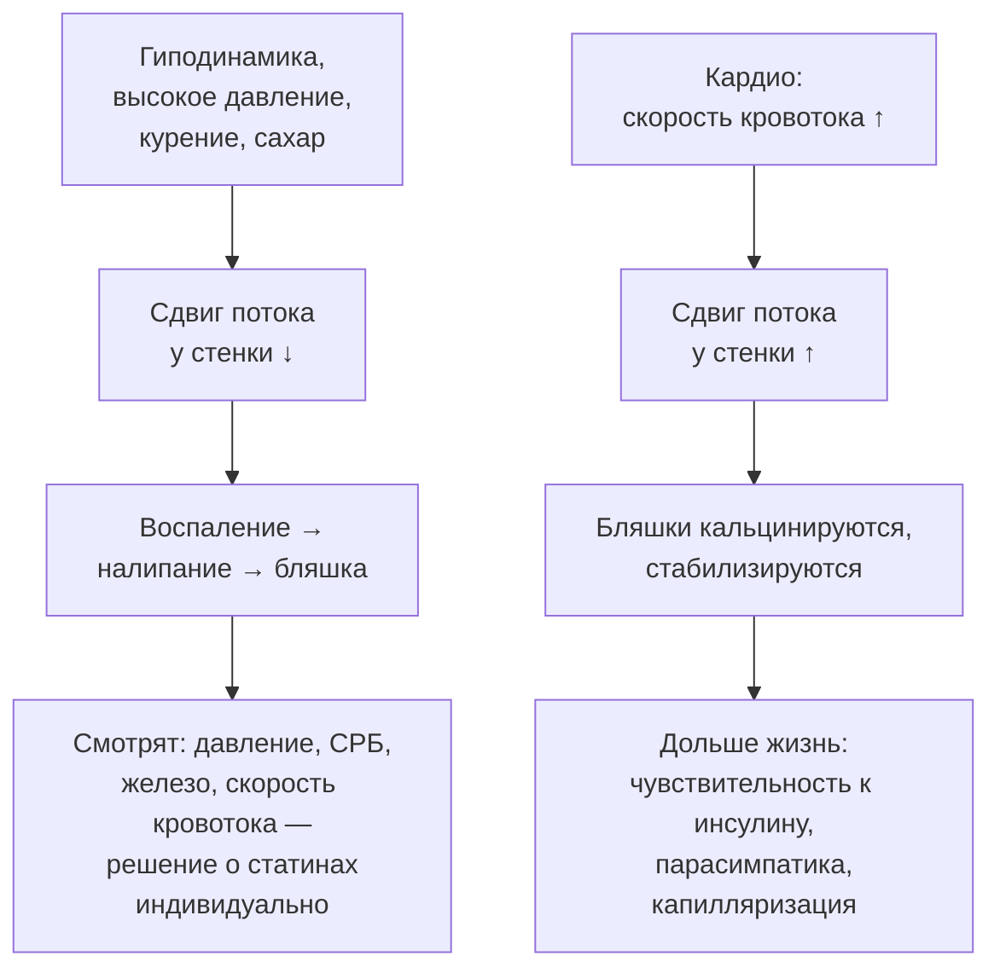

# Бляшка у здорового: физика сосудов, о которой не рассказывают

> **О чём статья:** почему бляшки находят у ЗОЖ-мужчин 30–40 лет с нормальным липидным профилем, а у «плохих» липидов сосуды бывают чистые: гемодинамика, эндотелий и давление — физическая сторона атеросклероза. Голос и общая линия самоучителя — `THROUGHLINE.md`.

**TL;DR**

- Бляшки локализуются в зонах ветвления артерий (бифуркациях), где ламинарный кровоток нарушается — «атеросклероз начинается с физики, а не с биохимии».
- Эндотелий — эндокринный орган: ламинарный сдвиг крови держит его здоровым через оксид азота; нарушенный поток запускает воспаление и «налипание всего подряд».
- Давление — независимый физический фактор: даже 120/80 в подростковом возрасте дозозависимо повышает риск коронарного атеросклероза через ~30 лет (JAMA Cardiology, 10 220 мужчин).
- Кардио не убирает бляшки, но «усыхает» их до безопасных кальцинированных — и работает на продолжительность жизни другими механизмами.

---

## Уровень 1 — Просто: река в сосуде

Представь сосуды рекой. На прямых участках вода течёт быстро и ровно — ламинарный поток. В местах ветвления — заводи: вода завихряется, течёт медленно, там «зацветает». Сосуды — та же река: бляшки образуются не на ровных участках, а в бифуркациях, где ламинарный поток нарушается и у стенки возникает низкая, «осциллирующая» скорость сдвига.

Что это меняет для тебя. Уровень холестерина — важный ускоритель, но не инициатор: в заводи воспаление и «налипание» начинается почти при любой биохимии. А у человека с удачной геометрией сосудов и плохим липидным профилем бляшек может не быть — именно поэтому врач видит и «ЗОЖника с бляшкой», и «курильщика с чистыми сосудами». Не повезло с геометрией — это не приговор: скорость кровотока ты можешь поднять сам, и это единственное, что реально работает на месте «заводь».

### Что запомнить

- Бляшки растут в «заводях» — местах ветвления с нарушенным потоком.
- Холестерин — ускоритель и материал, но не инициатор: инициатор — физика потока.
- Кардио поднимает скорость кровотока — это самая дешёвая «работа над заводями».

**Проверка:** бляшка только с одной стороны, в бифуркации сонной артерии, сосуд выше и ниже — чистый. Значит ли это «срочно снизить холестерин в ноль»? _(По логике конспекта — нет: это локальная геометрия потока; статины замедляют, но причину — физику сдвига — не убирают.)_

---

## Уровень 2 — Подробно: числа, исследования, кейсы

### Таблица-числа

| Показатель | Значение | Смысл | Где в данных |
| --- | --- | --- | --- |
| Нормальная скорость сдвига эндотелия | 15–70 дин/см² | ламинарный поток | транскрипт `_NgaflRg4ro` |
| Низкий/осцилляторный сдвиг | <10–12 дин/см² | зона бляшкообразования | транскрипт `_NgaflRg4ro` |
| Давление в венах | 0–20 мм рт. ст. | в венах бляшки не образуются; пересаженная вена «артеризуется» и зарастает | транскрипт `0OPsc53fG3I` |
| 120/80 в подростковом возрасте | дозозависимый риск коронарного атеросклероза к 45–50 годам | 10 220 мужчин, наблюдение ~40 лет | транскрипт `0OPsc53fG3I` |
| Разница давления между руками | до 10 мм рт. ст. (правая обычно выше) | одна из причин, почему бляшка в сонной артерии чаще справа | транскрипт `0OPsc53fG3I` |
| Женское «фору» | давление ~100×70 до климакса | одна из причин десятилетнего отрыва по сердечно-сосудистым событиям | транскрипт `0OPsc53fG3I` |
| Бег и кальций | >16 км/нед (бег) или >48 км/нед (велосипед) | коронарного кальция у 50–60-летних бегунов больше, чем у нетренирующихся ровесников | конспект `XhQlmlWHoZU` |
| Три вида бляшек | мягкая (опасная) / смешанная / кальцинированная (стабильная) | кардио кальцинирует бляшки | конспект `XhQlmlWHoZU` |
| Практический объём кардио | ~30 км бега в неделю или 40–60 мин ходьбы ежедневно | практика автора | транскрипт `_NgaflRg4ro` |
| Кейс автора (кето-эксперимент) | ЛПНП 613, ЛПВП 2,19, ТГ 1,03, индекс атерогенности 2,86 | через 6 мес кето: УЗИ сонных артерий чисто | транскрипт `LC88971bhys` |
| Кейс Лп(а) | ХС >7, ЛПНП >5, Лп(а) повышен | сосуды чистые в 41–43 года | конспект `sHlCmsgnViA` |
| Кейс «здорового с бляшкой» | нормальный липидный профиль, единичные бляшки | мужчина 41 год | конспект `sHlCmsgnViA` |

### Таблица «Что утверждается → насколько подтверждено → исследования»

| Утверждение | Статус | Исследования |
| --- | --- | --- |
| 120/80 в юности → дозозависимый рост риска коронарного атеросклероза в среднем возрасте | подтверждено | [JAMA Cardiology — когортный анализ, 10 220 мужчин](https://jamanetwork.com/journals/jamacardiology/fullarticle/2841358) |
| Ламинарный сдвиг держит эндотелий здоровым; нарушенный поток запускает воспаление и бляшку | подтверждено | [Обзор: гемодинамика и атеросклероз](https://link.springer.com/article/10.1186/s12929-025-01177-z), [Обзор механики эндотелия](https://pmc.ncbi.nlm.nih.gov/articles/PMC13039374/#sec24) |
| У молодых с бляшками в БЦА ведущая роль локальной гемодинамики и механики эндотелия | подтверждено (свежие публикации в пересказе) | [Публикация PubMed 1](https://pubmed.ncbi.nlm.nih.gov/41176538/), [Публикация PubMed 2](https://pubmed.ncbi.nlm.nih.gov/41036559/) |
| У бегунов-марафонцев коронарного кальция больше, чем у нетренирующихся ровесников | подтверждено | [Обзор по бегу и кальцию](https://pmc.ncbi.nlm.nih.gov/articles/PMC7176353/#sec11), [AHA Circulation](https://www.ahajournals.org/doi/10.1161/CIRCULATIONAHA.117.028750), [Исследование PubMed](https://pubmed.ncbi.nlm.nih.gov/28450347/) |
| Кардио кальцинирует бляшки («усыхает»), а не предотвращает их появление | мнение автора (интерпретация данных о кальциевом индексе) | [Исследование кальциевого индекса](https://www.jacc.org/doi/10.1016/j.jacc.2007.02.059) |
| У метаболически здоровых на кето/low-carb высокий ЛПНП не связан с сердечно-сосудистыми событиями | мнение автора, расходится с консенсусом | [Обзор по частицам ЛПНП](https://www.ncbi.nlm.nih.gov/pmc/articles/PMC11095042/), [Клинический обзор липидных профилей](https://www.ncbi.nlm.nih.gov/pmc/articles/PMC9048595/) |

> ⚠️ **Про честность:** гемодинамическая теория дополняет, а не отменяет липидную — консенсусные рекомендации при подтверждённой бляшке чаще включают статины; решение о них индивидуально и принимается с врачом. Тезисы о «качках», гематокрите и варикозе — из транскриптов, в этой статье они не подаются как установленные факты.

### Что запомнить

- Давление — главный управляемый физический фактор: его рост ускоряет «заводь» даже там, где она уже есть.
- Кальциевый индекс нужно читать с умом: кальцинированная бляшка — стабильная, мягкая — опасная.
- Липиды — не единственная ось здоровья сосудов: смотрят давление, воспаление (СРБ), скорость кровотока, железо.

**Проверка:** бегун с повышенным коронарным кальцием испугался своих цифр. Что ему скажет логика статьи? _(У тренированных бляшки чаще кальцинированные — стабильные; кардио не предотвращает появление, но делает бляшки безопасными и работает на жизнь другими механизмами.)_

---

## Уровень 3 — Вглубь: механика эндотелия и цена экстремальных вариантов

### Механика: сдвиг, оксид азота, YAP

Эндотелий — внутренняя оболочка артерий и эндокринный орган: он вырабатывает факторы, которые сужают и расширяют сосуд, главный из них — оксид азота. Его вырабатывает сам кровоток: ламинарный сдвиг — «трение» потока о стенку — через механорецепторы (в конспекте — коактиватор YAP) держит эндотелиальные клетки выстроенными по потоку и стабильными. Нарушение потока запускает эндотелиально-мезенхимальную трансформацию: клетки эндотелия меняют свойства, начинается воспаление, к нему прилипают моноциты, окисленные ЛПНП, кальций, тромбоциты.

Отсюда объяснение обоих «чудес» из практики автора. Первый кейс: мужчина 41 год с многолетним «ужасным» липидным профилем (общий ХС >7, ЛПНП >5, повышенный липопротеин(а)) — сосуды полностью чистые: геометрия его артерий поддерживает ламинарный поток. Второй: Павел 41 год с нормальными липидами — единичные бляшки в бифуркации. Липиды ≠ детерминанта бляшек; ключевое — гемодинамика и возраст.

### Что работает, а что — «ускорители»

Практическая раскладка из транскриптов. Работает: регулярное кардио (сдвиг скорости кровотока во всех участках, включая «заводь»), низкое давление (стройность, движение), текучая кровь, контроль воспаления. Ускоряют: курение, алкоголь, сахар, гиподинамика (сидение — максимально медленный кровоток), высокое давление (оно ускоряет центральный поток и ещё сильнее тормозит пристеночный), густая кровь. У диабетиков бляшки растут особенно быстро: повреждённая глюкозой бляшка не «заживает», и факторы налипают снова и снова.

И честная цена темы: эластичность сосудов падает с возрастом независимо от холестерина; полностью «победить» атеросклероз по этой теории нельзя — можно замедлить и стабилизировать. Мужской пол сам по себе фактор риска в этом возрасте; у женщин 30–40 лет бляшки в брахиоцефальных артериях редки, а после климакса их защищённость исчезает вместе с гормональной «форой».

### Чего данные не говорят

- Гемодинамическая теория дополняет, но не отменяет липидную; «холестерин — одна тысячная фактора» — риторическое усиление автора транскрипта, а не консенсус.
- Трактовка «кардио не предотвращает бляшки, а кальцинирует» — авторская интерпретация данных о кальциевом индексе; кальциевый индекс — маркер, а не прямая мера смертности.
- Тезисы о кето-липопротеинах (ЛПНП 613 и «не надо снижать») расходятся с консенсусом кардиологических ассоциаций; конспект сам помечает «доказательная база неоднозначна».
- Кейсы («чистые сосуды при ХС >7», «бляшка при нормальных липидах») — клинические наблюдения автора, n=1; они иллюстрируют индивидуальную вариативность, но не доказывают причинность.

### Список исследований

1. [JAMA Cardiology — артериальное давление в подростковом возрасте и коронарный атеросклероз (когорта 10 220 мужчин)](https://jamanetwork.com/journals/jamacardiology/fullarticle/2841358)
2. [Обзор: гемодинамика и атеросклероз (Кардиоваскулярный журнал, Springer)](https://link.springer.com/article/10.1186/s12929-025-01177-z)
3. [Обзор механики эндотелия при нарушенном потоке](https://pmc.ncbi.nlm.nih.gov/articles/PMC13039374/#sec24)
4. [Публикация о бляшках у молодых (PubMed)](https://pubmed.ncbi.nlm.nih.gov/41176538/)
5. [Публикация о механике эндотелия и бифуркациях (PubMed)](https://pubmed.ncbi.nlm.nih.gov/41036559/)
6. [Обзор по бегу и коронарному кальцию](https://pmc.ncbi.nlm.nih.gov/articles/PMC7176353/#sec11)
7. [Статья AHA Circulation о тренированных и коронарном кальции](https://www.ahajournals.org/doi/10.1161/CIRCULATIONAHA.117.028750)
8. [Исследование о кардионагрузке и бляшках (PubMed)](https://pubmed.ncbi.nlm.nih.gov/28450347/)
9. [Исследование кальциевого индекса (JACC)](https://www.jacc.org/doi/10.1016/j.jacc.2007.02.059)
10. [Обзор по частицам ЛПНП у метаболически здоровых](https://www.ncbi.nlm.nih.gov/pmc/articles/PMC11095042/)
11. [Клинический обзор липидных профилей на low-carb](https://www.ncbi.nlm.nih.gov/pmc/articles/PMC9048595/)

Названия части публикаций в реестре отсутствуют — даны рабочие описания по контексту конспектов; при проверке ссылок их можно заменить точными названиями.

### Что запомнить

- Атеросклероз — плата за наземную гидравлику: он начинается у всех, вопрос только скорости.
- Кардио — «сосудистая терапия» через оксид азота и скорость потока, а не «чистые сосуды».
- Решение о статинах при бляшке — индивидуальное: сначала давление, воспаление, железо и скорость кровотока, а не «автомат при бляшке».

---

## Куда это ведёт

Ты сейчас понял физическую сторону здоровья сосудов — и это ещё один слой опоры **«сила для долголетия»**: тренировка работает на сосуды не «через холестерин», а через скорость потока, давление и вегетатику. Снижать риски смертности — исходная задача всей книги, и здесь она видна прямо.

Дальше по маршруту — **«Когда есть: еда по часам тела»** (`N-kogda-est-cirkadnye-ritmy.md`). Сосуды любят низкое давление и хорошую вегетатику — а оба они завязаны на сон и на то, *когда* ты ешь: вечером еда при начавшейся выработке мелатонина обходится дороже, и это связано с той самой ночной парасимпатикой, которую мы сейчас обсуждали.
