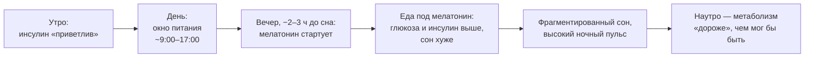
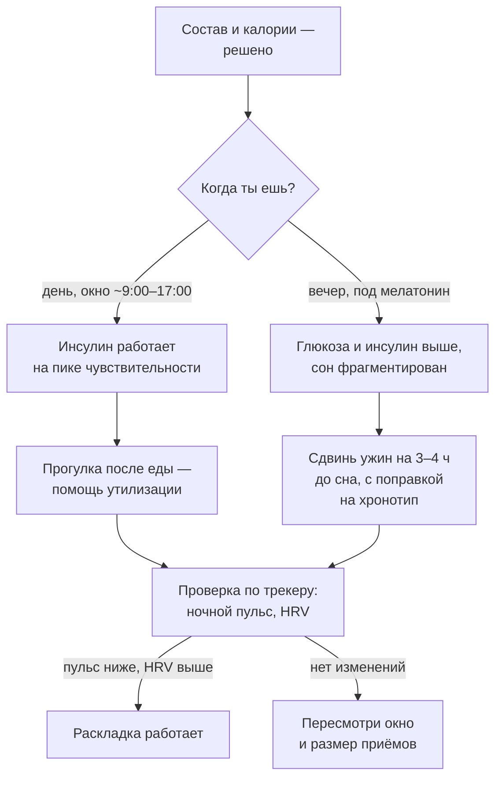

# Когда есть: еда по часам тела

> **О чём статья:** хронобиология питания — почему чувствительность к инсулину, гормоны голода и качество сна зависят не только от того, *что* и *сколько* ты ешь, но и *когда*: окно питания, мелатонин, вечерняя еда и личный эксперимент автора. Голос и общая линия самоучителя — `THROUGHLINE.md`.

**TL;DR**

- Чувствительность к инсулину максимальна утром/днём и снижается к вечеру — вечерняя еда метаболически «дороже».
- Механизм — мелатонин: за 2–3 часа до привычного сна начинается его выработка, а мелатонин «не дружит» с глюкозой.
- Оптимальное окно питания по новым данным — днём (примерно 9:00–17:00), а не «пропустить завтрак»; универсальной цифры «не есть после 18» нет — ориентир хронотип.
- На интервальном голодании легко потерять не только жир: минимум — белок ~1,5 г/кг и 2 силовые тренировки в неделю.

---

## Уровень 1 — Просто: у еды есть час пик

Представь кассы в супермаркете: утром работают все, вечером — одна. Твоя инсулиновая «обработка еды» устроена так же: чувствительность к инсулину максимальна утром и днём и снижается к вечеру. Одна и та же еда утром и в 23:00 — это разные метаболические «чеки»: вечером за неё платят выше глюкозой, инсулином и качеством сна.

Причина конкретная — мелатонин. За 2–3 часа до привычного сна начинается его выработка, и он снижает утилизацию глюкозы: тело уже готовится к ночному режиму, а ты в него вносишь обед. Отсюда правило, которое легко запомнить: есть — днём, ночью — отдых от еды. А точную границу подбирает хронотип: у «сов» мелатонин стартует позже, поэтому «не есть после 18» — не универсальный закон, а частный случай.

### Что запомнить

- Вечерняя еда дороже по глюкозе и инсулину — даже при том же составе.
- Ориентир не «после 18», а «за 3–4 часа до сна» — с поправкой на свой хронотип.
- Прогулка после еды — дешёвый способ помочь утилизации глюкозы.

**Проверка:** «сова» ужинает в 19:00 и ложится в 00:30. Работает ли для неё «не есть после 18» как закон? _(Нет: у «сов» мелатонин стартует позже; ориентир — 3–4 часа до собственного сна.)_

---

## Уровень 2 — Подробно: окно, голодание и цифры эксперимента

### Таблица-числа

| Показатель | Значение | Смысл | Где в данных |
| --- | --- | --- | --- |
| Старт выработки мелатонина | за 2–3 часа до привычного сна | после этого еда даёт повышенные глюкозу и инсулин | конспект `JMbwy3zP7Ws` |
| Оптимальное окно питания | 8 часов, примерно 9:00–17:00 | «пропустить завтрак» — не оптимум, хотя автор сам годами так питался | конспект `5M4LtIFyJjA` |
| Эксперимент автора (n=1) | ранний ужин 16–17 ч: ночной пульс ниже 50 (было 51–57), HRV ~60 → ~75–80 | тот же рацион и тренировки; субъективно — глубже сон | конспект `JMbwy3zP7Ws` |
| Минимум белка на ИГ | ~1,5 г/кг | плюс 2 силовые тренировки в неделю — иначе путь в skinny fat | конспект `5M4LtIFyJjA` |
| Липиды на ИГ | ЛПНП и холестерин могут быть повышены | следствие жирового обмена, кетонов и кортизола при голодных паузах (наблюдал у себя) | конспект `5M4LtIFyJjA` |
| Термогенный эффект белка | ~30% его калорий уходит на усвоение | белок — «дорогой» нутриент для обмена | конспект `XhCRv404_MM` |
| Нормы белка по автору | малоподвижным 0,8–1 г/кг; активным до 2 г/кг «идеальной» массы | рост минус ~100 | конспект `XhCRv404_MM` |
| Опасное сочетание | жир + углеводы одновременно и перманентно | «именно так жиреют дети у бабушки» | конспект `XhCRv404_MM` |
| OMAD на ночь | худеешь, но сон и утреннее самочувствие страдают | «как с бодуна» | конспект `JMbwy3zP7Ws` |

### Таблица «Что утверждается → насколько подтверждено → исследования»

| Утверждение | Статус | Исследования |
| --- | --- | --- |
| Мелатонин снижает утилизацию глюкозы; еда под мелатонин ухудшает сон | подтверждено | [Мелатонин и секреция инсулина (PNAS)](https://www.pnas.org/doi/10.1073/pnas.1418955112), [Обзор мелатонина и обмена (Endocrine Reviews)](https://academic.oup.com/edrv/article-abstract/18/5/716/2530790?redirectedFrom=fulltext), [Обзор циркадных механизмов метаболизма](https://pmc.ncbi.nlm.nih.gov/articles/PMC6224937/) |
| Окно питания лучше держать в первой половине дня | подтверждено (отдельные исследования; вопрос «завтрак vs ужин» дискутабелен) | [Хронобиология питания и время еды (обзор)](https://academic.oup.com/edrv/article/43/2/405/6371193), [Питание и циркадные ритмы (исследование)](https://www.mdpi.com/2072-6643/18/11/1799), [Время приёмов пищи и здоровье](https://www.mdpi.com/2304-8158/13/13/1960) |
| Чувствительность к инсулину снижается к вечеру | подтверждено (данные 1970-х–2010-х в пересказе) | ссылка не найдена в данных — требует ручного поиска |
| Эффекты раннего ужина на ночной пульс и HRV | мнение автора (самоотчёт, n=1) | — |
| ИГ меняет липидный профиль (рост ЛПНП) | мнение автора (личное наблюдение) | — |
| Белок окисляется при одном большом приёме; де ново липогенез из белка «не работает» | мнение автора (упрощение; классическая наука признаёт и другие пути) | ссылка не найдена в данных — требует ручного поиска |
| Жир + углеводы вместе — главная схема набора жира | мнение автора | — |

> ⚠️ **Про честность:** ключевые эффекты раннего ужина продемонстрированы автором на себе (n=1) и на наблюдательных данных; РКИ по раннему ужину ограничены — конспект сам помечает «доказательная база неоднозначна».

### Что запомнить

- «Хронобиология питания» — третий параметр еды, наравне с составом и калорийностью.
- ИГ — рабочий, но не единственный инструмент; выбирать метод (ИГ, гибкая диета, подсчёт калорий) — за человеком.
- На ИГ без белка и силовых теряются мышцы, а не только жир.

**Проверка:** хочешь попробовать ИГ 16:8 «с обеда до вечера». Что по новым данным автора стоит изменить в раскладке? _(Сдвинуть окно к утру: примерно 9:00–17:00 — и не забыть белок ~1,5 г/кг и 2 силовые тренировки в неделю.)_

---

## Уровень 3 — Вглубь: циркадные механизмы и 20 лет экспериментов

### Механизм: мелатонин против инсулина

Циркадные часы управляют не только сном, но и обменом: секреция инсулина, чувствительность тканей, гормоны голода — всё привязано к времени суток. Конфликт возникает в зоне пересечения: мелатонин, сигнал «ночь», снижает утилизацию глюкозы — именно поэтому еда под мелатонин даёт более высокие пики глюкозы и инсулина при той же еде днём. Плюс она мешает переключению в парасимпатику — а ночная парасимпатика и есть тот режим, в котором низкий пульс, высокий HRV и восстановление. Заметь, как это замыкается на статью про сосуды: одна и та же ночная вегетатика и там, и тут.

Эксперимент автора честно ограничен (n=1): тот же рацион и тренировки, сдвинут ужин на 16–17 часов — ночной пульс стабильно ниже 50 против прежних 51–57, HRV выросла с ~60 до ~75–80. Это не доказательство, а наглядная демонстрация механизма, подтверждённая на данных его же трекера.

### Биохимия макронутриентов: итог 20 лет

Третий конспект серии — итог двух десятилетий экспериментов и наблюдений за пациентами. Белок — строительный нутриент, и тело платит за него дорого: ~30% его калорий уходит на усвоение; теоретически белок может стать и глюкозой, и жиром, но на практике де ново липогенез из белка «не работает» — излишки выводятся. Пищевой жир — противоположность: на его усвоение тело почти не тратит энергии, и он складируется «на склад» напрямую.

Отсюда центральный тезис: главное опасное сочетание — жир и углеводы одновременно и перманентно (пирожки, вафли, печенье). Отдельно углеводы или отдельно жир тело обрабатывает иначе. Конспект сам помечает упрощения: классическая наука признаёт и де ново липогенез из углеводов при профиците, и роль общего профицита калорий — так и оставляем: это позиция автора, а не консенсус.

### Чего данные не говорят

- РКИ по раннему ужину ограничены; точка об оптимальности именно утреннего окна опирается на отдельные исследования — «завтрак vs ужин» в науке дискутабелен.
- Цифры HRV и пульса — самоотчёт на трекере (n=1), не исследование.
- Тезисы «де ново липогенез из белка не работает» и «жир складируется напрямую» — упрощения автора; классическая биохимия сложнее.
- Универсальной границы «не есть после 18» данные не дают: всё привязано к хронотипу и индивидуальному старту мелатонина.

### Список исследований

1. [Мелатонин и секреция инсулина (PNAS)](https://www.pnas.org/doi/10.1073/pnas.1418955112)
2. [Обзор мелатонина и метаболизма (Endocrine Reviews)](https://academic.oup.com/edrv/article-abstract/18/5/716/2530790?redirectedFrom=fulltext)
3. [Циркадные механизмы метаболизма (обзор)](https://pmc.ncbi.nlm.nih.gov/articles/PMC6224937/)
4. [Хронобиология питания и время приёмов пищи (Endocrine Reviews)](https://academic.oup.com/edrv/article/43/2/405/6371193)
5. [Питание, циркадные ритмы и здоровье (исследование)](https://www.mdpi.com/2072-6643/18/11/1799)
6. [Время приёмов пищи и метаболическое здоровье (обзор)](https://www.mdpi.com/2304-8158/13/13/1960)

Названия публикаций в реестре отсутствуют — даны рабочие описания по контексту конспектов.

### Что запомнить

- Мелатонин и еда — антагонисты по глюкозе: не пересекай их по времени.
- Трекер (пульс, HRV) — честная проверка твоей раскладки еды и сна, доступная без лаборатории.
- «Что есть» без «когда есть» — половина уравнения; и вторая половина дешевле первой.

---

## Куда это ведёт

Ты сейчас добавил к питанию ось времени — и вместе с ней связку с ночным восстановлением из статей про сон и сосуды. Это всё тот же общий бюджет: **сон, еда и тренировки делят одну вегетатику**, и раскладка по часам — не мода, а способ не платить двойную цену за одну тарелку.

Дальше по маршруту — **«ГСПГ и свободный тестостерон: почему „мало свободного Т“ — не диагноз»** (`B-gspg-svobodnyy-testosteron.md`): питание и циркадные ритмы двигают гормональный фон, и там же разобрано, почему решения о гормональной терапии принимают по системе, а не по одной цифре. Ну а финальная глава темы здоровья — **«Цена курса: что фармакология делает с сердцем»** (`O-farmakologiya-serdce.md`).
