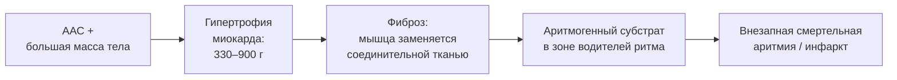
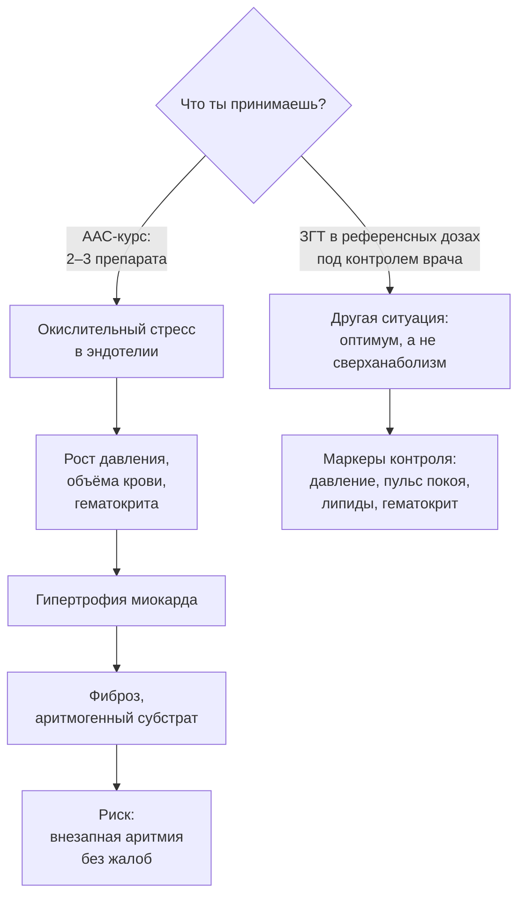

# Цена курса: что фармакология делает с сердцем

> **О чём статья:** данные аутопсий пользователей андрогенно-анаболических стероидов, механизм гипертрофии и фиброза миокарда, связь с аритмиями и внезапной смертью — и чем это отличается от адекватной заместительной терапии. Голос и общая линия самоучителя — `THROUGHLINE.md`.

**TL;DR**

- В 19 аутопсиях пользователей ААС (17 мужчин, 2 женщины, 18–37 лет, средний возраст 28) масса миокарда 330–900 г при норме до ~190 г — в 2 раза и более выше.
- Гипертрофия ведёт к фиброзу; фиброз в зоне водителей ритма — аритмогенный субстрат: внезапная смертельная аритмия без жалоб, часто во сне или на тренировке.
- Сердце растёт от анаболиков и от общей массы тела — неважно, мышцы или жир.
- Всё сказанное касается андрогенно-анаболических курсов, а не адекватной заместительной терапии в референсных дозах — оговорка самого конспекта.

---

## Уровень 1 — Просто: сердце — тоже мышца, и оно тоже растёт

Вот мысль, которую стоит уложить первой: сердце — мышечный орган. Всё, что растит мышцы на курсе, растит и миокард. Плюс растёт общая масса тела — и неважно, мышцы это или жир: чем больше масса, тем выше нагрузка на сердце. У вскрытых пользователей стероидов масса миокарда была 330–900 граммов — при норме до ~190 у мужчин.

Дальше цепочка: гипертрофия ведёт к фиброзу — замещению мышечной ткани соединительной. Участки сердца хуже кровоснабжаются и теряют эластичность. А фиброз в зоне водителей ритма — это готовый «провод с изоляцией, из которой вылезла медь»: желудочковая аритмия, фибрилляция, внезапная смерть. Часто во сне или на тренировке, без жалоб.

### Что запомнить

- Сердце растёт от анаболиков и от массы тела — от любой: мышцы или жира.
- Опасна не сама гипертрофия, а её конец — фиброз с аритмогенным субстратом.
- Смерть часто приходит без жалоб: «внезапная» — это не риторика, а диагноз.

**Проверка:** почему «накачанное сердце» — не комплимент, как «накачанные бицепсы»? _(Миокард растёт до фиброза: соединительная ткань не работает ни как насос, ни как проводящая система — это путь к аритмии.)_

---

## Уровень 2 — Подробно: данные аутопсий и статистика

### Таблица-числа

| Показатель | Значение | Смысл | Где в данных |
| --- | --- | --- | --- |
| Аутопсии пользователей ААС | 19 случаев: 17 мужчин, 2 женщины, 18–37 лет, средний 28±4 | публикация данных вскрытий | конспект `5mG_yRo5GlU` |
| Норма массы миокарда (мужчины) | ~140–190 г | 200+ г — уже гипертрофия | конспект `5mG_yRo5GlU` |
| Норма массы миокарда (женщины) | до ~150–160 г | — | конспект `5mG_yRo5GlU` |
| Масса миокарда у вскрытых | 330–900 г | в 2 раза и более выше нормы | конспект `5mG_yRo5GlU` |
| Причина смерти | почти во всех случаях — сердечно-сосудистая патология | аритмия или инфаркт | конспект `5mG_yRo5GlU` |
| Тахикардия как маркер | 90–100 уд/мин покоя | хроническая симпатическая активация мешает сердцу расслабляться | конспект `5mG_yRo5GlU` |
| Риск внезапной сердечной смерти у мужчин | в 3–4 раза выше, чем у женщин | гормональный профиль, а не только образ жизни | конспект `Mn-q7iX2JoI` |
| Женщины-бодибилдеры на андрогенах | тот же фенотип кардиомиопатии; частота внезапных смертей у профи >в 20 раз выше, чем у любительниц | «естественный эксперимент» | конспект `Mn-q7iX2JoI` |
| Смертность бодибилдеров 20–50 лет | highest среди видов спорта | статистика смертей | конспект `Mn-q7iX2JoI` |
| Кейс 24-летнего бодибилдера | закупорка основных коронарных артерий >75% | при отсутствии сердечных заболеваний в семье | транскрипт `2kKssc-FqzY` |

### Таблица «Что утверждается → насколько подтверждено → исследования»

| Утверждение | Статус | Исследования |
| --- | --- | --- |
| У пользователей ААС на аутопсии — кардиомегалия 330–900 г и ССЗ-причины смерти | подтверждено | [Серия аутопсий пользователей анаболических стероидов](https://pmc.ncbi.nlm.nih.gov/articles/PMC4462039/) |
| Высокий тестостерон у мужчин и сниженный эстрадиол у женщин независимо связаны с аритмогенной кардиомиопатией | подтверждено (в конспекте) | [Статья European Heart Journal о тестостероне и аритмогенной кардиомиопатии](https://academic.oup.com/eurheartj/article/38/19/1498/3002813) |
| У женщин-бодибилдеров на андрогенных препаратах — тот же фенотип; смертность профи в разы выше любительниц | подтверждено (свежая публикация в пересказе) | [Ст European Heart Journal: женщины-бодибилдеры и сердечно-сосудистая смертность](https://academic.oup.com/eurheartj/advance-article/doi/10.1093/eurheartj/ehaf789/8288296) |
| Механизмы повреждения сосудов на курсах — более десяти (окислительный стресс, липиды, давление и др.) | мнение автора (синтез литературы в транскрипте) | ссылка не найдена в данных — требует ручного поиска |
| Биохимия сосудов «качка» на курсе ≈ биохимии гипогонадика с ожирением | мнение автора (образная интерпретация) | — |
| ААС растят оба типа волокон дозозависимо; снятие «потолка» волокон I — дозы >600 мг Т/нед | мнение автора (со ссылкой на данные, не приведённые в корпусе) | ссылка не найдена в данных — требует ручного поиска |

> ⚠️ **Про честность:** данные аутопсий — наблюдательные; причинность для каждого конкретного человека не доказуема, и конспекты сами это помечают. Отдельные долгожители «на курсах» не опровергают статистику: так работает выборочное наблюдение.

### Что запомнить

- Масса миокарда — измеримый предел: 330–900 г против нормы 140–190 г — это не «вариация», а патология.
- Пол не спасает: у женщин-бодилдеров на андрогенах тот же фенотип, и разрыв смертности — в разы.
- Смертность бодибилдеров 20–50 лет — высшая среди видов спорта; это статистика, а не «страшилка».

**Проверка:** «я знаю человека, который 15 лет на курсах и жив-здоров». Как это соотносится с данными? _(Наблюдательное исключение не опровергает статистику аутопсий и повышенную смертность группы; конспекты сами помечают причинность как индивидуально недоказуемую.)_

---

## Уровень 3 — Вглубь: механизмы и граница «курс vs терапия»

### Каскад: от сигнала роста до аритмии

Механизм, собранный из конспектов, многослойный. Первый слой — прямой анаболический сигнал: высокоанаболическая среда разгоняет метаболизм («турбина» из транскрипта): больше топлива — больше реактивных форм кислорода; вместо защитного оксида азота в сосудистой стенке образуется повреждающий супероксид. Эндотелий страдает ещё до разговоров о липидах и давлении. Всего механизмов повреждения транскрипт насчитывает «больше десяти» — от окислительного стресса до изменения липидного профиля и роста давления.

Второй слой — нагрузка массой: большая мышечная масса (особенно на фарме, с задержкой жидкости и ростом объёма циркулирующей крови) повышает давление, а сердце растёт от любой массы. Третий — симпатика: хроническая перегрузка и тахикардия покоя 90–100 мешают сердцу расслабляться и питаться — тот же фиброз ускоряется. Четвёртый — реология: высокий гематокрит, обезвоживание, жара и гипоксия на тренировке повышают густоту крови и тромбообразование.

### Граница: курс — не терапия

Сам транскрипт даёт обязательную оговорку: всё сказанное не касается гормонозаместительной терапии адекватными дозировками, поддерживающими тестостерон в референсных значениях. Речь — об андрогенно-анаболических курсах: два-три препарата с изменёнными анаболическим и андрогенным индексами. Влияние анаболизма U-образное: плохо и очень низко (гипогонадизм), и очень высоко — нужен оптимум, «серединка» по тестостерону и эстрадиолу.

И итоговый вывод автора, который не «запугивание», а цена: «использование фармакологии — игра в русскую рулетку». Мышечный качок на курсе выглядит здоровым — а по биохимии сосудов его состояние похоже на состояние гипогонадика с лишним весом и повышенным давлением. Мы гонимся за картинкой и платим по фактическим счетам.

### Чего данные не говорят

- Данные аутопсий — наблюдательные: они показывают, у кого что нашли, но не доказывают причинность для каждого человека.
- «Более десяти механизмов» повреждения сосудов — перечень из транскрипта без ссылки на обзор; конспектов на это видео ещё нет (статус queued).
- Цифра «>600 мг тестостерона/нед» для снятия потолка волокон I — утверждение автора; данные в корпусе не приведены.
- Дозы, схемы и длительность курсов в данных фрагментарны — «доказательная база» по ним не собрана.

### Список исследований

1. [Серия аутопсий пользователей андрогенно-анаболических стероидов (кардиомегалия, причины смерти)](https://pmc.ncbi.nlm.nih.gov/articles/PMC4462039/)
2. [Статья European Heart Journal о тестостероне, эстрадиоле и аритмогенной кардиомиопатии](https://academic.oup.com/eurheartj/article/38/19/1498/3002813)
3. [Статья European Heart Journal о женщинах-бодилдерах и сердечно-сосудистой смертности](https://academic.oup.com/eurheartj/advance-article/doi/10.1093/eurheartj/ehaf789/8288296)

Названия публикаций в реестре отсутствуют — даны рабочие описания по контексту конспектов.

### Что запомнить

- Кардиомегалия у молодых пользователей ААС — измеренный факт, а не гипотеза.
- Опасность асимметрична: смерть внезапна и часто без симптомов — «пока не жалуюсь» не значит «здоров».
- Граница «курс vs ЗГТ» — это разница доз и целей, а не «одно и то же по-другому».

---

## Куда это ведёт

Ты сейчас видел цену, которую платят за «картинку»: сердце растёт от любого анаболизма, а фиброз не прощает. Это самая жёсткая иллюстрация финальной опоры книги: **сила — для долголетия**. Натуральный силовой тренинг снижает риски смертности; сверханаболизм их повышает — на той же физиологии роста, только в другую сторону.

На этом маршрут «здоровье» закончен, и вся книга сворачивается в финальную точку — **«Почему год, а не тренировка: арифметика прогресса»** (`D-pochemu-god-a-ne-trenirovka.md`). Ты умеешь дозировать подход и день, вести волну через плато, кормить и восстанавливать систему, беречь сердце — осталось сложить это в годы: 5 циклов × 7–8 кг ≈ +40 кг рабочего веса и здоровье, которое несёт тебя в 60–70 лет.
