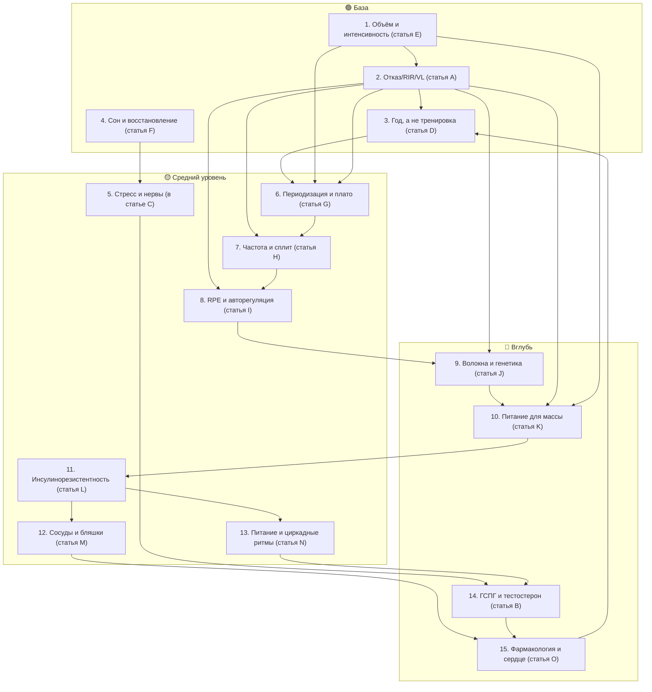

# learning-path.md — учебный трек по базе знаний (от простого к сложному)

Маршрут чтения по корпусу «Журнал Сплит KB» (Yeti + Доктор Егоров). Каждая тема помечена уровнем сложности: 🟢 базовая · 🟡 средняя · 🔴 продвинутая. Правило маршрута: **не переходить к теме, пока не пройдены темы со стрелкой «до»**.

Статьи самоучителя готовы по всем темам: A (`A-otkaz-rir-poterya-skorosti.md`), B (`B-gspg-svobodnyy-testosteron.md`), C (`C-most-nervnaya-sistema.md`), D (`D-pochemu-god-a-ne-trenirovka.md`), E (`E-obem-ubuvayushchaya-otdacha.md`), F (`F-son-glavnaya-vosstanovleniya.md`), G (`G-plato-periodizaciya.md`), H (`H-chastota-split-fullbody.md`), I (`I-rpe-avtoregulyaciya.md`), J (`J-volokna-genetika.md`), K (`K-pitanie-massa-sushka.md`), L (`L-insulinorezistentnost.md`), M (`M-sosudy-gemodinamika.md`), N (`N-kogda-est-cirkadnye-ritmy.md`), O (`O-farmakologiya-serdce.md`). Число ссылок на исследования указано из реестра `study-links.jsonl`.

## Маршрут новичка (1-й месяц)

1. 🟢 **Объём и интенсивность — база** (Yeti: `QSyZQPrOmNc` «Число подходов», `2IW5fq8CnAs` «Силовой тренинг натурально») → **статья E готова** (`E-obem-ubuvayushchaya-otdacha.md`).
   — объём как доза с убывающей отдачей; режимы 1–5 / 6–12 / 15+ повторений; прогрессия как метрика. Ссылок в данных: нет (тезисы — ручной поиск).
2. 🟢 **Отказ, RIR и потеря скорости** (Yeti: `tuoZpEkyz-s`, `OU8Uwisjvr8`) → **статья A готова** (`A-otkaz-rir-poterya-skorosti.md`).
   До: п.1.
3. 🟢 **Почему год, а не тренировка: арифметика прогресса** (манифест автора + конспекты `gZhlZmHhHnU`, `xDxoL_siXQM`, `-0uU9xJM17Q`, `LFy-dwBfUV4`) → **статья D готова** (`D-pochemu-god-a-ne-trenirovka.md`).
   До: п.2. Ставится сразу после A, потому что A объясняет регулятор отдельного подхода (RIR), а D — зачем нужен горизонт: складывать подходы в циклы 8 недель и в год (5 циклов × 7–8 кг ≈ +40 кг; финал — сила для долголетия).
4. 🟢 **Сон и восстановление** (Егоров: `9Z9i3SkUJAU`) → **статья F готова** (`F-son-glavnaya-vosstanovleniya.md`).
   — сон как база восстановления, недосып и тестостерон, апноэ. Ссылок: нет (ручной поиск).
   До: ничего.
5. 🟡 **Стресс и нервная система** (Егоров: `3-EcUfcimKM`, `CxkMsx7mJoo`) → входит в **статью C (мост)** (`C-most-nervnaya-sistema.md`).
   До: п.4.
6. 🟡 **Периодизация и плато** (Yeti: `XIcaHZuDuWg`, `7oBZ0uuvpa8`, `u2eoz_xOywc`) → **статья G готова** (`G-plato-periodizaciya.md`).
   До: п.1, п.2.

## Маршрут продолжающего (2-й месяц)

7. 🟡 **Частота, сплит/фуллбоди** (Yeti: `AlvQ2bkdA6I`, `aWAShk6gr5o`) → **статья H готова** (`H-chastota-split-fullbody.md`).
   До: п.2, п.6.
8. 🟡 **Авторегуляция и RPE** (Yeti: `C2AMozKpHxI`, `jVKAV1QWL9E`) → **статья I готова** (`I-rpe-avtoregulyaciya.md`).
   До: п.2.
9. 🔴 **Типы волокон и генетика** (Yeti: `m5Ets2w9Sfw`, `zTbK62fLa5w`) → **статья J готова** (`J-volokna-genetika.md`). Покрытие данными слабое: исследования названы годами без ссылок — в статье это помечено.
   До: п.2.
10. 🟡 **Питание для массы/сушки** (Yeti: `UUSQ9A8SGr0`, `7GtrKSdH7AA`) → **статья K готова** (`K-pitanie-massa-sushka.md`). Ссылок: нет (ручной поиск).
    До: п.2.

## Маршрут «здоровье» (параллельно, от простого к сложному)

11. 🟢 **Метаболизм и инсулинорезистентность** (Егоров: `QsXYVUX4kto`, `4P_aEPQvAWE`, `Rjy6MBjEWwc`) → **статья L готова** (`L-insulinorezistentnost.md`). Ссылок: нет (ручной поиск).
    До: ничего.
12. 🟡 **Сосуды и атеросклероз** (Егоров: `sHlCmsgnViA` — 4 ссылки, `0OPsc53fG3I` — 1, `XhQlmlWHoZU` — 3, `_NgaflRg4ro` — 1, `LC88971bhys` — 2) → **статья M готова** (`M-sosudy-gemodinamika.md`). 11 ссылок-исследований.
    До: п.11.
13. 🟡 **Питание и циркадные ритмы** (Егоров: `JMbwy3zP7Ws` — 3 ссылки, `5M4LtIFyJjA` — 3, `XhCRv404_MM`) → **статья N готова** (`N-kogda-est-cirkadnye-ritmy.md`). 6 ссылок-исследований.
    До: п.11.
14. 🔴 **ГСПГ и тестостерон** (Егоров: `jL-M8ziq9yA` — 8 ссылок, `bTmwJE-vhhY` — 30, `RRP06Y6A_iU` — 2) → **статья B готова** (`B-gspg-svobodnyy-testosteron.md`). До: п.5, п.11.
15. 🔴 **Фармакология и сердце** (Егоров: `5mG_yRo5GlU` — 1 ссылка, `Mn-q7iX2JoI` — 2, `2kKssc-FqzY` — транскрипт, конспекта нет) → **статья O готова** (`O-farmakologiya-serdce.md`).
    До: п.12, п.14.

## Граф зависимостей маршрута

## Правила трека

- Тема считается пройденной, если читатель ответил на мини-проверки внутри статей.
- Если по теме в данных нет ссылок — статья всё равно собрана, а недостающие исследования помечены «ссылка не найдена в данных — требует ручного поиска».
- Буквы статей идут по порядку маршрута: E–G — маршрут новичка (п.1, п.4, п.6), H–K — маршрут продолжающего (п.7–п.10), L–O — маршрут «здоровье» (п.11, п.12, п.13, п.15). Статьи A–C и D сохраняют свои позиции (п.2, п.5, п.3).
